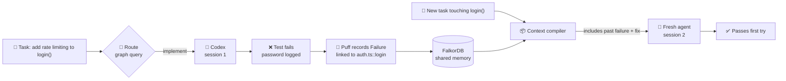
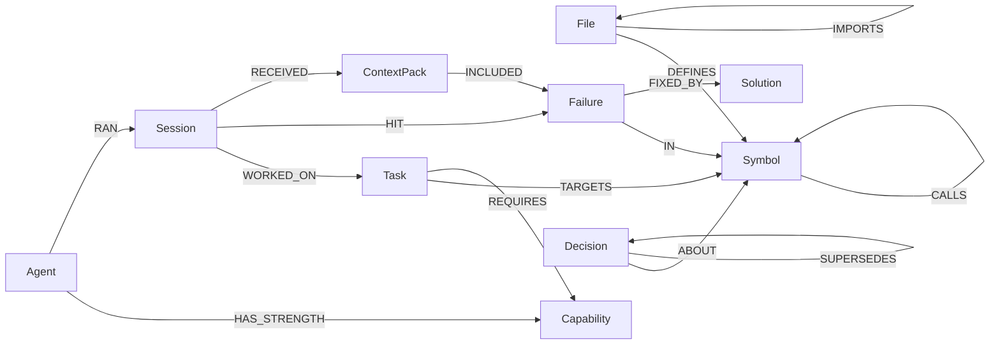
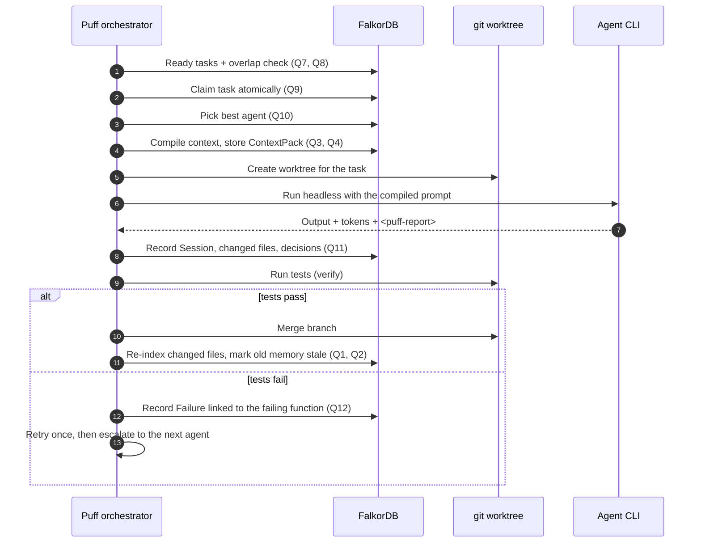

<div align="center">


# Puff

### One brain. Many agents. Shared memory.

**Shared graph memory for a team of real coding agents. Every lesson is tied to the code it came from.**

[](https://www.wemakedevs.org/hackathons/falkordb)
[](#hackathon)
[](https://www.falkordb.com/)
[](#tech-stack)
[](#roadmap)

[Problem](#the-problem) · [Solution](#the-solution) · [How it uses FalkorDB](#how-puff-uses-falkordb) · [How agents use Puff](#how-agents-use-puff) · [Quick start](#quick-start) · [Docs](#documentation)

</div>

---

## TL;DR

Puff runs a **team of different coding agents** (Claude Code, Codex and OpenCode) on one repository. All of them share **one graph memory in [FalkorDB](https://www.falkordb.com/)**.

The graph holds two things, linked together:

1. **The code**: files, functions, classes, calls and imports, parsed with tree-sitter.
2. **What the team has learned**: tasks, sessions, failures, fixes, decisions, procedures and handoffs.

Puff uses that graph to decide **which agent gets which task**, **what context each agent receives**, **what can safely run in parallel**, and **why it made each choice**. A failure is linked to the exact function it happened in. The next agent that touches that function, from any vendor, starts with the lesson instead of repeating the mistake.

---

## The problem

AI coding agents start almost every session with **amnesia**.

| Pain | What actually happens |
|---|---|
| 🔍 **They rediscover the codebase every time** | grep, read files, grep again. Tokens are spent re-learning code that hasn't changed. |
| 🔁 **They repeat past mistakes** | Last week's failing test and its fix are gone. The same trap catches the next agent. |
| 🤷 **They lose the "why"** | Decisions and constraints sit in chat logs nobody reads again. |
| 🧱 **Agents can't share knowledge** | A lesson Claude Code learned is invisible to Codex, and the reverse. |
| 🎯 **Nobody routes work by strength** | Teams mix reasoning-heavy, fast and cheap agents by hand. |

Today's workaround is hand-written `CLAUDE.md` / `AGENTS.md` files. They are flat text, go stale quickly, aren't connected to the code, and every vendor reads a different one.

---

## The solution

<table>
<tr>
<td width="50%" valign="top">

### 🧠 Memory tied to code
Every `Failure` and `Decision` points at a real `Symbol` (a function, class or method). Memory lives where the code lives, so it can be found and checked, and it goes stale when that code changes.

### 🤝 Shared across vendors
Claude Code, Codex and OpenCode all read and write the **same graph**. A lesson from one agent is context for the next.

### 🧭 Routed by strength
Planning and verification go to a reasoning agent, implementation to a fast coder, docs chores to a cheap agent. The choice comes from the graph: declared strengths, adjusted by each agent's past successes and failures.

</td>
<td width="50%" valign="top">

### 📦 Minimal, targeted context
Before a task, Puff compiles a **ContextPack**: the target functions with line ranges, the callers that may break, past failures and fixes on that code, active decisions and procedures. The agent stops scanning the whole repo.

### 🚦 Safe parallelism
Tasks whose code overlaps (directly or through `CALLS`) wait for each other. Independent tasks run at the same time, each in its own git worktree.

### 💡 Explainable
Every item an agent receives is stored with a **reason**. Click **Why?** to see the graph path behind each choice.

</td>
</tr>
</table>

### The memory loop in one picture



---

## How Puff uses FalkorDB

FalkorDB is **not a log sink**. It is where Puff thinks. Take it away and Puff can't pick an agent, build context, schedule work or explain itself.

| Puff decision | What the graph does | Query |
|---|---|---|
| **What context does this agent need?** | `Task → TARGETS → Symbol`, then up to 2 hops of callers, failures `IN` that symbol with their fixes, active decisions `ABOUT` it, and procedures for its technologies | [Q3](docs/GRAPH_SCHEMA.md#q3-build-context-for-a-task-core-query) |
| **Which agent should take this task?** | `Task → REQUIRES → Capability ← HAS_STRENGTH ← Agent`, scored by that agent's past `Session` outcomes on the same capability | [Q10](docs/GRAPH_SCHEMA.md#q10-route-best-agent-for-this-task) |
| **Can these tasks run in parallel?** | Do two tasks target the same symbols, or symbols one `CALLS` hop apart? | [Q8](docs/GRAPH_SCHEMA.md#q8-overlap-check-safe-to-run-in-parallel) |
| **What breaks if I change this?** | Reverse `CALLS*1..3` up to the files that define the callers | [Q6](docs/GRAPH_SCHEMA.md#q6-impact-what-breaks-if-i-change-this) |
| **Which memories are now outdated?** | File hash changed → every Failure/Decision linked to its symbols is marked `stale` | [Q2](docs/GRAPH_SCHEMA.md#q2-mark-memory-stale-when-a-file-changes) |
| **Why did the agent get this?** | `Session → RECEIVED → ContextPack → INCLUDED {reason} → memory` | [Q5](docs/GRAPH_SCHEMA.md#q5-why-did-this-session-get-this-context) |
| **Separate memory per project** | One graph per project: `puff_<project>` | [Tenancy](docs/GRAPH_SCHEMA.md#database) |

These are **multi-hop questions**: function → callers → failed here → fixed by → which agent. A vector store can find one similar item. The graph follows the whole chain in a single query.

### The graph, simplified



The full schema, indexes and every Cypher query are in **[docs/GRAPH_SCHEMA.md](docs/GRAPH_SCHEMA.md)**.

---

## How agents use Puff

Puff doesn't rely on agents to remember anything. **Puff writes the facts itself** (diffs, test results, outcomes, tokens). Agents add their reasoning (decisions and notes) through whichever channel their CLI supports.

| Agent | Role it's good at | Gets context through | Writes memory back through |
|---|---|---|---|
| 🟠 **Claude Code** | planning, reasoning, verification, review | Compiled prompt + **Puff MCP server** (`get_context`, `impact_of`, `why`) | MCP `record_decision` / `handoff` + `<puff-report>` block |
| 🟢 **Codex** | implementation, refactors | Compiled prompt (MCP calls are cancelled in `codex exec`, see [openai/codex#24135](https://github.com/openai/codex/issues/24135)) | `<puff-report>` block, parsed by Puff |
| 🔵 **OpenCode** | simple edits, docs, boilerplate | Compiled prompt + **Puff MCP server** | MCP + `<puff-report>` block |

### What happens to one task



Every agent receives the same prompt shape:

```text
You are the coder on a team of coding agents working in this repository.

TASK: Add rate limiting to login
TARGET CODE (read these first, do not scan the whole repo):
- src/auth/login.ts:12-48  login
CALLERS THAT MAY BREAK: routes/auth.ts::postLogin, session.ts::Session.start

PROJECT MEMORY
Past failures here and their fixes:
- "test: password appears in audit log" → fixed by: redact credentials before audit()
Active decisions you must respect:
- Tokens are stored in httpOnly cookies, never localStorage
Procedures:
- Run tests with `npm test -- auth`

WHEN DONE: final block <puff-report>{"decisions":[...],"notes":"..."}</puff-report>
```

---

## Features

| | Feature | Status |
|---|---|---|
| 🌳 | Code indexer (tree-sitter → files, symbols, calls, imports; re-index by content hash) | 🔨 |
| 🧠 | Memory layer: sessions, failures, solutions, decisions, procedures, handoffs, all linked to code | 🔨 |
| 📦 | Context compiler + stored ContextPacks with reasons | 🔨 |
| 🤖 | Harness adapters: Claude Code, Codex, OpenCode (headless, one worktree each) | 🔨 |
| 🔁 | Core loop: plan → implement → verify → record → retry → escalate | 🔨 |
| 🧭 | Routing by strength + learned success rate | 🔨 |
| 🚦 | Graph-based parallel scheduling (overlap-aware) | 🔨 |
| 💡 | **Why?** view: graph path for every choice | 🔨 |
| ♻️ | Memory correctness: stale-on-change, `SUPERSEDES` for decisions | 🔨 |
| 🔌 | Puff MCP server | 🔨 |
| 📊 | Benchmark: tokens, files read, first-try pass rate, with vs without Puff | 🔨 |
| ✨ | Stretch: PageRank-based complexity, vector search over failures, generic CLI adapter | 🔭 |

## Roadmap

Puff is built in **phases**. Each phase ends with a checkpoint: a working build that's committed before the next phase starts.

| Phase | Builds | Checkpoint |
|---|---|---|
| **P0 Foundation** ✅ | Monorepo, shared types/API/mocks, FalkorDB + indexes | UI renders mocks; project graph is created on start |
| **P1 Code graph** ✅ | Indexer, impact query, demo repo, live graph view | Demo repo visible as a graph |
| **P2 Memory + context** | Memory writes, stack trace → symbol mapping, context compiler, ContextPack | A recorded failure lands on the right function |
| **P3 Three agents, one loop** | Claude Code + Codex + OpenCode adapters, worktrees, verify, retry | Session 2 avoids session 1's mistake |
| **P4 Team coordination** | Planner, routing, scheduling, escalation, live board | 3 agents in parallel, one waits on overlap |
| **P5 Correctness + Why** | Stale flags, supersede, Why view, MCP server | Editing code marks memory stale |
| **P6 Benchmark** | Benchmark runner, savings screen | Real numbers on screen |
| **P7 Stretch** | PageRank, vector search, generic adapter, Electron packaging | Each one ships independently |

Details: [docs/ARCHITECTURE.md → Build phases](docs/ARCHITECTURE.md#build-phases).

---

## Quick start

> 🚧 Puff is being built during Graph Hacks (15–18 Oct 2026). **Phases P0 and P1 are in:** FalkorDB setup, the tree-sitter code indexer, the impact query, the synthetic demo repo, the MCP server, and the desktop app showing the live code graph (tasks and memory are still mock data until P2 and P3).

**Prerequisites:** Node 22.12+, Docker (or [falkordblite](docs/ARCHITECTURE.md#option-b-no-docker-falkordblite)), git. Agent CLIs (`claude`, `codex`, `opencode`) are needed from phase P3.

```bash
git clone https://github.com/Shaurya01836/Puff.git
```

```bash
cd Puff && npm install
```

Start FalkorDB (database on `6379`, browser UI on <http://localhost:3000>):

```bash
npm run db:up
```

> If port 6379 is already used by another Redis, copy `.env.example` to `.env` and set `FALKORDB_PORT=6380` and `FALKORDB_URL=falkor://localhost:6380`. Puff detects a plain Redis and tells you.

Index the demo repo into its graph: creates `puff_shop_api`, the indexes and the agent pool, then parses every file (safe to re-run; only changed files are rewritten):

```bash
npm run puff -- index demo/shop-api
```

Try the impact query:

```bash
npm run puff -- impact login demo/shop-api
```

Open the desktop app:

```bash
npm run dev
```

### Working on the code

| Command | What it does |
|---|---|
| `npm run dev` | Electron app with hot reload |
| `npm run dev:web` | Same UI in a normal browser at <http://localhost:5173>, backed by mocks (fastest for UI work) |
| `npm run puff -- index demo/shop-api` | Parse the repo with tree-sitter and write it to the graph (incremental; `--force` rewrites all) |
| `npm run puff -- impact login demo/shop-api` | What may break if a symbol changes (callers up to 3 hops) |
| `npm run puff -- symbols cart demo/shop-api` | Find symbols by name |
| `npm run puff -- <init|status|graphs>` | Graph setup and inspection |
| `npm run mcp` | Puff MCP server over stdio (needs `PUFF_PROJECT`) |
| `npm run typecheck` · `npm test` · `npm run format` | Checks (also run in CI) |
| `npm run build:desktop` | Package the installable app (.exe / .dmg / AppImage) |

**UI work:** screens live in `apps/desktop/src/renderer/src/screens`. They only talk to `puff` (`lib/api.ts`), which is the `PuffApi` from `packages/shared`. Until the backend lands, every call returns mock data from `packages/shared/src/mocks`, and **Start** simulates live task and memory events.

Setup, configuration and deployment details: **[docs/ARCHITECTURE.md](docs/ARCHITECTURE.md#deployment)**.

---

## Benchmark

Same tasks, same models, a fresh worktree per run. **Arm A** is the plain harness. **Arm B** is the same harness with Puff context.

| Metric | Without Puff | With Puff | Δ |
|---|---|---|---|
| Tokens (in + out) | — | — | — |
| Files read | — | — | — |
| First-try pass rate | — | — | — |
| Repeated-mistake rate | — | — | — |

> Numbers will be filled in from `bench/results.json`. If a harness doesn't report token usage, we say so instead of estimating.

---

## Tech stack

| Layer | Choice |
|---|---|
| Graph database | **FalkorDB** (Docker `falkordb/falkordb`), official `falkordb` npm client |
| Core | Node 22 + TypeScript |
| Parsing | `web-tree-sitter@0.22.6` + `tree-sitter-wasms` (WASM, no native rebuilds) |
| Agents | Claude Code, Codex, OpenCode (headless CLIs) |
| Git | `simple-git` + `git worktree` |
| Agent protocol | `@modelcontextprotocol/sdk` (Puff MCP server) |
| UI | React + TypeScript + Tailwind + shadcn/ui, `react-force-graph`, Electron shell |

## Repository layout

```text
puff/
  apps/desktop        Electron + React UI (Board, Task detail, Memory graph, Agents)
  packages/core       indexer, graph queries, context compiler, router, scheduler, adapters
  packages/mcp        Puff MCP server (stdio)
  packages/shared     types, API contract, mock fixtures
  demo/shop-api       our own synthetic demo repo + benchmark tasks
  scripts/            seed, reset-graph, run-benchmark
  docs/               architecture, graph schema, queries
  docker-compose.yml  FalkorDB
```

## Documentation

| Doc | What's inside |
|---|---|
| 📐 [docs/ARCHITECTURE.md](docs/ARCHITECTURE.md) | Platform, components, agent adapters, orchestrator, config, UI, deployment, build phases, risks |
| 🕸️ [docs/GRAPH_SCHEMA.md](docs/GRAPH_SCHEMA.md) | Database setup, full graph data model, indexes, every Cypher query with explanations |

---

## How Puff compares

| | Agent orchestrators | Code-search indexers | **Puff** |
|---|---|---|---|
| Runs & supervises agents | ✅ many harnesses | ❌ | ✅ 3 harnesses, minimal loop |
| Finds relevant code | via the agent | ✅ text / vector | ✅ **structural graph** (calls, imports) |
| Remembers across sessions | chat history | notes | ✅ **failures, fixes, decisions linked to functions** |
| Shared across vendors | partly | ❌ | ✅ **one graph for every agent** |
| Routes by agent strength | user picks | ❌ | ✅ **graph query over history** |
| Explains its choices | ❌ | ❌ | ✅ **stored ContextPack + graph path** |

We don't compete on orchestration breadth. Puff is the **memory and reasoning layer** that orchestrators are missing.

---

## Hackathon

- **Event:** Graph Hacks: Context for AI Agents (WeMakeDevs × FalkorDB), 15–18 Oct 2026
- **Track:** **Track 02: Agent Memory and Coordination** (also relevant to Track 01)
- **Data:** the demo repository is our own synthetic project. No private or third-party data is used.

## AI assistance

We used Claude Code and Codex to help with boilerplate, scaffolding and documentation drafts. The graph schema, Cypher queries and architecture were designed and checked by the team, and we can walk through every query.

## Credits

Ideas (not code) were drawn from [Orchestrator.inc](https://github.com/OrchestratorInc/agent-orchestrator) (running agents in parallel) and [XERJ](https://github.com/xerj-org/xerj) (indexed code retrieval for agents). Both are Apache-2.0. Thanks to [FalkorDB](https://www.falkordb.com/) and [WeMakeDevs](https://www.wemakedevs.org/).

## Team

| | |
|---|---|
| **Dhruv Pancholi** | Backend, graph, agents |
| _Teammate_ | Design, UI, mascot, story |

<div align="center">
<br/>

<br/>
<sub>Puff is a placeholder mascot until the 3D render arrives. Any harness plugs in; they all share one brain.</sub>
</div>
