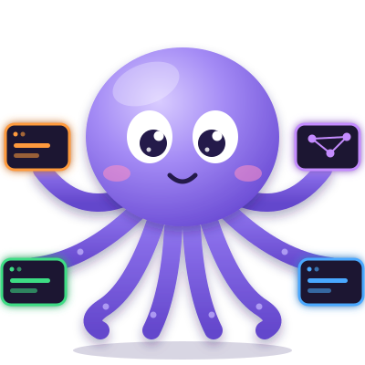
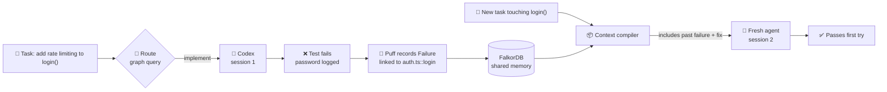
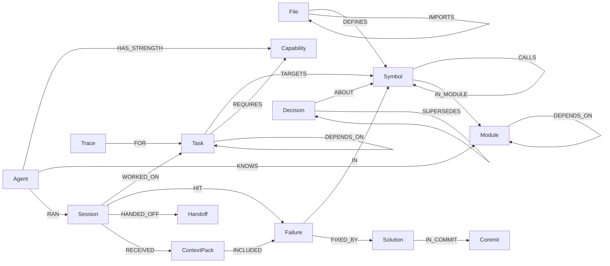
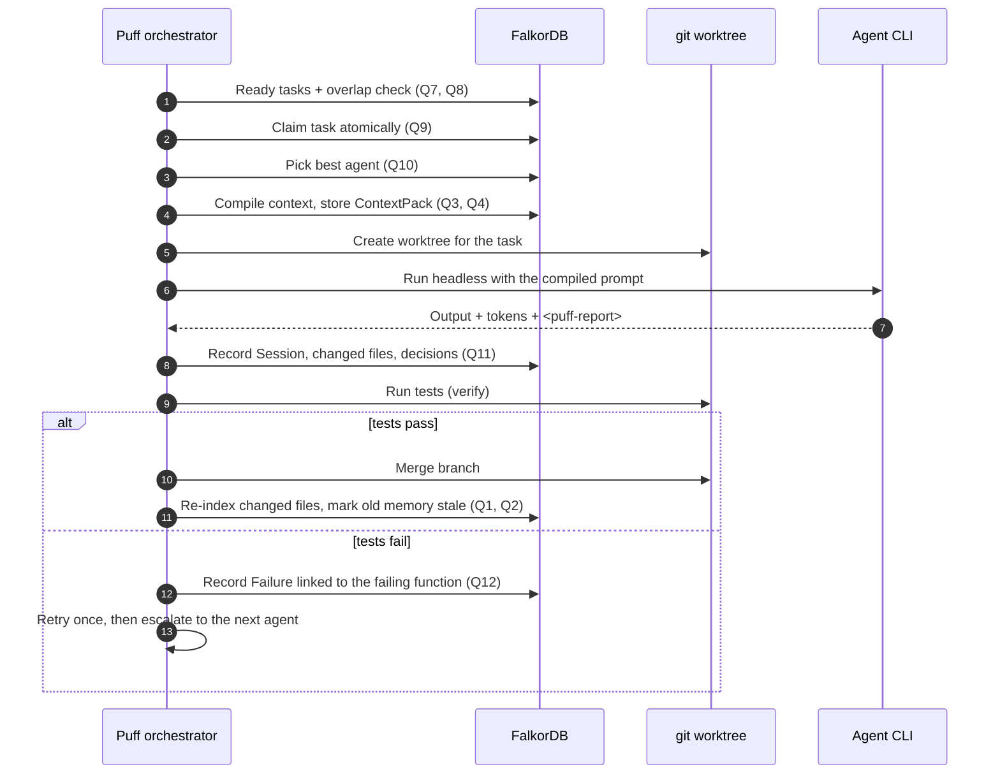

<div align="center">



# Puff

### One brain. Many agents. Shared memory.

**Shared graph memory for a team of real coding agents. Every lesson is tied to the code it came from.**

[](https://www.wemakedevs.org/hackathons/falkordb)
[](#hackathon)
[](https://www.falkordb.com/)
[](#tech-stack)
[](#roadmap)

[For the judges](#for-the-judges) · [Problem](#the-problem) · [Solution](#the-solution) · [How it uses FalkorDB](#how-puff-uses-falkordb) · [The Cypher](#the-cypher-puff-depends-on) · [How agents use Puff](#how-agents-use-puff) · [Install](#install-the-windows-app) · [Quick start](#quick-start) · [Docs](#documentation)

### ⬇ [Download Puff for Windows](https://github.com/Shaurya01836/Puff/releases/latest/download/Puff-Setup.exe)

Windows 10/11 · about 115 MB · [all releases](https://github.com/Shaurya01836/Puff/releases/latest) · [install guide](docs/INSTALL.md)

</div>

---

## For the judges

**Puff is a team of real coding agents (Claude Code, Codex and OpenCode) that share one memory in FalkorDB.** A planner agent splits a goal into tasks; Puff routes each task to an agent, runs it in its own git worktree, checks it with the project's own tests, merges it, and records what went wrong. The next agent that touches the same code, from any vendor, starts with the lesson instead of repeating the mistake. **Track: Track 02, Agent Memory and Coordination.**

**Demo video:** _the link goes here before the deadline_ · **Download:** [Puff-Setup.exe](https://github.com/Shaurya01836/Puff/releases/latest/download/Puff-Setup.exe) · **From source:** [Quick start](#quick-start)

### What Rule 10 asks for, and where it is

| Requirement | Where |
|---|---|
| Public source repository | This repository |
| README with setup instructions and the graph data model | Setup: [Install](#install-the-windows-app) and [Quick start](#quick-start). Model: [The graph data model](#the-graph-data-model) |
| The Cypher queries and graph algorithms the product depends on | [The Cypher Puff depends on](#the-cypher-puff-depends-on): the key queries inline, and a table giving the source file and the test for each. All of them, with the reasoning, are in [docs/GRAPH_SCHEMA.md](docs/GRAPH_SCHEMA.md) (Q1 to Q32) |
| Demo video | Linked above |
| Live deployment, or complete local setup | Puff is a desktop app that drives agent CLIs on your own repository, so it is not a hosted service. Setup is complete two ways: the Windows installer, or `npm install` and `npm run db:up` from a checkout (both below) |
| The track | Track 02: Agent Memory and Coordination |

### Track 02: what it asks for, and where Puff does it

| Track 02 asks for | What Puff does | Where | Test |
|---|---|---|---|
| **Episodic memory** | Every agent run is a `Session` (agent, role, steps, tokens, outcome). Every failure is stored with the test output that produced it, pinned to the function it happened in: `(Session)-[:HIT]->(Failure)-[:IN]->(Symbol)` | `memory/sessions.ts`, `memory/memory.ts` | `memory.test.ts`, `run.test.ts` |
| **Semantic memory** | The code graph (files, functions, calls, imports) and `Decision` nodes `ABOUT` functions, replaced decisions kept through `SUPERSEDES` | `indexer/`, `memory/memory.ts` | `indexer.test.ts`, `memory.test.ts` |
| **Procedural memory** | `Procedure` nodes, project-wide or per technology, put into every prompt that touches that code | `memory/memory.ts` | `memory.test.ts` |
| **Memory that updates over time** | Editing a function marks what was learned about *that function* "possibly outdated"; a revert of the merge a lesson came from downgrades it and what was built on it; a trust score (0 to 1) moves with outcomes and decides whether a lesson reaches the next agent | `indexer/index.ts` (Q2), `memory/provenance.ts` (Q23, Q24) | `indexer.test.ts`, `trust.test.ts` |
| **Shared state and handoffs between agents** | One graph read and written by Claude Code, Codex and OpenCode. A `Handoff` from one session is delivered inside the next session's context. Tasks are claimed with one atomic query, and a task that touches the same code as a running one waits, with the reason | `memory/memory.ts`, `orchestrator/schedule.ts` | `memory.test.ts`, `team.test.ts` |
| **High-concurrency reads and writes** | Tested: 8 schedulers race for one task and exactly one wins (Q9); two merges at once are serialized; parallel agents run against one graph. **Not load-tested at scale** | `memory/tasks.ts`, `git/repo.ts` | `team.test.ts`, `worktree.test.ts` |
| **Separate memory per user or tenant** | One FalkorDB graph per project, `puff_<project>`. A lesson in one project is invisible in another, even on an identically named function | `db/init.ts`, `ids.ts` | `isolation.test.ts` |
| **Persistent conversation history** | Partly. Every agent session (output, steps, tokens, outcome) is stored in the graph and survives restarts. The Ask Puff chat itself is **not saved yet** | `memory/sessions.ts` | `memory.test.ts` |

### Is the graph doing the work?

FalkorDB is the only place Puff keeps anything: the code, the tasks, every session, every lesson, and the trace of every decision. On top of that, [the decisions listed below](#how-puff-uses-falkordb) are answered by queries and graph algorithms (PageRank, betweenness, weakly connected components, shortest paths, full-text and vector search, `GRAPH.COPY`), and each one records the Cypher it ran so you can read it in the app (a task's **Why** tab).

**The graph-off switch is a measurement, not a fallback.** `PUFF_GRAPH=off` keeps FalkorDB as the store (tasks, sessions and lessons are still recorded) but stops asking the graph to decide: agents are tried in a fixed order, the agent gets the task and its target files only, overlap is judged by file name, and nothing is marked outdated. Every trace says "graph off". It exists so we can measure what the graph's decisions are worth.

**What they are worth, measured** (Codex, one attempt per run, a fresh copy of the demo repository each time; 5 traps, 3 runs each, so 15 judged runs per arm). A *repeated mistake* is a named trap test failing on the first attempt:

| What the agent is given | Repeated the mistake | Passed everything | Average tokens |
|---|---|---|---|
| Nothing (the task alone) | 6 of 15 | 5 of 15 | 185k |
| **Puff** (context chosen by the graph) | **2 of 15** | 10 of 15 | 160k |
| The same lessons in a flat `AGENTS.md` | 3 of 15 | 11 of 15 | 175k |
| Puff with the graph off | 7 of 15 | 5 of 15 | 165k |

What this does and does not show:

- Graph off behaves like no memory (7 against 6). The lessons only help when the graph picks and delivers them.
- **A flat file was nearly as good as Puff here** (3 repeats against 2, 11 passes against 10). With five lessons a flat file is enough. Where a flat file cannot follow is lessons that go stale after an edit or were learned in a reverted merge; we have tests for that behaviour ([trust.test.ts](packages/core/test/trust.test.ts)) but have **not measured it** against a flat file.
- Codex fell into only three of the five traps in any arm. On those three (9 runs per arm) the repeats were 6, 2, 3 and 7 of 9, in the order of the table.
- All five lessons were **replayed**: Codex did not fall into the trap on the learn tasks, so the recorded careless change was run through the real tests and the real failure locator instead.
- One agent, one model, 15 runs per arm: read it as an indication, not proof. The OpenCode run (a slower free model) was still running when this was written. Method, per-trap numbers and raw runs: [docs/BENCHMARK.md](docs/BENCHMARK.md), [`bench/results-transfer-codex.json`](bench/results-transfer-codex.json).

### Limits, stated plainly

- Only TypeScript and JavaScript repositories are indexed (tree-sitter). Python, Go and others are not understood yet.
- The app drives agent CLIs that you have installed and signed in; it is not hosted. The Windows installer is not code-signed.
- No load test beyond the concurrency tests above, and the Ask Puff conversation is not persisted.
- The benchmarks are small samples, as said above.

---

## Install the Windows app

1. **Download** [`Puff-Setup.exe`](https://github.com/Shaurya01836/Puff/releases/latest/download/Puff-Setup.exe) and run it. Windows may warn about an unknown publisher (the installer is not code-signed yet): choose **More info**, then **Run anyway**.
2. **Have Docker Desktop running.** On first start Puff shows a setup screen; press **Start the database** and it starts FalkorDB for you.
3. **Have at least one agent CLI installed:** Claude Code, Codex or OpenCode. The same screen lists which are installed and signed in, and has a **Sign in** button for Claude Code and Codex. One is enough: Ask Puff, the chat that plans and runs the team, works with whichever you have (pick it in the panel header).
4. **Press Add a project…**, choose a git repository (TypeScript or JavaScript), give the team a goal, and press **Run team**.

Already installed? Run the new installer: it updates in place and keeps your projects and memory. Details, where files are kept, and building the installer yourself are in [docs/INSTALL.md](docs/INSTALL.md). macOS and Linux: run from source ([Quick start](#quick-start)).


---

## TL;DR

Puff runs a **team of different coding agents** (Claude Code, Codex and OpenCode) on one repository. All of them share **one graph memory in [FalkorDB](https://www.falkordb.com/)**.

The graph holds two things, linked together:

1. **The code**: files, functions, classes, calls and imports, parsed with tree-sitter.
2. **What the team has learned**: tasks, sessions, failures, fixes, decisions, procedures and handoffs.

Puff uses that graph to decide **which agent gets which task**, **what context each agent receives**, **what can safely run in parallel**, and **why it made each choice**. A failure is linked to the exact function it happened in. The next agent that touches that function, from any vendor, starts with the lesson instead of repeating the mistake.

---

## The problem

AI coding agents start almost every session with **amnesia**.

| Pain | What actually happens |
|---|---|
| 🔍 **They rediscover the codebase every time** | grep, read files, grep again. Tokens are spent re-learning code that hasn't changed. |
| 🔁 **They repeat past mistakes** | Last week's failing test and its fix are gone. The same trap catches the next agent. |
| 🤷 **They lose the "why"** | Decisions and constraints sit in chat logs nobody reads again. |
| 🧱 **Agents can't share knowledge** | A lesson Claude Code learned is invisible to Codex, and the reverse. |
| 🎯 **Nobody routes work by strength** | Teams mix reasoning-heavy, fast and cheap agents by hand. |

Today's workaround is hand-written `CLAUDE.md` / `AGENTS.md` files. They are flat text, go stale quickly, aren't connected to the code, and every vendor reads a different one.

---

## The solution

<table>
<tr>
<td width="50%" valign="top">

### 🧠 Memory tied to code
Every `Failure` and `Decision` points at a real `Symbol` (a function, class or method). Memory lives where the code lives, so it can be found and checked, and it goes stale when that code changes.

### 🤝 Shared across vendors
Claude Code, Codex and OpenCode all read and write the **same graph**. A lesson from one agent is context for the next.

### 🧭 Routed by strength
Planning and verification go to a reasoning agent, implementation to a fast coder, docs chores to a cheap agent. The choice comes from the graph: declared strengths, adjusted by each agent's past successes and failures.

</td>
<td width="50%" valign="top">

### 📦 Minimal, targeted context
Before a task, Puff compiles a **ContextPack**: the target functions with line ranges, the callers that may break, past failures and fixes on that code, active decisions and procedures. The agent stops scanning the whole repo.

### 🚦 Safe parallelism
Tasks whose code overlaps (directly or through `CALLS`) wait for each other. Independent tasks run at the same time, each in its own git worktree.

### 💡 Explainable
Every item an agent receives is stored with a **reason**. Click **Why?** to see the graph path behind each choice.

</td>
</tr>
</table>

### The memory loop in one picture



---

## How Puff uses FalkorDB

FalkorDB is **not a log sink**. It is where Puff thinks. Take it away and Puff can't pick an agent, build context, schedule work or explain itself.

| Puff decision | What the graph does | Query |
|---|---|---|
| **What context does this agent need?** | `Task → TARGETS → Symbol`, then up to 2 hops of callers, failures `IN` that symbol with their fixes, active decisions `ABOUT` it, and procedures for its technologies | [Q3](docs/GRAPH_SCHEMA.md#q3-build-context-for-a-task-core-queries) |
| **Which agent should take this task?** | `Task → REQUIRES → Capability ← HAS_STRENGTH ← Agent`, scored by that agent's past `Session` outcomes on the same capability | [Q10](docs/GRAPH_SCHEMA.md#q10-route-best-agent-for-this-task) |
| **Can these tasks run in parallel?** | Do two tasks target the same symbols, or symbols one `CALLS` hop apart? | [Q8](docs/GRAPH_SCHEMA.md#q8-overlap-check-safe-to-run-in-parallel) |
| **What breaks if I change this?** | Reverse `CALLS*1..3` up to the files that define the callers | [Q6](docs/GRAPH_SCHEMA.md#q6-impact-what-breaks-if-i-change-this) |
| **Which memories are now outdated?** | File hash changed → every Failure/Decision linked to its symbols is marked `stale` | [Q2](docs/GRAPH_SCHEMA.md#q2-mark-memory-stale-when-the-code-it-is-about-changes) |
| **Why did the agent get this?** | `Session → RECEIVED → ContextPack → INCLUDED {reason} → memory` | [Q5](docs/GRAPH_SCHEMA.md#q5-why-did-this-session-get-this-context) |
| **Is this code load-bearing?** | `algo.pageRank` and `algo.betweenness` over `CALLS`, plus open failures, stored as a percentile on every function. A task in the top 10% goes to an agent that declares reasoning and gets 1.5× the context budget | [Q20](docs/GRAPH_SCHEMA.md#q20-risk-from-pagerank-and-betweenness) |
| **Which lessons are two calls away?** | `target → CALLS → m → CALLS → n`: a mistake in `log()` reaches a task on `login()` through `audit()` | [Q21](docs/GRAPH_SCHEMA.md#q21-lessons-two-calls-away) |
| **Which past failures sound like this task?** | Full-text search over `Failure.message` (`db.idx.fulltext.queryNodes`), for lessons the call graph does not reach | [Q22](docs/GRAPH_SCHEMA.md#q22-failures-worded-like-the-task) |
| **How many agents can this plan use, and why does a task wait?** | The plan's tasks are tied where they share code or depend on each other, on a `GRAPH.COPY`; `algo.WCC` gives the independent lanes. A waiting task says which two functions meet ("login() calls audit(), which task_03 changes"), and a free one how far the nearest running work is, by `algo.SPpaths` | [Q30](docs/GRAPH_SCHEMA.md#q30-lanes), [Q31](docs/GRAPH_SCHEMA.md#q31-wait-reasons-and-nearby-work) |
| **Which past failures mean the same as this task?** | A vector index on `Failure.embedding` (a 30 MB static model that runs in TypeScript, no server): "Stop leaking user credentials when recording events" finds "password appears in audit log" with no shared word. Full-text search stays as the fallback | [Q32](docs/GRAPH_SCHEMA.md#q32-similar-failures-by-meaning) |
| **Who is best at this part of the code?** | Functions are grouped into modules (folders), `CALLS` across folders become `DEPENDS_ON`, and every finished session updates `(Agent)-[:KNOWS {runs, wins}]->(Module)`. An agent with a real record in the task's module can take the lead over the declared best ("opencode has won 5 of 6 runs in the cart module"). Tasks in the same module as a choke point (top betweenness) do not run side by side | [Q27](docs/GRAPH_SCHEMA.md#q27-modules), [Q28](docs/GRAPH_SCHEMA.md#q28-expertise), [Q29](docs/GRAPH_SCHEMA.md#q29-choke-points) |
| **What will this merge change?** | Before a task is merged, `GRAPH.COPY` makes a copy of the graph, the branch is indexed into it, and the two are compared: functions added, changed, removed, calls added, lessons that would become outdated, new callers of load-bearing code. For a plan, a dry run of the scheduler on a copy shows which tasks start together and which wait | [Q25](docs/GRAPH_SCHEMA.md#q25-merge-preview), [Q26](docs/GRAPH_SCHEMA.md#q26-plan-preview) |
| **Can this lesson still be trusted?** | Each lesson links to the session and commit it came from. A revert of that merge (by Puff's re-test or by you in git) marks its fix reverted and follows `DERIVED_FROM` up to 3 steps to downgrade what was built on it. Trust (confirmations, sessions it helped, staleness, reverts, the learning agent's record) sinks or drops a lesson from context | [Q23](docs/GRAPH_SCHEMA.md#q23-repair-on-revert), [Q24](docs/GRAPH_SCHEMA.md#q24-trust) |
| **Separate memory per project** | One graph per project: `puff_<project>`. A lesson in one project is invisible in another, even on an identically named function (tested) | [Tenancy](docs/GRAPH_SCHEMA.md#database) |

**See the Cypher behind every decision.** Each decision (which agent, what context, when it may start, what went out of date, where a failure belongs) records the queries it ran, with milliseconds and row counts, as a `Trace` in the graph ([Q19](docs/GRAPH_SCHEMA.md#q19-trace-the-queries-behind-a-decision)). Open a task and choose its **Why** tab.

**Turn the graph off to see what it is worth.** `PUFF_GRAPH=off` (or `graph.enabled: false`) is a measurement switch, not a fallback: FalkorDB still holds every task, session and lesson, but the graph stops deciding. The same team then routes by escalation order, gets the task and its target files only, overlaps by file name, and nothing is marked stale. The Why view and every trace say "graph off". It is the fourth arm of the [transfer benchmark](#benchmark).

These are **multi-hop questions**: function → callers → failed here → fixed by → which agent. A vector store can find one similar item. The graph follows the whole chain in a single query.

## The Cypher Puff depends on

Every decision below is one or a few queries on FalkorDB. Each query is written by a person and run with parameters: **no agent ever writes Cypher**, and a trace of each decision's queries, timings and row counts is stored in the graph ([Q19](docs/GRAPH_SCHEMA.md#q19-trace-the-queries-behind-a-decision)). Reads go through `GRAPH.RO_QUERY`. The key ones are inline here; the full set with the reasoning is [docs/GRAPH_SCHEMA.md](docs/GRAPH_SCHEMA.md).

| Query | Decision it makes | FalkorDB feature | Source | Test |
|---|---|---|---|---|
| [Q3](docs/GRAPH_SCHEMA.md#q3-build-context-for-a-task-core-queries) | What an agent is told: callers that may break, failures and fixes on that code, decisions, procedures | multi-hop `CALLS*1..2`, `OPTIONAL MATCH` | `context/compiler.ts` | `graph-decisions.test.ts`, `memory.test.ts` |
| [Q21](docs/GRAPH_SCHEMA.md#q21-lessons-two-calls-away) | Lessons two calls away | two-hop traversal | `context/compiler.ts` | `graph-decisions.test.ts` |
| [Q22](docs/GRAPH_SCHEMA.md#q22-failures-worded-like-the-task) | Failures worded like the task | full-text index | `queries/insights.ts` | `graph-decisions.test.ts` |
| [Q32](docs/GRAPH_SCHEMA.md#q32-similar-failures-by-meaning) | Failures that mean the same as the task | **vector index** | `embed/lessons.ts` | `vectors.test.ts` |
| [Q10](docs/GRAPH_SCHEMA.md#q10-route-best-agent-for-this-task) | Which agent takes the task | capability and outcome aggregation | `orchestrator/routing.ts` | `graph-decisions.test.ts` |
| [Q20](docs/GRAPH_SCHEMA.md#q20-risk-from-pagerank-and-betweenness) | Which code is load-bearing (routing and context budget) | **`algo.pageRank`, `algo.betweenness`** | `queries/insights.ts` | `graph-decisions.test.ts` |
| [Q27 to Q29](docs/GRAPH_SCHEMA.md#q27-modules) | Modules, what each agent knows per module, choke points | folder grouping, betweenness | `queries/modules.ts` | `modules.test.ts` |
| [Q8](docs/GRAPH_SCHEMA.md#q8-overlap-check-safe-to-run-in-parallel) | May these tasks run side by side | `CALLS*0..1` | `orchestrator/schedule.ts` | `graph-decisions.test.ts`, `team.test.ts` |
| [Q31](docs/GRAPH_SCHEMA.md#q31-wait-reasons-and-nearby-work) | Why a task waits, and how near running work is | **`algo.SPpaths`** | `orchestrator/schedule.ts` | `graph-decisions.test.ts` |
| [Q9](docs/GRAPH_SCHEMA.md#q9-atomic-claim) | Exactly one scheduler takes a task | one atomic conditional `SET` | `memory/tasks.ts` | `team.test.ts` (8 racing) |
| [Q2](docs/GRAPH_SCHEMA.md#q2-mark-memory-stale-when-the-code-it-is-about-changes) | Which lessons went out of date | per-function body hash | `indexer/index.ts` | `indexer.test.ts` |
| [Q23, Q24](docs/GRAPH_SCHEMA.md#q23-repair-on-revert) | What a revert downgrades, and how far a lesson is trusted | `DERIVED_FROM*1..3` | `memory/provenance.ts` | `trust.test.ts` |
| [Q25, Q26](docs/GRAPH_SCHEMA.md#q25-merge-preview) | What a merge will change; how a plan would run | **`GRAPH.COPY`** | `queries/preview.ts` | `preview.test.ts` |
| [Q30](docs/GRAPH_SCHEMA.md#q30-lanes) | How many agents a plan can use at once | **`algo.WCC`** | `queries/preview.ts` | `preview.test.ts` |

### What an agent is told (Q3, Q21)

Failures on or next to the target functions, with their fixes. The fix is its own `OPTIONAL MATCH`, so a failure nobody has fixed yet is still returned: those are the most important warnings.

```cypher
MATCH (f:Failure)-[:IN]->(s:Symbol) WHERE s.id IN $ids
OPTIONAL MATCH (f)-[:FIXED_BY]->(sol:Solution)
RETURN f.id AS id, f.message AS message, coalesce(f.stale, false) AS stale,
       coalesce(f.count, 1) AS count, f.createdAt AS at, s.id AS symbol,
       sol.id AS solId, sol.summary AS fix, sol.createdAt AS solAt
ORDER BY f.createdAt DESC
```

The functions near the task: the callers that may break (two hops up) and, for lessons, the functions two calls down. A mistake in `log()` reaches a task on `login()` through `audit()`:

```cypher
MATCH (:Task {id: $id})-[:TARGETS]->(s:Symbol)<-[:CALLS*1..2]-(c:Symbol)
WHERE coalesce(c.removed, false) = false
RETURN DISTINCT c.id AS id, s.id AS of ORDER BY id LIMIT 12

MATCH (:Task {id: $id})-[:TARGETS]->(s:Symbol)-[:CALLS]->(m:Symbol)-[:CALLS]->(n:Symbol)
WHERE n <> s AND coalesce(m.removed, false) = false AND coalesce(n.removed, false) = false
RETURN s.id AS target, n.id AS near, 'callee2' AS rel, m.id AS via
```

### Which agent, and is this code load-bearing (Q10, Q20)

Candidates are agents with a declared strength for what the task requires, ranked by their record on that capability:

```cypher
MATCH (:Task {id: $id})-[:REQUIRES]->(c:Capability)<-[:HAS_STRENGTH]-(a:Agent)
OPTIONAL MATCH (a)-[:RAN]->(s:Session)-[:WORKED_ON]->(:Task)-[:REQUIRES]->(c)
WHERE s.outcome IN ['success', 'failure']
WITH a, c, collect(DISTINCT s) AS ss
RETURN a.name AS agent, size(ss) AS runs, size([x IN ss WHERE x.outcome = 'success']) AS wins
```

After every index, PageRank and betweenness over `CALLS` are stored on each function as a percentile. A task whose riskiest target is in the top 10% goes to an agent that declares reasoning and gets 1.5 times the context budget:

```cypher
CALL algo.pageRank('Symbol', 'CALLS') YIELD node, score
WITH node, score WHERE coalesce(node.removed, false) = false
RETURN node.id AS id, score

CALL algo.betweenness({nodeLabels: ['Symbol'], relationshipTypes: ['CALLS'],
                       samplingSize: 2000, samplingSeed: 7}) YIELD node, score
WITH node, score WHERE coalesce(node.removed, false) = false
RETURN node.id AS id, score
```

### May these tasks run together, and who gets the task (Q8, Q9, Q31, Q30)

Two tasks conflict when they target the same function, or functions one call apart in either direction. The reason is built from the same match, so a waiting task says which two functions meet:

```cypher
MATCH (:Task {id: $id})-[:TARGETS]->(s:Symbol)
MATCH (s)-[:CALLS*0..1]-(near:Symbol)<-[:TARGETS]-(other:Task)
WHERE other.id <> $id AND other.status IN $statuses
OPTIONAL MATCH (s)-[c:CALLS]->(near)
RETURN DISTINCT other.id AS id, s.id AS mine, near.id AS theirs,
       CASE WHEN s = near THEN 'same' WHEN c IS NOT NULL THEN 'calls' ELSE 'called' END AS how
```

When several schedulers race for a task, FalkorDB runs each query atomically, so exactly one gets a row back (tested with 8 concurrent claims):

```cypher
MATCH (t:Task {id: $id, status: 'ready'})
SET t.status = 'running', t.claimedBy = $owner, t.updatedAt = timestamp(), t.blockedBy = null
RETURN t.id AS id
```

A task that is free to start records how near the running work is, by shortest call path in either direction. For a plan, tasks that would collide are tied on a copy of the graph and weakly connected components are its independent lanes:

```cypher
MATCH (:Task {id: $id})-[:TARGETS]->(s:Symbol), (other:Task)-[:TARGETS]->(t:Symbol)
WHERE other.id <> $id AND other.status IN $statuses AND other.type IN $writes AND s <> t
CALL algo.SPpaths({sourceNode: s, targetNode: t, relTypes: ['CALLS'], relDirection: 'both',
                   maxLen: $max, pathCount: 1})
YIELD path, pathWeight
RETURN other.id AS id, pathWeight AS hops, [n IN nodes(path) | n.id] AS path

CALL algo.WCC({nodeLabels: ['Task'], relationshipTypes: ['CONFLICTS']}) YIELD node, componentId
WITH node, componentId WHERE node.id IN $ids
RETURN node.id AS id, componentId AS lane
```

### What went out of date, and what a revert undoes (Q2, Q23)

Staleness is decided per function. Each function stores a hash of its own lines; when a file is re-indexed, a function whose hash changed marks every failure and decision about it:

```cypher
UNWIND $syms AS sym
MATCH (s:Symbol {id: sym.id})
WHERE s.bodyHash IS NOT NULL AND s.bodyHash <> sym.hash
MATCH (s)<-[:ABOUT|IN]-(m)
WHERE coalesce(m.stale, false) = false
SET m.stale = true, m.staleAt = timestamp(), m.staleBecause = s.id
RETURN count(DISTINCT m) AS flagged
```

When a merge is reverted, by Puff's own re-test or by a person in git, the fixes and decisions learned in it are marked, and everything built on them, up to three steps, is downgraded:

```cypher
MATCH (s:Solution)-[:IN_COMMIT]->(:Commit {sha: $m})
SET s.status = 'reverted', s.revertedIn = $m
RETURN s.id AS id

MATCH (m)-[:DERIVED_FROM*1..3]->(root) WHERE root.id IN $roots AND NOT m.id IN $roots
SET m.downgradedBy = coalesce(m.downgradedBy, $m)
RETURN DISTINCT m.id AS id
```

### Failures that mean the same (Q22, Q32)

Full-text search finds failures that share words with a task. The vector index finds the ones that mean the same: "Stop leaking user credentials when recording events" finds "password appears in audit log" with no word in common. Messages are embedded with a 30 MB static model that runs in TypeScript (no model server); the vector is stored on the `Failure` node:

```cypher
CREATE VECTOR INDEX FOR (f:Failure) ON (f.embedding)
OPTIONS {dimension: 256, similarityFunction: 'cosine'}

CALL db.idx.vector.queryNodes('Failure', 'embedding', $k, vecf32($q)) YIELD node, score
WITH node, 1 - score AS similarity WHERE similarity >= $min
MATCH (node)-[:IN]->(s:Symbol)
RETURN node.id AS id, node.message AS message, s.id AS symbol, similarity AS score
ORDER BY score DESC LIMIT $limit
```

### Previews on a copy (Q25, Q26)

`GRAPH.COPY puff_<project> puff_<project>__preview_<purpose>_<time>` copies a project graph in milliseconds. Puff indexes the branch into the copy, compares it with the real graph (functions added, changed and removed, calls added, lessons that would become outdated, new callers of load-bearing code), and deletes the copy. The same is done for a plan: a dry run of the scheduler shows which tasks start together and which wait.

---

## The graph data model

One graph per project (`puff_<project>`). Nodes and what they hold:

| Layer | Nodes | Holds |
|---|---|---|
| **Code** | `Project`, `File`, `Symbol`, `Technology`, `Module`, `Commit` | Files, functions, classes and methods with line ranges and a hash of their body (no code is stored), what calls what, which folder a function is in, the commits Puff merged |
| **Work** | `Task`, `Session`, `Handoff`, `Capability`, `Agent` | Tasks with their targets and dependencies, one `Session` per agent run, structured notes passed between sessions, what each agent is good at |
| **Memory** | `Failure`, `Solution`, `Decision`, `Procedure` | What went wrong (with its vector), what fixed it, why something was chosen, how things are done here |
| **Explanations** | `ContextPack`, `Trace`, `MergePreview` | Exactly what each agent was given and why, the queries behind each decision, what a merge was predicted to change |



Memory types: **episodic** is `Session` and `HIT → Failure`; **semantic** is the code graph and `Decision`; **procedural** is `Procedure`; **shared state** is `Handoff`, the claimed `Task` and `blockedBy`; **change over time** is `stale`, `SUPERSEDES`, `REVERTED_BY` and `DERIVED_FROM`. Every property, index and relationship is in [docs/GRAPH_SCHEMA.md](docs/GRAPH_SCHEMA.md#data-model).

---

## How agents use Puff

Puff doesn't rely on agents to remember anything. **Puff writes the facts itself** (diffs, test results, outcomes, tokens). Agents add their reasoning (decisions and notes) through whichever channel their CLI supports.

| Agent | Role it's good at | Gets context through | Writes memory back through |
|---|---|---|---|
| 🟠 **Claude Code** | planning, reasoning, verification, review | Compiled prompt + **Puff MCP server** (`get_context`, `impact_of`, `why`) | MCP `record_decision` / `handoff` + `<puff-report>` block |
| 🟢 **Codex** | implementation, refactors | Compiled prompt (MCP calls are cancelled in `codex exec`, see [openai/codex#24135](https://github.com/openai/codex/issues/24135)) | `<puff-report>` block, parsed by Puff |
| 🔵 **OpenCode** | simple edits, docs, boilerplate | Compiled prompt + **Puff MCP server** | MCP + `<puff-report>` block |

### What happens to one task



Every agent receives the same prompt shape:

```text
You are the coder on a team of coding agents working in this repository.

TASK: Add rate limiting to login
TARGET CODE (read these first, do not scan the whole repo):
- src/auth/login.ts:12-48  login
CALLERS THAT MAY BREAK: routes/auth.ts::postLogin, session.ts::Session.start

PROJECT MEMORY
Past failures here and their fixes:
- "test: password appears in audit log" → fixed by: redact credentials before audit()
Active decisions you must respect:
- Tokens are stored in httpOnly cookies, never localStorage
Procedures:
- Run tests with `npm test -- auth`

WHEN DONE: final block <puff-report>{"decisions":[...],"notes":"..."}</puff-report>
```

---

## Features

| | Feature | Status |
|---|---|---|
| 🌳 | Code indexer (tree-sitter → files, symbols, calls, imports; re-index by content hash) | ✅ |
| 🧠 | Memory layer: sessions, failures, solutions, decisions, procedures, handoffs, all linked to code | ✅ |
| 📦 | Context compiler + stored ContextPacks with reasons | ✅ |
| 🤖 | Harness adapters: Claude Code, Codex, OpenCode (headless, one worktree each) | ✅ |
| 🔁 | Core loop: plan → implement → verify → record → retry → escalate | ✅ |
| 🧭 | Routing by strength + learned success rate | ✅ |
| 🚦 | Graph-based parallel scheduling (overlap-aware), plan lanes from `algo.WCC`, wait reasons by call path (`algo.SPpaths`) | ✅ |
| 💡 | **Why?** view: graph path for every choice | ✅ |
| ♻️ | Memory correctness: stale-on-change, `SUPERSEDES` for decisions | ✅ |
| 🔌 | Puff MCP server | ✅ |
| 📊 | Benchmark: tokens, files read, first-try pass rate, with vs without Puff | ✅ |
| 🎯 | Risk from PageRank + betweenness drives routing and the context budget; lessons two calls away; failures found by wording | ✅ |
| 🔎 | **Graph trace**: the Cypher, timing and rows behind every decision; `PUFF_GRAPH=off` ablation switch | ✅ |
| 🧩 | **Team intelligence**: modules, what each agent knows per module (routing uses it), choke points that do not run in parallel | ✅ |
| 🔮 | **Previews on a `GRAPH.COPY`**: what a merge will change in the graph before it happens; a dry run of the plan | ✅ |
| 🛡️ | **Trustworthy memory**: provenance for every lesson, repair on revert, a trust score that decides what the next agent is told | ✅ |
| 🧬 | **Vector search over failures**: a vector index on `Failure.embedding`, a 30 MB static model that runs in TypeScript (no server), full-text as the fallback | ✅ |
| 🖥️ | **Desktop app**: Tasks with a live panel per task and the graph's reason on each, Memory (every lesson with its state and trust), Agents (records, who did what), Ask Puff | ✅ |
| ✨ | Stretch: generic CLI adapter, Python support | 🔭 |

## Roadmap

Puff is built in **phases**. Each phase ends with a checkpoint: a working build that's committed before the next phase starts.

| Phase | Builds | Checkpoint |
|---|---|---|
| **P0 Foundation** ✅ | Monorepo, shared types/API/mocks, FalkorDB + indexes | UI renders mocks; project graph is created on start |
| **P1 Code graph** ✅ | Indexer, impact query, demo repo, live graph view | Demo repo visible as a graph |
| **P2 Memory + context** ✅ | Memory writes, stack trace → symbol mapping, context compiler, ContextPack | A recorded failure lands on the right function |
| **P3 Three agents, one loop** ✅ | Claude Code + Codex + OpenCode adapters, worktrees, verify, retry | Session 2 avoids session 1's mistake |
| **P4 Team coordination** ✅ | Goal-to-tasks planner, overlap-aware parallel runs, Team timeline, New task dialog | 3 agents in parallel, one waits on overlap |
| **P5 Correctness + Why** ✅ | Stale flags per function, supersede, confirm, Why view, MCP server | Editing code marks memory stale |
| **P6 Benchmark** ✅ | Benchmark runner, savings screen | Real numbers on screen |
| **P7 Land it** ✅ | Real benchmark numbers, every new screen checked, committed | Savings screen shows measured results |
| **P8 Projects** ✅ | Add any repo from the app or CLI, switch between projects, per-project settings, import checks | Add a second repo, index it, switch back |
| **P9 Command center** ✅ | Ask Puff chat with slash commands and a Claude Code orchestrator, task actions (retry, edit, remove, see changes) | "Add a /health endpoint and run it" typed in chat |
| **P10 Installer** ✅ | Windows installer, first-run setup (database, agent CLIs) | Install, add a project, run a task without the source folder |
| **P11 Watch agents** ✅ | Live view of what each agent does (Activity tab), re-test of the combined result after every merge | You see files read, edits and commands as they happen |
| **P13 Foundations** ✅ | `PUFF_GRAPH=off` ablation switch, a trace of the queries behind every decision | The same task routes and gets context differently with the graph on and off |
| **P14 Proof** 🔨 | Lesson-transfer benchmark: four arms (no memory, Puff, a flat AGENTS.md, Puff with the graph off), two agents | Codex results are in ([Benchmark](#benchmark)); the OpenCode run is still going |
| **P15 The graph decides** ✅ | Risk from PageRank and betweenness in routing and the budget, lessons two calls away, failures found by wording, Graph trace tab, risk badge | Each decision shows its query in the app |
| **P16 Trustworthy memory** ✅ | Provenance edges, repair on revert (Puff's or a person's), trust in context ranking and the Context tab | A revert downgrades the right lessons, end to end |
| **P17 Team intelligence** ✅ | Modules from folders and `CALLS`, per-agent expertise in routing, choke points in scheduling, "Knows" on agent cards | The agent with the record in a module gets its tasks |
| **P18 Previews** ✅ | Merge preview and plan dry run on a `GRAPH.COPY` | A branch's effect on the graph is known before it is merged |
| **UI and graph features** ✅ | Tasks split view, Memory screen, plan lanes (`algo.WCC`), wait reasons by call path (`algo.SPpaths`), vector search over failures | The graph's reason on every task |
| **P12 Ship** | One-command demo story, clean-clone test, screenshots | Fresh clone to running demo in minutes |
| **Stretch** | PageRank (hotspots, done), similar failures (done), vector search (done), Python support | Each one ships independently |

Details: [docs/ARCHITECTURE.md → Build phases](docs/ARCHITECTURE.md#build-phases).

---

## Quick start

> 🚧 Puff was built during Graph Hacks (15–18 Oct 2026). Roadmap phases P0 to P11 and P13 to P18 are in; P12 (a one-command demo) and the OpenCode half of P14 (the benchmark) are not finished. Claude Code, Codex and OpenCode run tasks in isolated git worktrees, Puff verifies with the project's own tests, records what went wrong, retries with the lesson and escalates. Tasks really run by agents were verified on the demo repository (OpenCode and Codex, both merged with tests passing). The sample data in this quick start is seeded, not real, and the UI says so.

**Just want to use it?** [Download the Windows app](#install-the-windows-app) (no source code, Node or npm needed). The rest of this section is for running from a checkout.

**Prerequisites:** Node 22.12+, Docker (or [falkordblite](docs/ARCHITECTURE.md#option-b-no-docker-falkordblite)), git. Agent CLIs (`claude`, `codex`, `opencode`) are needed from phase P3.

```bash
git clone https://github.com/Shaurya01836/Puff.git
```

```bash
cd Puff && npm install
```

Start FalkorDB (database on `6379`, browser UI on <http://localhost:3000>):

```bash
npm run db:up
```

> If port 6379 is already used by another Redis, copy `.env.example` to `.env` and set `FALKORDB_PORT=6380` and `FALKORDB_URL=falkor://localhost:6380`. Puff detects a plain Redis and tells you.

Index the demo repo into its graph: creates `puff_shop_api`, the indexes and the agent pool, then parses every file (safe to re-run; only changed files are rewritten):

```bash
npm run puff -- index demo/shop-api
```

Try the impact query:

```bash
npm run puff -- impact login
```

Write sample tasks, sessions and memory for the demo repo (flagged `seeded`, so the UI says it is sample data):

```bash
npm run puff -- seed --force
```

See what a fresh agent would be handed for the running task, and why each item is in it:

```bash
npm run puff -- task list
```

```bash
npm run puff -- context <taskId>
```

### Your own projects

Puff finds the app inside your repository by itself. If the code is in a folder (a Next.js app in `my-app/`, a package in `packages/web`) and there is no package.json at the top, it picks the folder with the most source code and a real test script or TypeScript setup, runs the project's check from the top of the repository, and links that folder's `node_modules` into each agent's worktree. A project with no tests is type-checked (`tsc --noEmit`) instead; Puff says so, because a pass then means "it compiles", not "it works". Anything you set in the project's settings wins.

The app and the CLI share one list of projects (`~/.puff/projects.json`). Each project is a folder, its own graph (`puff_<name>`), and its own test command. Add one:

```bash
npm run puff -- project add C:\work\my-app
```

Puff looks at the folder first and tells you what will work: whether it is a git repository (agents need one, because they work in separate git worktrees), how many TypeScript/JavaScript files it can read, which test command it found in `package.json`, and what it cannot read (Python, Go and other languages are not understood yet). If the folder is not a git repository, `--init-git` runs `git init` and makes a first commit, only when you ask. Then:

```bash
npm run puff -- project list
```

```bash
npm run puff -- project use my-app
```

From then on every command works on the active project; `--repo <folder|name>` picks another for one command. `project set` changes a project's test command or linked folders, and `project remove` forgets a project (its folder is never touched; `--delete-memory` also deletes its graph). In the desktop app the project card at the top of the sidebar does the same: switch, **Add a project…** (with a folder picker and the same checks), settings and remove. Your agents and limits stay shared: `npm run puff -- config init` copies the defaults to `~/.puff/config.yaml` for you to edit.

### Take control of the team

- **See who did what.** Each card in the **Board** view (the columns toggle on the Tasks screen) keeps a trail of every agent that worked on the task and how each attempt ended ("OpenCode stalled, Codex failed, Claude Code working"), how long the current attempt has been running, and a warning when the agent has printed nothing for three minutes. A task's **Live** tab has a **Console** view that reads like a terminal log.
- **Act on a card.** **Stop** kills one task's agent and leaves the rest running. **Retry**, **Switch agent** (gives the task to another agent and model), **Done** (you did it yourself; what waits for it can start) and **Take over** are on every card. You can also drag a card: a running card onto *Needs attention* stops it, a failed card onto *Planned* retries it, any card onto *Done* marks it done. There is a search box and an agent filter, and **Pause after current** lets the running tasks finish and starts nothing new (**Stop now** is the hard stop).
- **Leave a note** on a task: the next attempt is told to follow it.
- **Take over in a real terminal.** The agents run without a screen of their own while Puff drives them (that is how Puff reads their steps and token use), so a run in progress cannot show Claude Code's, Codex's or OpenCode's own screen. One click does: **Open in Codex** (or Claude Code, or OpenCode: whichever agent the task is using) stops the agent and opens that agent's own terminal inside the app, in the task's working folder, with the task and what was tried already given to it. The folder starts from the agent's last attempt, so you carry on from there, in the program's own screen (this uses tokens, as any CLI session does). **Another** next to the terminal tab adds a second one or a plain shell. You finish with **Verify and merge my changes**. If you took a task over while an agent was still running it in the background, Puff says so on the task (what you see under Live is that background run, not your terminal) and **Stop** ends it. When you are done, **Verify and merge my changes** checks your work with the project's tests, merges it, re-tests the combined result and records it as work done by *you* (if it fixes what an agent got wrong, that failure gets its fix).
- **Stuck agents.** An agent silent for `limits.stallWarnMs` (default 3 minutes) is marked stalled on its card. Set `limits.stallKillMs` to stop it automatically and move the task on to the next agent; it is off by default.

### Protecting your tokens

- **The check is tested before any agent starts.** When a run is about to start an agent that writes code, Puff first runs the project's own check once on the untouched code. If that command cannot run at all (no package.json where it runs, a missing tool), the run stops with the reason, nothing is spent, and the tasks stay ready. A project whose check already fails still runs, since the task may be the fix: Puff notes the failures that were there (a compiler error by file and message, a failing test by name) and judges each task against them, so a task passes if it adds no new failure, and it says how many were already there. Output Puff cannot read is judged strictly, as before.
- **An agent that hit its usage limit is skipped** for the rest of the run, instead of being asked again by every task.
- **A task left "running" by a closed app** goes back to the queue the next time the project is opened (anything silent for more than two agent timeouts cannot still be running).

### Watch the agents work

Open a task and its **Live** tab shows each step as it happens: the files an agent reads, what it edits, the commands it runs, what it says, and Puff's own steps in between (running the tests, merging, re-testing). A running task opens on it, with a pulse on the tab. The steps are kept with the session, so you can read what an earlier attempt did (the **History** tab). In the terminal, `npm run puff -- run` prints the same steps.

Puff also **re-runs the project's tests on the combined result after every merge**. A task that passed in its own worktree can still break the code merged before it. If the combined tests fail twice (the second run rules out a flaky test), Puff undoes the merge with a revert commit, records the failure against the code it broke, and the next attempt starts with that lesson. Set `verify.retestAfterMerge: false` in the config to turn it off.

### Talk to Puff

Open **Ask Puff** in the app (or press Ctrl+K). The side panel is the conversation with Puff. Who did what, and who handed what to whom, is on the **Agents** screen under *Who did what*. Or use the terminal:

```bash
npm run chat
```

Type `/` for **instant commands that cost nothing**: `/status`, `/tasks`, `/goal <what you want>`, `/task <title>`, `/run`, `/stop`, `/retry <task>`, `/why <task>`, `/diff <task>`, `/index`, `/projects`, `/project <name>`. Tasks are named by the last six characters of their id, or a word from their title.

Anything else is a plain sentence ("plan a health check endpoint and document it"). Those go to the agent you pick in the panel header (**Claude Code, Codex or OpenCode**, whichever you have installed and signed in; your choice is remembered). Claude Code is started with `--tools ""`, a strict MCP config and only Puff's tools; Codex and OpenCode run read-only and ask for Puff's tools in plain text, which Puff runs for them through the same guarded tool server. Either way the agent: it can look at the board, add goals and tasks, edit and retry tasks, and read the project's memory and code graph. It **cannot** edit files, run commands, delete anything, or write memory. It can only *ask* to run the team; that shows up as a card with **Run now / Not now**, because running spends your tokens (set `PUFF_CHAT_AUTO_APPROVE=1` to skip the question). Each message gets at most 20 tool calls. The agent you picked must be installed and signed in. If it is not, the chat says so and offers a **Sign in** button (or type `/login`): Puff starts that agent's own sign-in, which opens your browser on Anthropic's page. If the page ends by showing a one-time code, paste it as `/code <the code>`; it is handed to the waiting sign-in and not kept in the conversation. Puff never sees your password or token. Until you are signed in, slash commands keep working.

On a task's detail panel you can also **Retry** a failed task, **Edit** one that has not started (its title, targets, agent and model), **Remove** one that never ran, and read what it changed in the **Changes** tab (the commit that merged it, or the newest attempt that was kept).

### Run real agents

Agents work in git worktrees, so the project must be the root of its own git repository. `demo/shop-api` lives inside Puff's repo, so this makes a separate copy under `~/.puff/demo` (outside the Puff checkout, so agents cannot see `demo/TRAPS.md`) and points `PUFF_REPO` at it:

```bash
npm run puff -- demo setup
```

Check which agent CLIs are installed and runnable (this does not call any model):

```bash
npm run puff -- agents
```

Create a small task and run it. Puff picks the agent from declared strengths and past results; `--agent` forces one (`opencode` has a free model):

```bash
npm run puff -- task add "Add a helper that returns all product names, with a test" -t listProducts
```

```bash
npm run puff -- run <taskId>
```

Or give the team a **goal** and let a planner agent split it into tasks (with dependencies and the functions each one touches), then run the whole queue. Tasks that do not overlap run at the same time:

```bash
npm run puff -- goal "Add a GET /products/count endpoint and document it"
```

```bash
npm run puff -- run --agent opencode
```

```bash
npm run puff -- team
```

`team` prints the timeline: who worked on what, who handed what to whom, who asked for which follow-up task, and every escalation and retry. The same story is on the **Agents** screen of the app. In the app, **New task** lets you choose the work, the functions it touches, the agent and the model (or leave it on Auto).

Prerequisites: `codex` (`npm install -g @openai/codex`, then `codex login`), `opencode` (`npm install -g opencode-ai`), and `claude` signed in (`claude` then `/login`). Each run spends real tokens: even a tiny task used about 100k input tokens on Codex and OpenCode, because every tool call re-sends the conversation.

Open the desktop app:

```bash
npm run dev
```

### Working on the code

| Command | What it does |
|---|---|
| `npm run dev` | Electron app with hot reload |
| `npm run dev:web` | Same UI in a normal browser at <http://localhost:5173>, backed by mocks (fastest for UI work) |
| `npm run puff -- project add <folder>` · `list` · `use <name>` · `info` · `set` · `remove` | Manage the projects Puff knows about (see [Your own projects](#your-own-projects)) |
| `npm run puff -- config init` · `config path` | Copy the default configuration to `~/.puff/config.yaml` · show which file is used |
| `npm run puff -- index` | Parse the repo with tree-sitter and write it to the graph (incremental; `--force` rewrites all) |
| `npm run puff -- impact login` | What may break if a symbol changes (callers up to 3 hops) |
| `npm run puff -- symbols cart` | Find symbols by name |
| `npm run puff -- task add "…" -t login` / `task list` | Create and list tasks (targets are symbols) |
| `npm run puff -- context <taskId> [--agent codex]` | The context an agent would receive, with a reason per item. With `--agent` it starts a session and records the pack |
| `npm run puff -- failure add --session <id> --test-output <file> [--diff <file>]` | Record failures from real test output; each is located in code (stack, diff, targets) |
| `npm run puff -- fix add` · `decision add` · `procedure add` · `handoff` | Record fixes, decisions (with `--supersedes`), procedures and handoff notes |
| `npm run puff -- why <taskId>` · `memory` | Why a task went to its agent and why each context item was included · the memory feed |
| `npm run puff -- demo setup` · `agents` | Make the demo its own git repo for agent runs · check the agent CLIs |
| `npm run puff -- run [taskId] [--agent x]` | Run one task, or every ready task in dependency order, in parallel when the code does not overlap. `--agent` applies to the whole queue. Ctrl+C stops it cleanly |
| `npm run puff -- goal "…"` · `team` | Add a planning task for a goal · print the team timeline |
| `npm run puff -- seed [--force]` · `reset-memory` | Sample data for the demo · clear tasks and memory (keeps the code graph) |
| `npm run puff -- <init|status|graphs>` | Graph setup and inspection |
| `npm run puff -- confirm <id>` | Clear "possibly outdated" on a failure or decision you checked still holds |
| `npm run chat [project]` | The Ask Puff conversation in the terminal (slash commands, any installed agent as orchestrator via `PUFF_CHAT_AGENT`, y/n before a run) |
| `npm run mcp` | Puff MCP server over stdio (needs `PUFF_PROJECT`; optional `PUFF_SESSION`). Tools: `get_context`, `impact_of`, `find_symbols`, `record_decision` / `record_failure` / `record_solution`, `confirm_memory`, `handoff`, `why` |
| `npm run puff -- mcp-config` | Print the MCP config to point Claude Code or OpenCode at this project |
| `npm run typecheck` · `npm test` · `npm run format` | Checks (also run in CI) |
| `npm run build:desktop` | Build the Windows installer (`apps/desktop/release/Puff-Setup.exe`) |

**UI work:** screens live in `apps/desktop/src/renderer/src/screens`. They only talk to `puff` (`lib/api.ts`), which is the `PuffApi` from `packages/shared`. Inside Electron they are served live from FalkorDB (the badge in the top bar says what is still sample data). In the browser-only mode (`npm run dev:web`) every call returns mock data from `packages/shared/src/mocks`. **Run team** runs the ready tasks through the same orchestrator as `puff run`, and the task list, agent pool and memory update live.

Setup, configuration and deployment details: **[docs/ARCHITECTURE.md](docs/ARCHITECTURE.md#deployment)**.

---

## Benchmark

### Lesson transfer (the main one)

Does a lesson one agent learned stop the next agent from repeating the mistake on a different, related task? Five seeded traps (passwords written to the audit log, the session token returned in a response body, tax applied after the discount, stock reserved through the wrong function, rate limits per IP), each with a *learn* task and a different, related *transfer* task. Four arms: nothing, Puff, the same lessons in a flat `AGENTS.md`, and Puff with the graph off. One attempt per run, a fresh repository copy each time, one agent and model per arm.

**Codex, 3 runs per trap and arm (15 judged runs per arm):**

| Arm | Repeated the mistake | Passed everything | Average tokens (range) |
|---|---|---|---|
| none | 6 of 15 | 5 of 15 | 185,226 (135,431 to 226,667) |
| **puff** | **2 of 15** | 10 of 15 | 160,152 (33,330 to 241,934) |
| flat `AGENTS.md` | 3 of 15 | 11 of 15 | 175,382 (123,500 to 261,934) |
| graph off | 7 of 15 | 5 of 15 | 165,359 (121,988 to 207,824) |

Repeats by trap (of 3 runs per arm):

| Trap (transfer task) | none | puff | flat | graph off |
|---|---|---|---|---|
| 1 Passwords never logged (`login-request-log`) | 1 | 0 | 0 | 1 |
| 2 Token only in an httpOnly cookie (`token-in-body`) | 3 | 2 | 3 | 3 |
| 3 Tax after the discount (`cart-quote`) | 0 | 0 | 0 | 0 |
| 4 Stock reserved through `addItem()` (`cart-reorder`) | 0 | 0 | 0 | 0 |
| 5 Rate limits reset after the window (`login-lockout`) | 2 | 0 | 0 | 3 |

**What this does and does not show.** Puff cut repeated mistakes from 6 to 2 of 15 and the graph-off arm was as bad as no memory (7), so the lessons only help when the graph picks and delivers them. A flat file was nearly as good (3 of 15): with five lessons there is not much to select. Codex never fell into traps 3 and 4 in any arm, and on trap 2 Puff helped only once. All five lessons were replayed (Codex avoided the trap on the learn tasks, so the recorded careless change was run through the real tests and failure locator). It is one agent and one model, 15 runs per arm: an indication, not proof. We have not measured the case where a flat file should fail (many lessons, some stale or reverted). The OpenCode run was still going when this was written. Method, limits and raw runs: **[docs/BENCHMARK.md](docs/BENCHMARK.md)**, [`bench/results-transfer-codex.json`](bench/results-transfer-codex.json).

### Token use (the first benchmark)

Same agent and model, the same four tasks, a fresh copy of the demo repo for every run, one attempt each. **Without Puff** the agent gets the task alone; **with Puff** it also gets the target code, its callers, and what the team learned about that code. A run passes only if the agent changed files and the whole test suite plus a hidden acceptance spec pass. 16 real runs on OpenCode (its default free model), 2 per task and arm.

| Metric (average per run) | Without Puff | With Puff | Change |
|---|---|---|---|
| Tokens (input + output) | 302,838 | 212,725 | **-30%** |
| Files read | 9.8 | 10.3 | +5% (no reduction) |
| First-try pass rate | 8/8 | 8/8 | no difference |
| Wall time (final attempt) | 293 s | 166 s | -43% (noisy, see below) |

| Task | Without Puff | With Puff | Change |
|---|---|---|---|
| `cart-summary` | 359,641 | 176,954 | -51% |
| `token-expiry` (control, no lesson in memory) | 347,534 | 218,087 | -37% |
| `cart-bulk-add` | 370,315 | 285,454 | -23% |
| `failed-login-reason` | 133,861 | 170,407 | **+27%** |

**What this does and does not show.** Puff used about 30% fewer tokens on average, but it is a small sample: the same arm varied by up to 2x between runs, and in two of the four tasks the ranges of the two arms overlap. The saving also appeared on the control task, where nothing was remembered, so it cannot be credited to memory; it more likely comes from the target code and callers in the prompt, but files read did not go down, so we cannot say why. **No agent fell into any trap in either arm**, so every run passed and this benchmark does **not** show Puff preventing repeated mistakes. That claim rests on the recorded demo, not on these numbers. Wall time covers only the final attempt of each run, on a free model whose speed varies by the hour, so it should not be read closely.

Method, limits and how to reproduce: **[docs/BENCHMARK.md](docs/BENCHMARK.md)**. Raw results: [`bench/results.json`](bench/results.json).


---

## Tech stack

| Layer | Choice |
|---|---|
| Graph database | **FalkorDB** (Docker `falkordb/falkordb`), official `falkordb` npm client |
| Core | Node 22 + TypeScript |
| Parsing | `web-tree-sitter@0.22.6` + `tree-sitter-wasms` (WASM, no native rebuilds) |
| Agents | Claude Code, Codex, OpenCode (headless CLIs) |
| Git | `simple-git` + `git worktree` |
| Agent protocol | `@modelcontextprotocol/sdk` (Puff MCP server) |
| Embeddings | `minishlab/potion-base-8M` (MIT, 30 MB), a static model run in plain TypeScript (`packages/core/src/embed`) |
| UI | React + TypeScript + Tailwind + shadcn/ui, `react-force-graph`, Electron shell |

## Repository layout

```text
puff/
  apps/desktop        Electron + React UI (Tasks with the task panel, Memory, Agents)
  packages/core       indexer, graph queries, context compiler, router, scheduler, adapters
  packages/mcp        Puff MCP server (stdio)
  packages/shared     types, API contract, mock fixtures
  demo/shop-api       our own synthetic demo repo + benchmark tasks
  scripts/            seed, reset-graph, run-benchmark
  docs/               architecture, graph schema, queries
  docker-compose.yml  FalkorDB
```

## Documentation

| Doc | What's inside |
|---|---|
| 📐 [docs/ARCHITECTURE.md](docs/ARCHITECTURE.md) | Platform, components, agent adapters, orchestrator, config, UI, deployment, build phases, risks |
| 💿 [docs/INSTALL.md](docs/INSTALL.md) | Install on Windows, first-run setup, where files live, building the installer |
| 🕸️ [docs/GRAPH_SCHEMA.md](docs/GRAPH_SCHEMA.md) | Database setup, full graph data model, indexes, every Cypher query with explanations |

---

## How Puff compares

| | Agent orchestrators | Code-search indexers | **Puff** |
|---|---|---|---|
| Runs & supervises agents | ✅ many harnesses | ❌ | ✅ 3 harnesses, minimal loop |
| Finds relevant code | via the agent | ✅ text / vector | ✅ **structural graph** (calls, imports) |
| Remembers across sessions | chat history | notes | ✅ **failures, fixes, decisions linked to functions** |
| Shared across vendors | partly | ❌ | ✅ **one graph for every agent** |
| Routes by agent strength | user picks | ❌ | ✅ **graph query over history** |
| Explains its choices | ❌ | ❌ | ✅ **stored ContextPack + graph path** |

We don't compete on orchestration breadth. Puff is the **memory and reasoning layer** that orchestrators are missing.

---

## Hackathon

- **Event:** Graph Hacks: Context for AI Agents (WeMakeDevs × FalkorDB), 15–18 Oct 2026
- **Track:** **Track 02: Agent Memory and Coordination** (also relevant to Track 01, Agents That Act on Connected Data: a team of agents working through a codebase)
- **Data:** the demo repository is our own synthetic project. No private or third-party data is used.

## AI assistance

Puff was built with AI coding assistants, and a large share of the code was written by them. What we used and who did what:

- **Claude Code (Anthropic)** wrote most of the implementation in `packages/` and `apps/desktop/`, one roadmap phase at a time: the indexer, the memory and graph queries, the context compiler, router and scheduler, the agent adapters, the orchestrator, the MCP server, the desktop screens and the tests.
- **Codex** helped with some early scaffolding. **Codex and OpenCode** are also the product's agents: they ran the demo tasks and the benchmark.
- **Dhruv Pancholi** directed the work: the idea and the architecture, the graph model, what each phase builds and in what order, and the rules the product keeps (Puff writes the facts itself; agents never write Cypher; every lesson is pinned to a function). He reviewed what was produced, ran real agents on real repositories, and turned what failed there into fixes and tests.
- **How it was checked:** the test suite runs against a real FalkorDB, not mocks (more than 230 tests); tasks were run by real agents and merged only when the project's own tests passed; every benchmark task is first verified on the real demo project (the untouched repository fails, a correct change passes, the careless change trips its trap test); and the numbers above are reported with their limits.
- **We can explain it:** the graph model, every query in [The Cypher Puff depends on](#the-cypher-puff-depends-on), and the architecture are described in this repository, and each of us can walk through them.
- The website (`frontend/`) was built by Shaurya Upadhyay and the desktop dashboard's visual restyle by Nitin Jain.
<!-- Confirm with Shaurya and Nitin which AI tools they used on their parts, and add it to the line above. -->

## Credits

Ideas (not code) were drawn from [Orchestrator.inc](https://github.com/OrchestratorInc/agent-orchestrator) (running agents in parallel) and [XERJ](https://github.com/xerj-org/xerj) (indexed code retrieval for agents). Both are Apache-2.0. The embedding model is [potion-base-8M](https://huggingface.co/minishlab/potion-base-8M) by Minish Lab (MIT). Thanks to [FalkorDB](https://www.falkordb.com/) and [WeMakeDevs](https://www.wemakedevs.org/).

## Team

| | |
|---|---|
| **Dhruv Pancholi** (team lead) | Graph model and queries, orchestrator, agent adapters, MCP server, desktop app (backend and screens), benchmarks, docs |
| **Shaurya Upadhyay** | Website and repository |
| **Nitin Jain** | Desktop dashboard design |
| **Gaurav Jain** | |

<div align="center">
<br/>

<br/>
<sub>Puff the octopus. Any harness plugs in; they all share one brain.</sub>
</div>
