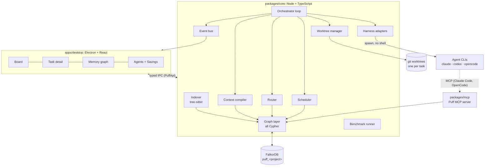
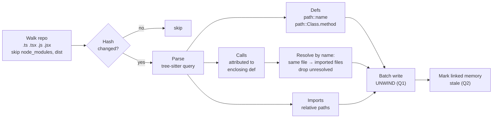
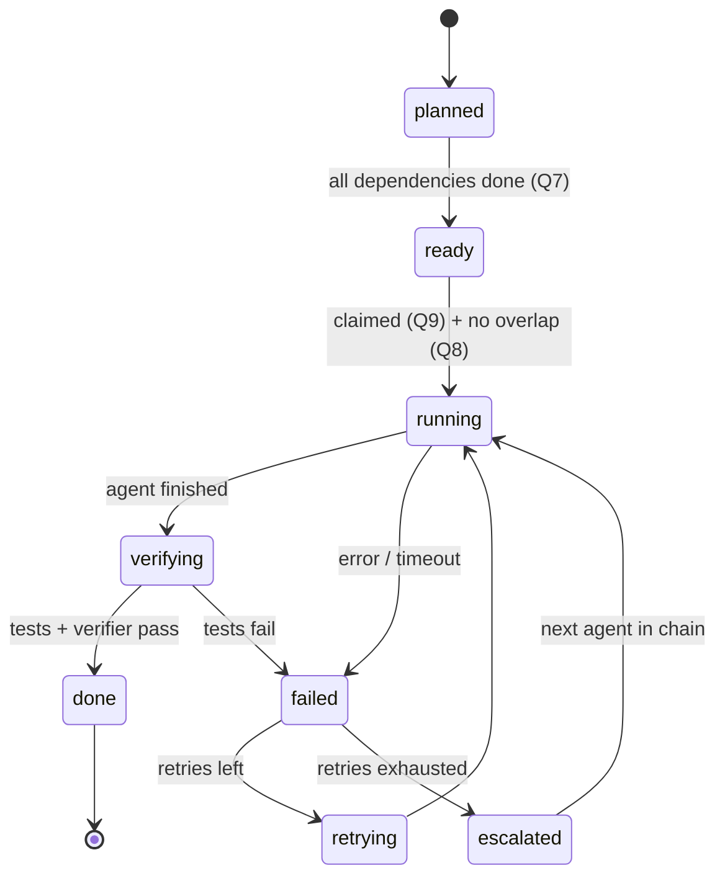
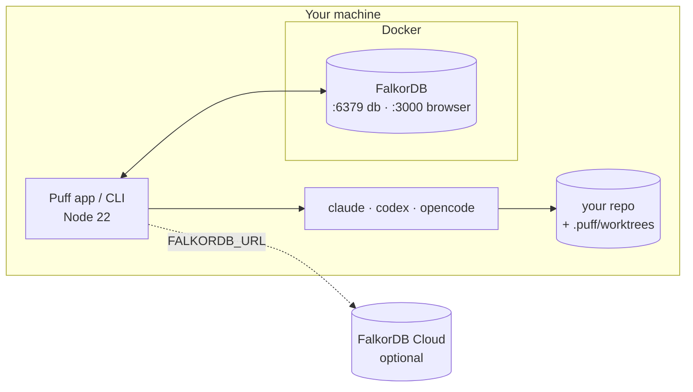

# 📐 Puff architecture, platform and deployment

How Puff is put together, how it runs agents, and how to set it up.

- [System overview](#system-overview)
- [Platform and tech stack](#platform-and-tech-stack)
- [Monorepo layout](#monorepo-layout)
- [Components](#components)
- [Task lifecycle](#task-lifecycle)
- [Agent adapters](#agent-adapters)
- [Context compiler](#context-compiler)
- [Puff MCP server](#puff-mcp-server)
- [Configuration](#configuration)
- [Shared types and API contract](#shared-types-and-api-contract)
- [UI](#ui)
- [Deployment](#deployment)
- [Demo repo and benchmark](#demo-repo-and-benchmark)
- [Build phases](#build-phases)
- [Security](#security)
- [Risks and mitigations](#risks-and-mitigations)

The graph data model and every Cypher query are in **[GRAPH_SCHEMA.md](GRAPH_SCHEMA.md)**.

---

## System overview



**Key principle:** all logic lives in `packages/core`, which runs **without Electron**. The desktop app is only a window onto it. If packaging breaks, the same demo runs from the CLI with a web renderer.

---

## Platform and tech stack

| Layer | Choice | Why |
|---|---|---|
| Runtime | **Node 22**, TypeScript (strict) | Spawning CLIs, git and the FalkorDB client are all native to Node |
| Graph DB | **FalkorDB** (`falkordb/falkordb:latest`) | Fast multi-hop Cypher, one graph per project, built-in vector + graph algorithms |
| DB client | **`falkordb`** npm (official, MIT) | `connect`, `selectGraph`, parameterised `query`, `roQuery`, `list` |
| Parsing | **`web-tree-sitter@0.22.6`** + `tree-sitter-wasms` | WASM means no native rebuild inside Electron. **Pinned**: newer versions changed the API. |
| Git | `simple-git` + `git worktree` | Each task gets its own isolated checkout |
| Agent protocol | `@modelcontextprotocol/sdk` | Standard tool interface for Claude Code and OpenCode |
| Desktop | Electron + **electron-vite** | Same Node backend; the UI is a Vite React app first |
| UI | React, Tailwind, shadcn/ui | |
| Graph viz | `react-force-graph` | Force layout, handles a few thousand nodes |
| Tests | Vitest (Puff and the demo repo) | |

### Supported operating systems

| OS | Status | Notes |
|---|---|---|
| Windows 11 | Primary dev machine | See the [Windows notes](#windows-notes) for spawning |
| macOS / Linux | Supported | Nothing platform-specific beyond spawning |

---

## Monorepo layout

npm workspaces.

```text
puff/
├─ apps/
│  └─ desktop/                 Electron main + preload + React renderer
│     ├─ src/main/             IPC handlers → core
│     ├─ src/preload/          exposes window.puff (PuffApi)
│     └─ src/renderer/         screens, graph view, mascot states
├─ packages/
│  ├─ shared/                  types.ts, api.ts, mocks/ (frozen contract)
│  ├─ core/
│  │  ├─ src/db/               connection, graph init, indexes
│  │  ├─ src/queries/          one file per query group (Q1–Q18)
│  │  ├─ src/indexer/          walk → hash → parse → resolve → write
│  │  ├─ src/memory/           sessions, failures, decisions, handoffs
│  │  ├─ src/context/          compiler + prompt templates
│  │  ├─ src/agents/           adapters, router, pool
│  │  ├─ src/orchestrator/     loop, scheduler, state machine, verify
│  │  ├─ src/git/              worktree manager, diff, merge
│  │  ├─ src/bench/            benchmark runner
│  │  └─ src/cli.ts            `puff` CLI entry
│  └─ mcp/                     stdio MCP server, imports core
├─ demo/
│  ├─ shop-api/                synthetic Express + TS repo with seeded traps
│  └─ tasks/                   benchmark task definitions
├─ scripts/                    seed.ts, reset-graph.ts, run-benchmark.ts
├─ bench/                      results.json (generated)
├─ docs/
├─ assets/                     mascot, screenshots
├─ puff.config.yaml
└─ docker-compose.yml
```

---

## Components

| Component | Responsibility | Graph queries |
|---|---|---|
| **Indexer** | Walk the repo (respecting `.gitignore`), hash files, parse with tree-sitter, resolve calls and imports, write in batches | Q1, Q2 |
| **Graph layer** | The only module that talks to FalkorDB. Typed functions wrapping each query. | all |
| **Memory** | Record sessions, failures, solutions, decisions, handoffs. Parse `<puff-report>`. | Q11–Q15 |
| **Context compiler** | Build a per-task, per-role prompt within a token budget and store it as a ContextPack | Q3, Q4, Q6 |
| **Router** | Pick the agent type for a task from strengths and history, respecting free instances | Q10 |
| **Scheduler** | Promote ready tasks, check overlap, claim atomically, respect `maxParallel` | Q7, Q8, Q9 |
| **Orchestrator** | Runs the loop and state machine: retry, escalate, merge, re-index | all above |
| **Harness adapters** | Run each agent CLI headless and normalise its output into `HarnessResult` | — |
| **Worktree manager** | `git worktree add` per task, collect diffs, merge one at a time, clean up | — |
| **Event bus** | Push `task:update`, `session:update` and `memory` events to the UI | — |
| **MCP server** | Expose memory tools to agents that support MCP | Q3, Q5, Q6, Q12–Q15 |
| **Benchmark runner** | Run tasks with and without Puff, aggregate into `bench/results.json` | reads Session |

### Indexer pipeline



Tree-sitter query (tested on TypeScript):

```scheme
(function_declaration name:(identifier) @def.fn)
(variable_declarator name:(identifier) @def.fn value:(arrow_function))
(method_definition name:(property_identifier) @def.method)
(class_declaration name:(type_identifier) @def.class)
(call_expression function:[(identifier) @call
                           (member_expression property:(property_identifier) @call)])
(import_statement source:(string) @import)
```

Technologies come from `package.json` dependencies plus file extensions.

---

## Task lifecycle

### State machine



### Orchestrator loop

```ts
while (await hasOpenTasks(project)) {
  await promoteReady(project);                       // Q7
  for (const t of await readyTasks(project)) {
    if (!pool.hasFreeSlot()) break;
    const { safeToRun, blockedBy } = await overlap(t); // Q8
    if (!safeToRun) { emit({ type: 'task:update', task: { ...t, blockedBy } }); continue; }
    const sessionId = newId('ses');
    if (await claim(t.id, sessionId)) void runTask(t, sessionId); // Q9
  }
  await sleep(1000);
}

async function runTask(t: Task, sessionId: string) {
  const agent  = await route(t, pool.freeAgents());           // Q10
  const wt     = await worktrees.create(t.id);
  const pack   = await compileContext(t, roleFor(t), sessionId); // Q3, Q4
  const res    = await adapters[agent].run({ prompt: pack.prompt, cwd: wt, role: roleFor(t), timeoutMs });
  const changed = await worktrees.changedFiles(wt);
  await recordSession(t, agent, sessionId, res, changed);       // Q11 + <puff-report>
  const verdict = await verify(t, wt);                          // tests + verifier agent
  if (verdict.ok) {
    await worktrees.merge(wt);                                  // one merge at a time
    await reindex(changed);                                     // Q1, Q2
    await setStatus(t, 'done');
  } else {
    await recordFailure(sessionId, verdict);                    // Q12 (stack trace → symbol)
    await retryOrEscalate(t);
  }
}
```

### Who writes what

| Written by | What |
|---|---|
| **Puff (always)** | Session, outcome, tokens, duration, changed files, test results, Failure (from test output), ContextPack, status changes, re-index |
| **Agents via MCP** (Claude Code, OpenCode) | Decisions, notes, handoffs |
| **Agents via `<puff-report>`** (all agents, including Codex) | Decisions, notes |

Puff never trusts an agent's claim of success. The outcome comes from the exit code **and** the test run.

---

## Agent adapters

| Harness | Headless command | MCP | Strengths |
|---|---|---|---|
| 🟠 **Claude Code** | `claude -p --output-format json --permission-mode acceptEdits --mcp-config puff-mcp.json` (prompt on stdin) | ✅ `--mcp-config` | reasoning, planning, verification, review |
| 🟢 **Codex** | `codex exec --json --full-auto -` (prompt on stdin) | ⚠️ MCP tool calls are cancelled in `exec` ([openai/codex#24135](https://github.com/openai/codex/issues/24135)), so context goes in the prompt | implementation, refactor |
| 🔵 **OpenCode** | `opencode run --format json "<prompt>"` | ✅ `opencode.json` → `mcp` or `OPENCODE_CONFIG` | simple-edit, docs, formatting, boilerplate |
| ⚫ Antigravity | — | — | **Not supported.** In headless mode it ignores `permissions.allow` and reports denied runs as successful, which would corrupt failure memory. Listed as future work. |

### Adapter interface

```ts
export interface HarnessAdapter {
  name: AgentName;
  run(opts: { prompt: string; cwd: string; role: Role; timeoutMs: number }): Promise<HarnessResult>;
}

export interface HarnessResult {
  exitCode: number;
  output: string;          // final text
  report?: PuffReport;     // parsed <puff-report>
  tokensIn?: number;
  tokensOut?: number;
  filesRead?: number;      // Read tool calls, where the stream exposes them
  durationMs: number;
  raw: unknown;            // parsed JSON for debugging
}
```

### Windows notes

- **No shell, ever:** the prompt is data and must never be interpolated into a command line.
- Agent CLIs installed with npm are **`.cmd` shims** on Windows. Recent Node versions refuse to `spawn` a `.cmd` file without `shell: true`. Puff resolves the shim to its underlying `node <script.js>` entry point (or uses `cross-spawn`) so it can stay shell-free.
- Windows limits a command line to about **32k characters**. Prompts are passed on **stdin** wherever the CLI supports it.
- Every run has a **timeout + kill** (`timeoutMs`). A stalled permission prompt is recorded as `outcome: error`.

### Token reporting

| Harness | Token fields | Status |
|---|---|---|
| Claude Code | `usage` in the JSON result | to confirm on a real run |
| Codex | usage events in the `--json` stream | to confirm on a real run |
| OpenCode | in the `--format json` events | to confirm on a real run |

If a harness doesn't report tokens, the benchmark says so and falls back to the harnesses that do.

---

## Context compiler

Input: `taskId`, `role`. Output: a prompt string and a stored `ContextPack`.

| Role | Includes |
|---|---|
| **planner** | goal, project technologies, procedures, active decisions, recent project-wide failures (top 5) |
| **coder** | task, target symbols with file + line ranges, callers (impact), failures + fixes on those symbols, active decisions, procedures, pending handoffs |
| **verifier** | task, diff, tests to run, decisions the change must respect, previous failures on these symbols |
| **chore** | task, target files, procedures |

**Rules:**
- Budget of about **2k tokens**. Items are ranked: unresolved failures → fixed failures → decisions → callers → procedures.
- `stale` items are dropped unless nothing else exists. In that case they are labelled *"possibly outdated"*.
- Every included item gets a **reason**, stored on the `INCLUDED` edge.

Prompt template:

```text
You are the {role} on a team of coding agents working in this repository.

TASK: {title}
TARGET CODE (read these first, do not scan the whole repo):
- {file}:{startLine}-{endLine}  {symbol}
CALLERS THAT MAY BREAK: {callers}

PROJECT MEMORY
Past failures here and their fixes:
- {failure} → fixed by: {fix}
Active decisions you must respect:
- {decision}
Procedures:
- {procedure}

WHEN DONE: state files changed, tests run, and any decision you made and why,
in a final block:
<puff-report>{"decisions":[{"symbol":"...","text":"..."}],"notes":"..."}</puff-report>
```

---

## Puff MCP server

A stdio server (`packages/mcp`) built with `@modelcontextprotocol/sdk`. Environment: `FALKORDB_URL`, `PUFF_PROJECT`.

| Tool | Input | Does |
|---|---|---|
| `get_context` | `{ taskId, role }` | Runs the context compiler and returns the text |
| `impact_of` | `{ symbolId }` | Q6 |
| `record_decision` | `{ symbolId, text, supersedes? }` | Q14 |
| `record_failure` | `{ symbolId, message, kind }` | Q12 |
| `record_solution` | `{ failureId, summary }` | Q13 |
| `handoff` | `{ toRole, payload }` | Q15 |
| `why` | `{ sessionId }` | Q5 |

Claude Code config (`puff-mcp.json`, generated by Puff with absolute paths):

```json
{
  "mcpServers": {
    "puff": {
      "command": "node",
      "args": ["<abs-path>/packages/mcp/dist/index.js"],
      "env": { "FALKORDB_URL": "falkor://localhost:6379", "PUFF_PROJECT": "shop_api" }
    }
  }
}
```

---

## Configuration

`puff.config.yaml` at the repo root:

```yaml
harnesses:
  claude-code:
    command: claude
    args: ["-p", "--output-format", "json", "--permission-mode", "acceptEdits", "--mcp-config", "{mcpConfig}"]
    promptVia: stdin
    instances: 2
    strengths: [reasoning, planning, verification, review]
  codex:
    command: codex
    args: ["exec", "--json", "--full-auto", "-"]
    promptVia: stdin
    instances: 2
    strengths: [implementation, refactor]
  opencode:
    command: opencode
    args: ["run", "--format", "json", "{prompt}"]
    promptVia: arg
    instances: 1
    strengths: [simple-edit, docs, formatting, boilerplate]

routing:            # task type → required capabilities
  plan: [planning, reasoning]
  implement: [implementation]
  verify: [verification]
  chore: [simple-edit, docs]

limits:
  maxParallel: 3
  timeoutMs: 600000
  retriesBeforeEscalate: 1
  contextTokenBudget: 2000

escalation: [opencode, codex, claude-code]

verify:
  testCommand: "npm test --silent"
  verifierAgent: claude-code
```

Agents, capabilities and `HAS_STRENGTH` edges are written to the graph from this file on startup, so routing (Q10) is a pure graph query.

---

## Shared types and API contract

`packages/shared` is the **frozen contract** between backend and UI. The UI is built against mocks; the backend implements the same interface.

```ts
export type AgentName = 'claude-code' | 'codex' | 'opencode';
export type Role = 'planner' | 'coder' | 'verifier' | 'chore';
export type TaskType = 'plan' | 'implement' | 'verify' | 'chore';
export type TaskStatus =
  | 'planned' | 'ready' | 'running' | 'verifying'
  | 'failed' | 'retrying' | 'escalated' | 'done';

export interface PuffApi {
  openProject(repoPath: string): Promise<{ projectId: string }>;
  indexProject(projectId: string): Promise<{ files: number; symbols: number; calls: number }>;
  listTasks(projectId: string): Promise<Task[]>;
  createGoal(projectId: string, goal: string): Promise<Task[]>;
  createTask(projectId: string, t: Partial<Task>): Promise<Task>;
  getTask(taskId: string): Promise<{ task: Task; sessions: SessionInfo[] }>;
  getContextPack(sessionId: string): Promise<ContextPack>;
  getWhy(taskId: string): Promise<WhyPath>;
  getGraph(projectId: string, focusId?: string, depth?: number): Promise<GraphData>;
  getMemoryFeed(projectId: string, limit?: number): Promise<MemoryEvent[]>;
  listAgents(projectId: string): Promise<AgentProfile[]>;
  getSavings(projectId: string): Promise<Savings>;
  start(projectId: string): Promise<void>;
  stop(projectId: string): Promise<void>;
  onEvent(cb: (e: PuffEvent) => void): () => void;
}
```

The full type definitions (`Task`, `SessionInfo`, `ContextPack`, `WhyPath`, `GraphData`, `MemoryEvent`, `AgentProfile`, `Savings`, `PuffEvent`) live in `packages/shared/src/types.ts`. Mock fixtures cover every return type: 8–12 tasks across all statuses, a 60–100 node graph, 20 memory events and 3 agents.

---

## UI

| Screen | Contents |
|---|---|
| **Memory graph** (the demo opens here) | Force graph of the project. Nodes coloured by kind; the current task's neighbourhood highlighted; click a node → side panel; live **memory feed** column. |
| **Board** | Columns: Planned · Running · Verifying · Failed/Retrying · Done. Cards show title, agent, role, worktree, tests passed, tokens, and **"waiting on …"** when blocked by overlap. "+ New goal" with agent: Auto / specific. |
| **Task detail** | Agent output, changed files, **Context received** (items + reasons), **Why?** mini-graph, session history |
| **Agents** | Pool cards (strengths, busy/free, success rate, average tokens) and the **savings meter** |

Mascot states: **idle** (empty states) · **working** (agents running) · **happy** (verified) · **worried** (failure recorded).

Visual direction: dark and calm, "mission control". The graph and the mascot are the identity.

---

## Deployment

Puff is a **local-first developer tool**. Agents run on your machine against your repo, and FalkorDB runs next to them. Nothing leaves your machine except the agent CLIs' own model calls.



### Option A: Docker (recommended)

```yaml
# docker-compose.yml
services:
  falkordb:
    image: falkordb/falkordb:latest
    ports: ["6379:6379", "3000:3000"]
    volumes: ["falkordb-data:/data"]
volumes:
  falkordb-data: {}
```

```bash
docker compose up -d
```

### Option B: no Docker (falkordblite)

`falkordblite` ships a real FalkorDB server binary through pip, which is useful when Docker Desktop isn't available.

```bash
pip install falkordblite
```

Start it on port 6379 and point `FALKORDB_URL` at it.

### Option C: FalkorDB Cloud

Create a free instance and set `FALKORDB_URL` to its connection string. Puff only stores references (no code bodies), so the free tier is plenty.

### Environment variables

| Variable | Default | Purpose |
|---|---|---|
| `FALKORDB_URL` | `falkor://localhost:6379` | Database connection |
| `PUFF_PROJECT` | from the opened repo | Graph name suffix (`puff_<project>`) |
| `PUFF_CONFIG` | `./puff.config.yaml` | Harness and routing config |
| `PUFF_WORKTREES` | `<repo>/.puff/worktrees` | Where task worktrees are created |
| `CODEX_HOME` | `~/.codex` | Codex config dir (used for MCP config if enabled) |
| `OPENCODE_CONFIG` | — | OpenCode config override |

### Run

```bash
npm install
```

```bash
npm run dev
```

```bash
npm run puff -- index demo/shop-api
```

```bash
npm run puff -- goal "Add rate limiting to login and update docs"
```

### Scripts

| Script | Does |
|---|---|
| `npm run dev` | Electron app with hot reload |
| `npm run puff -- <cmd>` | Headless CLI: `index`, `goal`, `run`, `why`, `graph` |
| `npm run seed` | Load the demo repo + baseline memory into a fresh graph |
| `npm run reset-graph` | Drop and recreate the project graph (keeps other projects) |
| `npm run bench` | Run the benchmark → `bench/results.json` |
| `npm run build:desktop` | Package the Electron app (electron-builder) |

### Data lifecycle

- **Graph:** persisted in the `falkordb-data` volume. `reset-graph` affects one project only.
- **Worktrees:** created under `.puff/worktrees/<taskId>`, removed after merge or after a failed task is escalated.
- **Inspecting:** the FalkorDB browser at <http://localhost:3000> runs any query from [GRAPH_SCHEMA.md](GRAPH_SCHEMA.md).

---

## Demo repo and benchmark

**`demo/shop-api`** is our own synthetic Express + TypeScript project: auth (login, session, tokens), users, products, cart, orders, middleware and a Vitest + Supertest suite (38 files, 25 tests). It has **seeded traps** (full list in `demo/TRAPS.md`, kept outside the repo copy agents see):

- `login` must never log passwords
- tokens must never go to `localStorage`
- the rate limiter must reset per IP

**Benchmark tasks:**

1. Add rate limiting to `login` (touches auth + middleware)
2. Add an endpoint that reuses cart logic (needs callers/impact)
3. Fix a seeded failing test
4. **Repeated-failure pair:** task A fails on a trap in session 1; task B in session 2 touches the same function and must avoid the trap on the first try
5. Docs chore (OpenCode)
6. Refactor a function with many callers (impact query)

**Arms:** (a) plain harness, (b) harness + Puff context. Same model and prompt wording otherwise, a fresh worktree per run, 2–3 runs per arm.

**Metrics:** tokens in/out, files read (where the stream exposes Read calls), first-try pass rate, **repeated-mistake rate**, wall time.

---

## Build phases

Every phase ends with a **checkpoint**: a working build, committed. The next phase starts only after the checkpoint passes, so a submittable project exists at every point.

| Phase | When | Backend | UI | Checkpoint |
|---|---|---|---|---|
| **P0 Foundation** | Thu afternoon | Monorepo, `packages/shared` contract + mocks, docker-compose, graph init + indexes | electron-vite shell, design tokens, mascot, Board on mocks | UI renders mocks; `puff init` creates the graph |
| **P1 Code graph** ✅ | Thu night | Indexer (Q1), impact (Q6), technologies, demo repo skeleton | Memory graph screen on real data | Demo repo visible as a graph; impact query returns files |
| **P2 Memory + context** | Fri morning | Memory writes (Q11–Q15), stack trace → symbol, context compiler + ContextPack (Q3–Q5), `<puff-report>` parsing | Task detail on mocks | A recorded failure lands on the right function |
| **P3 Three agents, one loop** | Fri afternoon | Claude Code + Codex + OpenCode adapters, worktrees, verify, retry once | Task detail on real data | **Session 2 avoids session 1's mistake** |
| **P4 Team coordination** | Fri night | Planner goal split, routing (Q10), scheduling (Q7–Q9), escalation, event bus | Board live, mascot states wired | A goal runs across 3 agents; one task waits on overlap |
| **P5 Correctness + Why** | Sat morning | Stale on hash change, supersede, MCP server | Why view, memory feed | Editing code marks memory stale; Why shows the path |
| **P6 Benchmark** | Sat afternoon | Benchmark runner (sessions recorded since P3), `results.json` | Savings meter | Real numbers on screen |
| **P7 Stretch** | Sat evening, until the 22:00 freeze | PageRank routing (Q18), vector failures (Q17), generic CLI adapter | Electron packaging, polish | Each item ships independently |
| **Ship** | Sun | README numbers, setup from a clean clone | Demo video, blog | Submit by 20:00 |

---

## Security

- Agent CLIs are spawned **without a shell**. Prompts are passed as data (stdin or a single argv entry) and never interpolated into a command line.
- Each task runs in its **own git worktree**; the main checkout is only touched by Puff's merge step.
- All Cypher is **parameterised**.
- The graph stores **no source code bodies and no secrets**: only paths, line ranges, signatures, hashes and short messages.
- The demo uses only **our own synthetic repository**.

---

## Risks and mitigations

| Risk | Mitigation |
|---|---|
| Harness stalls on a permission prompt | `acceptEdits` / `--full-auto`; timeout + kill; recorded as `error` |
| Codex can't call MCP in `exec` | Context in the prompt + `<puff-report>` + facts written by Puff |
| Token fields missing for a harness | Benchmark on the harnesses that report them; say so |
| Imperfect call resolution | Resolve by name, drop unresolved calls; good enough for impact and context |
| Stack trace doesn't map to a symbol | Fallbacks: changed target symbols → verifier names it |
| API quota / cost | `maxParallel: 3`, small demo repo, cached benchmark results |
| Merge conflicts | Overlap check (Q8), merge one at a time, re-run tests after merge |
| Electron packaging breaks | Core runs as a CLI; the UI runs as a web app |
| Live demo is flaky | Record from a known-good run; `npm run seed` resets to a known state |
