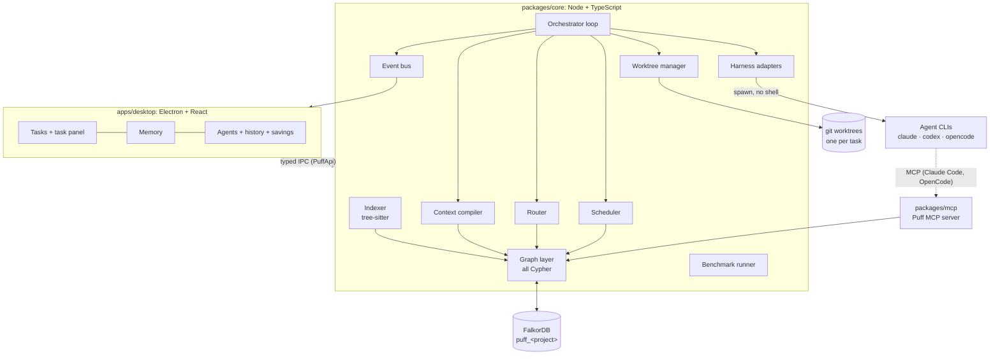
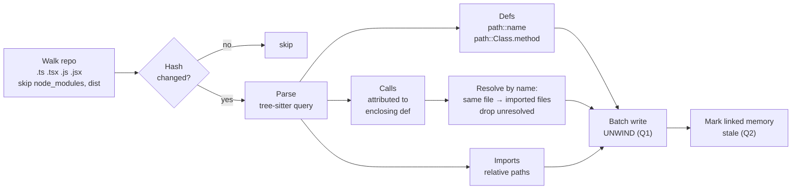
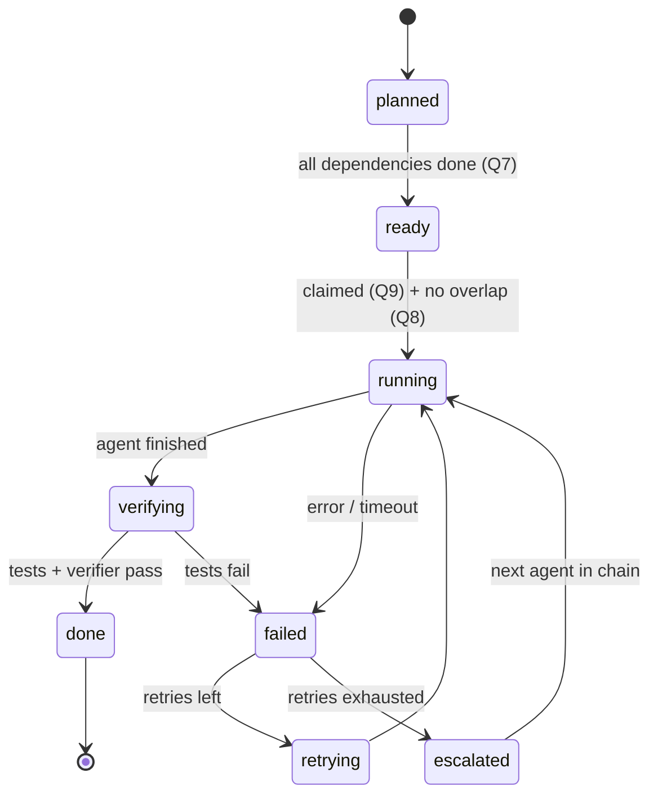
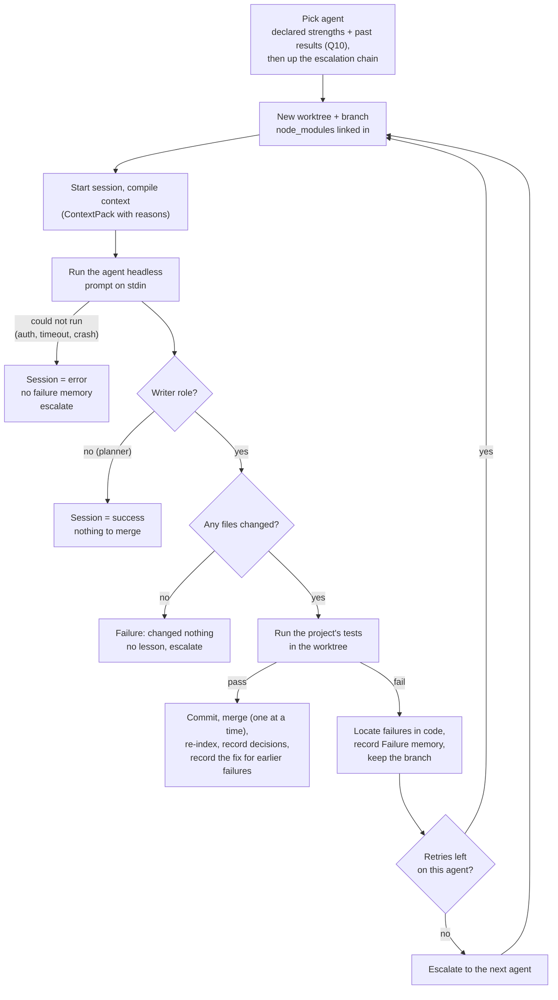
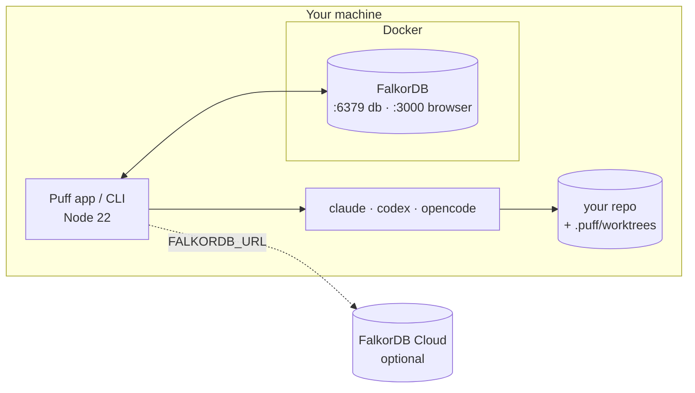

# 📐 Puff architecture, platform and deployment

How Puff is put together, how it runs agents, and how to set it up.

- [System overview](#system-overview)
- [Platform and tech stack](#platform-and-tech-stack)
- [Monorepo layout](#monorepo-layout)
- [Components](#components)
- [Task lifecycle](#task-lifecycle)
- [Agent adapters](#agent-adapters)
- [Context compiler](#context-compiler)
- [Puff MCP server](#puff-mcp-server)
- [Configuration](#configuration)
- [Shared types and API contract](#shared-types-and-api-contract)
- [UI](#ui)
- [Deployment](#deployment)
- [Demo repo and benchmark](#demo-repo-and-benchmark)
- [Build phases](#build-phases)
- [Security](#security)
- [Risks and mitigations](#risks-and-mitigations)

The graph data model and every Cypher query are in **[GRAPH_SCHEMA.md](GRAPH_SCHEMA.md)**.

---

## System overview



**Key principle:** all logic lives in `packages/core`, which runs **without Electron**. The desktop app is only a window onto it. If packaging breaks, the same demo runs from the CLI with a web renderer.

---

## Platform and tech stack

| Layer | Choice | Why |
|---|---|---|
| Runtime | **Node 22**, TypeScript (strict) | Spawning CLIs, git and the FalkorDB client are all native to Node |
| Graph DB | **FalkorDB** (`falkordb/falkordb:latest`) | Fast multi-hop Cypher, one graph per project, built-in vector + graph algorithms |
| DB client | **`falkordb`** npm (official, MIT) | `connect`, `selectGraph`, parameterised `query`, `roQuery`, `list` |
| Parsing | **`web-tree-sitter@0.22.6`** + `tree-sitter-wasms` | WASM means no native rebuild inside Electron. **Pinned**: newer versions changed the API. |
| Git | `simple-git` + `git worktree` | Each task gets its own isolated checkout |
| Agent protocol | `@modelcontextprotocol/sdk` | Standard tool interface for Claude Code and OpenCode |
| Desktop | Electron + **electron-vite** | Same Node backend; the UI is a Vite React app first |
| UI | React, Tailwind, shadcn/ui | |
| Graph viz | `react-force-graph` | Force layout, handles a few thousand nodes |
| Tests | Vitest (Puff and the demo repo) | |

### Supported operating systems

| OS | Status | Notes |
|---|---|---|
| Windows 11 | Primary dev machine | See the [Windows notes](#windows-notes) for spawning |
| macOS / Linux | Supported | Nothing platform-specific beyond spawning |

---

## Monorepo layout

npm workspaces.

```text
puff/
├─ apps/
│  └─ desktop/                 Electron main + preload + React renderer
│     ├─ src/main/             IPC handlers → core
│     ├─ src/preload/          exposes window.puff (PuffApi)
│     └─ src/renderer/         screens, graph view, mascot states
├─ packages/
│  ├─ shared/                  types.ts, api.ts, mocks/ (frozen contract)
│  ├─ core/
│  │  ├─ src/db/               connection, graph init, indexes
│  │  ├─ src/queries/          code (impact, symbol lookup), graph export for the UI, explain (Why, feed, agent stats)
│  │  ├─ src/indexer/          walk → hash → parse → resolve → write
│  │  ├─ src/memory/           tasks, sessions, memory writes, locate (failure → code), failures, puff-report
│  │  ├─ src/context/          prompt.ts (pure rendering) + compiler.ts (graph → ranked, budgeted ContextPack)
│  │  ├─ src/seed/             demo memory seed (flagged seeded)
│  │  ├─ src/agents/           adapters, router, pool
│  │  ├─ src/orchestrator/     loop, scheduler, state machine, verify
│  │  ├─ src/git/              worktree manager, diff, merge
│  │  ├─ src/bench/            benchmark runner
│  │  └─ src/cli.ts            `puff` CLI entry
│  └─ mcp/                     stdio MCP server, imports core
├─ demo/
│  ├─ shop-api/                synthetic Express + TS repo with seeded traps
│  └─ tasks/                   benchmark task definitions
├─ scripts/                    seed.ts, reset-graph.ts, run-benchmark.ts
├─ bench/                      results.json (generated)
├─ docs/
├─ assets/                     mascot, screenshots
├─ puff.config.yaml
└─ docker-compose.yml
```

---

## Components

| Component | Responsibility | Graph queries |
|---|---|---|
| **Indexer** | Walk the repo (respecting `.gitignore`), hash files, parse with tree-sitter, resolve calls and imports, write in batches | Q1, Q2 |
| **Graph layer** | The only module that talks to FalkorDB. Typed functions wrapping each query. | all |
| **Memory** | Record sessions, failures, solutions, decisions, handoffs. Parse `<puff-report>`. | Q11–Q15 |
| **Context compiler** | Build a per-task, per-role prompt within a token budget and store it as a ContextPack | Q3, Q4, Q6 |
| **Router** | Pick the agent type for a task from strengths and history, respecting free instances | Q10 |
| **Scheduler** | Promote ready tasks, check overlap, claim atomically, respect `maxParallel` | Q7, Q8, Q9 |
| **Orchestrator** | Runs the loop and state machine: retry, escalate, merge, re-index | all above |
| **Harness adapters** | Run each agent CLI headless and normalise its output into `HarnessResult` | — |
| **Worktree manager** | `git worktree add` per task, collect diffs, merge one at a time, clean up | — |
| **Event bus** | Push `task:update`, `session:update` and `memory` events to the UI | — |
| **MCP server** | Expose memory tools to agents that support MCP | Q3, Q5, Q6, Q12–Q15 |
| **Benchmark runner** | Run tasks with and without Puff, aggregate into `bench/results.json` | reads Session |

### Indexer pipeline



Tree-sitter query (tested on TypeScript):

```scheme
(function_declaration name:(identifier) @def.fn)
(variable_declarator name:(identifier) @def.fn value:(arrow_function))
(method_definition name:(property_identifier) @def.method)
(class_declaration name:(type_identifier) @def.class)
(call_expression function:[(identifier) @call
                           (member_expression property:(property_identifier) @call)])
(import_statement source:(string) @import)
```

Technologies come from `package.json` dependencies plus file extensions.

---

## Task lifecycle

### State machine



### Running a task (implemented in `orchestrator/run.ts`)



What it guarantees:

- **Puff observes, the agent does not self-report.** Success means the project's own test command exited 0 in the worktree. The agent's claim is never trusted, and a writer that changed nothing cannot "pass" on the old tests.
- **Retry with the lesson.** The retry gets a new worktree and a freshly compiled context that now contains the failure Puff just recorded.
- **The fix is learned.** When a later attempt passes, Puff records that as the **Solution** for the earlier failures of the same task (`FIXED_BY`, with the merge commit), so the next task that touches that code gets *what failed and what fixed it*.
- **Bounded cost.** At most `limits.maxAttempts` agent runs per task. An agent found unusable (not signed in, not installed) is skipped for the rest of the run.
- **Clean up.** A passing branch is deleted after the merge, a failed attempt keeps its branch (`puff/<task>-a<n>`) so it can be inspected, and worktrees are always removed. Removing one never touches the real `node_modules` it links to (tested).
- **Stop and crash recovery.** Stopping kills the running agent and returns its task to the queue; tasks left half-run by a crash are reset on the next start and their orphaned sessions closed as errors.

The team loop (`orchestrator/orchestrator.ts`) promotes planned tasks whose dependencies are done (Q7) and runs ready tasks one at a time, oldest first. Overlap-aware parallel runs and the goal-to-tasks planner arrive in P4.

### Planning: from a goal to tasks (`memory/plan.ts`, `memory/report.ts`)

A goal becomes a task of type `plan`. When the team runs, the planner agent (read-only) is given:

- the goal, the project's technologies, procedures and recent failures,
- a **code map**: every source file and the functions in it (read from the graph), so it can name real targets instead of guessing,
- the **tasks already on the board**, so it does not repeat them,
- the exact output format and the rules for a safe plan.

It answers with one JSON block, the same `<puff-report>` every agent uses, so it works for Codex too (which cannot call MCP tools headlessly):

```json
{"tasks":[
  {"title":"Add a /products/count route","type":"implement","complexity":"low","targets":["productsRouter"],"dependsOn":[]},
  {"title":"Document the route in docs/API.md","type":"chore","dependsOn":[0]}
]}
```

Any agent can also include `tasks` in its report to **ask for follow-up work** (for example a coder noticing the docs need updating), and `handoffs` to leave a note for whoever works next. Because agents can create work, Puff keeps it under control:

| Safeguard | Rule |
|---|---|
| Size | A plan creates at most `limits.maxTasksPerPlan` tasks (8) |
| Depth | Agent-created work may nest at most `limits.maxSpawnDepth` levels (2): a planner's task may ask for follow-ups, but those cannot ask for more forever |
| Cycles | `dependsOn` may only point at **earlier** tasks in the same list, so a plan can never contain a cycle |
| Duplicates | A task with the same title as one already on the board is skipped |
| Unknown code | A name that is not in the graph (new code) is kept as a **hint** shown to the agent, never guessed into a symbol |
| Empty plans | A plan that creates no tasks counts as a **failure**, not a success |
| Attribution | Each created task is linked to the session that asked for it (`(Session)-[:SPAWNED]->(Task)`) |

Models are loose about JSON, so the report parser is forgiving where it can be (a single string where a list belongs, numbers as strings, an unknown `type` falls back to `implement`) and strict where it matters (a task without a title invalidates the report, and the reason is returned).

### Scheduling: what runs at the same time (`orchestrator/schedule.ts`, `orchestrator.ts`)

The team loop keeps up to `limits.maxParallel` tasks running, and for every ready task, oldest first:

1. **Overlap (Q8).** If its code overlaps a task already in flight, it waits and `blockedBy` says for what.
2. **Claim (Q9).** Otherwise it is claimed atomically and started in its own worktree.
3. **Slots.** The agent chosen for it may only have as many simultaneous runs as its configured `instances`; extra runs wait for a free slot.
4. **Merge, one at a time.** Merging and the re-index that follows it run under one repository lock, so parallel tasks never read the main checkout halfway through each other's merge.

When any task finishes, the loop promotes tasks whose dependencies are now done (Q7) and looks again. This is tested with fake agents: independent tasks overlap in time, a task overlapping a running one starts only after it ends, and an agent with 2 slots never runs 3 tasks at once.

Not done: if two tasks edit different functions of the same file, git merges them, but a real textual conflict aborts the merge and fails that task cleanly. After a merge, the combined result is not re-tested.

### The Team timeline (`getTeamTimeline`)

The **Team** screen tells the story in order: which agent worked on which task and how it ended, which note was handed to whom, which agent asked for which task, and when a task moved up to another agent (**escalated**) or got a second try (**retried**). It is derived entirely from sessions, handoffs and `SPAWNED` edges already in the graph, so there is nothing extra to keep in sync. `npm run puff -- team` prints the same.

### Delegating a task by hand

The desktop app's **New task** dialog (and `puff task add`) lets a person choose what to do, which functions it touches (searched from the graph), the type and complexity, and **which agent and model** (Auto lets Puff route it). The choice is stored on the task (`preferredAgent`, `model`) and honoured by the run loop; escalation still applies if that agent fails.

### The demo needs its own git repository

Agents work in git worktrees, so a project must be the root of its own repository. `demo/shop-api` lives inside Puff's repository, so `npm run puff -- demo setup` copies it to `~/.puff/demo/shop-api` (a fresh repository with one commit, `node_modules` linked), and writes `PUFF_REPO` to your local `.env`. It is deliberately **outside the Puff checkout**: an agent working there cannot wander up into Puff's own files, such as `demo/TRAPS.md`, which lists the seeded traps. `--force` recreates it from scratch.

### Projects (`projects/`, `paths.ts`)

A project is a folder, a graph and a few settings. The list lives in **`~/.puff/projects.json`** (override the folder with `PUFF_HOME`), so the desktop app and the CLI always agree. Each entry: `slug` (the graph is `puff_<slug>`), `name`, `repoPath`, `addedAt`, and optional `testCommand` and `linkDirs`. One project is **active**; commands and the app work on it unless told otherwise.

| Piece | What it does |
|---|---|
| `registry.ts` | Read and write the list (atomic: temporary file, then rename). Adding the same folder again updates it. Two folders with the same name get different slugs (`api`, `api_2`) so they never share a graph. A corrupt file is reported, never guessed at. |
| `inspect.ts` | Look at a folder before adding it (below). `initRepo` makes a folder a git repository, only when the person asked. |
| `open.ts` | Apply a project's settings over the shared configuration, create its graph, index it the first time only. |

**What inspecting a folder says.** Three levels, so the app can be honest instead of just refusing:

- **Problems** stop it being added: the folder does not exist, it is a file, or Puff can read nothing in it (it only reads TypeScript and JavaScript for now; if it finds Python, Go and so on it says so).
- **Run blockers** allow adding and exploring, but agents cannot run: not a git repository, no commits, or inside another repository (Puff works in git worktrees, so the folder must be the top of its own repository). Where it can be fixed, Puff offers to run `git init` and a first commit (and a `.gitignore` for `node_modules` if there is none). Nothing is changed unless the person ticks it.
- **Warnings** are worth knowing: uncommitted changes (a finished task will not merge into a dirty checkout), no test script (or the `npm init` placeholder), dependencies not installed, files in languages Puff cannot read.

The test command is detected from `package.json` (`pnpm test`, `yarn test`, `bun test` or `npm test`, chosen by the lockfile).

**Settings layers.** The user's own configuration (agents, models, routing, limits) is shared by every project: `$PUFF_CONFIG`, else `~/.puff/config.yaml`, else the `puff.config.yaml` of a Puff checkout (`puff config init` copies the default to `~/.puff/config.yaml`). A project's own `testCommand` and `linkDirs` are applied on top (`applyProject`). Everything else is shared.

**Switching.** The desktop backend keeps one open project (graph, merged config, and the orchestrator for it). Switching, adding and removing are refused while agents are running. A `project` event tells the UI to reload everything, so nothing from the old project stays on screen. When there is no project at all (a fresh install), the app shows a welcome screen and every read returns empty. A development checkout of Puff seeds the list from `$PUFF_REPO` or its bundled demo when the list is empty.

**Which project a CLI command uses:** the folder, name or id given (as an argument or `--repo`), else the active project, else `$PUFF_REPO`, else the current folder.

### Who writes what

| Written by | What |
|---|---|
| **Puff (always)** | Session, outcome, tokens, duration, changed files, test results, Failure (from test output), ContextPack, status changes, re-index |
| **Agents via MCP** (Claude Code, OpenCode) | Decisions, notes, handoffs |
| **Agents via `<puff-report>`** (all agents, including Codex) | Decisions, notes |

Puff never trusts an agent's claim of success. The outcome comes from the exit code **and** the test run.

---

## Agent adapters

Every agent is run headless, in the task's own git worktree, with the prompt on **stdin**. The commands below are what Puff actually sends (verified against Claude Code 2.1.232, Codex 0.162.1 and OpenCode 1.19.0); the base arguments come from `puff.config.yaml`, and Puff adds the role's permissions, the working directory and the model.

| Harness | Base command | Added per role | Strengths |
|---|---|---|---|
| 🟠 **Claude Code** | `claude -p --output-format json --no-session-persistence` | `--permission-mode acceptEdits` and `--allowedTools Read,Glob,Grep,Edit,Write,MultiEdit,Bash(npm test:*)…` for writers; `--permission-mode default` and read-only tools for planners and verifiers | reasoning, planning, verification, review |
| 🟢 **Codex** | `codex exec --json --skip-git-repo-check --ephemeral` | `-s workspace-write` for writers, `-s read-only` otherwise, `-C <worktree>`, then `-` (read the prompt from stdin) | implementation, refactor |
| 🔵 **OpenCode** | `opencode run --format json` | `--dir <worktree>`, `--agent build` for writers and `--agent plan` (cannot edit) otherwise | simple-edit, docs, formatting, boilerplate |
| ⚫ Antigravity | — | — | **Not supported.** In headless mode it ignores `permissions.allow` and reports denied runs as successful, which would corrupt failure memory. Listed as future work. |

`--full-auto`, which the original plan used for Codex, no longer exists in Codex 0.162; the sandbox is chosen with `-s`. Puff's MCP server exists (see [Puff MCP server](#puff-mcp-server)) but is not attached to runs automatically, so all three get their context in the prompt.

### Adapter interface

```ts
export interface HarnessAdapter {
  readonly name: AgentName;
  available(): Promise<{ ok: boolean; detail: string }>;   // installed and runnable? no model call
  run(opts: { prompt; cwd; role; timeoutMs; model?; signal? }): Promise<HarnessResult>;
}

export interface HarnessResult {
  exitCode: number | null;
  output: string;            // the agent's final text
  report?: PuffReport;       // parsed <puff-report>
  tokensIn?: number;         // total input, including cached
  cachedIn?: number;         // the cached part of tokensIn
  tokensOut?: number;
  costUsd?: number;
  durationMs: number;
  error?: { kind: 'auth' | 'unavailable' | 'timeout' | 'aborted' | 'api' | 'crash'; message: string };
  raw: string;               // trimmed stdout, for debugging
}
```

**Errors are about the harness, never the code.** A run that ends in `error` is recorded as a session with outcome `error` and **writes no failure memory**. Otherwise a login problem would teach the next agent a "lesson" about the wrong function. We saw this for real: the standalone `claude` CLI prints a normal-looking JSON result with `is_error: true` and the text *"OAuth session expired and could not be refreshed"*, with exit code 1.

### Running programs safely (Windows)

- **No shell, ever, for agents.** The prompt is data. It travels on stdin, and arguments are passed as an array, so a prompt containing `& echo pwned | $(whoami)` arrives as plain text (tested).
- npm installs CLIs as **`.cmd` shims** on Windows, which Node refuses to spawn without a shell. Puff reads the shim and launches what it wraps: `opencode.cmd` wraps a real `opencode.exe`, and `codex.cmd` wraps `node …/codex.js`. The real target is the **last** quoted path in the shim, because shims first mention `%dp0%\node.exe` in a "use the bundled node" check (this broke Codex detection until `puff agents` caught it).
- Inside Electron, `process.execPath` is the Electron binary, so JavaScript shims are run with the `node` found on `PATH` (or `ELECTRON_RUN_AS_NODE`).
- Every run has a **timeout and an abort signal**. Both kill the whole process tree (`taskkill /T` on Windows), because agents start their own children.
- The test command is the one exception to "no shell": it comes from the project's own config, not from model output, and `npm` needs the shell on every OS.

### Token reporting (measured)

The three CLIs report usage differently, so Puff normalises everything to *total input (including cache)*, *the cached part*, and *output*.

| Harness | Where the tokens are | How they are normalised |
|---|---|---|
| Claude Code | `usage` in the result object | `input_tokens` **excludes** cache; total input = input + cache creation + cache reads |
| Codex | `turn.completed.usage` event | `input_tokens` **includes** `cached_input_tokens`; used as is |
| OpenCode | `step_finish.part.tokens` per step | `input` **excludes** cache; total input = input + cache read + cache write; reasoning tokens are added to output |

Even a one-word reply costs about **15,000 input tokens on Codex** (about 10,000 cached) and about **11,000 on OpenCode**, because each CLI sends its own system prompt. The benchmark therefore reports cached and uncached input separately and applies the same accounting to both arms.

---

## Context compiler

Input: `taskId`, `role`. Output: a prompt string and a stored `ContextPack`.

| Role | Includes |
|---|---|
| **planner** | goal, project technologies, a **code map** (files and their functions), the tasks already on the board, procedures, active decisions, recent project-wide failures, the plan format and rules |
| **coder** | task, target symbols with file + line ranges, callers (impact), failures + fixes on those symbols, active decisions, procedures, pending handoffs |
| **verifier** | task, diff, tests to run, decisions the change must respect, previous failures on these symbols, pending handoffs |
| **chore** | task, target files, active decisions, procedures, pending handoffs |

**Rules:**
- Budget of about **2k tokens**. Items are ranked: unresolved failures → fixed failures → decisions → callers → procedures.
- `stale` items are dropped unless nothing else exists. In that case they are labelled *"possibly outdated"*.
- Every included item gets a **reason**, stored on the `INCLUDED` edge.

Prompt template:

```text
You are the {role} on a team of coding agents working in this repository.

TASK: {title}
TARGET CODE (read these first, do not scan the whole repo):
- {file}:{startLine}-{endLine}  {symbol}
CALLERS THAT MAY BREAK: {callers}

PROJECT MEMORY
Past failures here and their fixes:
- {failure} → fixed by: {fix}
Active decisions you must respect:
- {decision}
Procedures:
- {procedure}

WHEN DONE: state files changed, tests run, and any decision you made and why,
in a final block:
<puff-report>{"decisions":[{"symbol":"...","text":"..."}],"notes":"..."}</puff-report>
```

### What the graph adds to the context (P15)

- **Two calls down** (Q21): besides the targets' direct callers and callees, lessons on functions the target reaches through one other function are included, ranked below closer ones, with the path in the reason ("reaches through audit()").
- **Worded like the task** (Q22): up to two failures found by full-text search on the task's title and note, when the call graph did not bring them in. They rank lowest; stale ones are skipped.
- **Risky code gets more room** (Q20): when the riskiest target is at or above `graph.riskThreshold`, the budget is ×1.5 (`RISK_BUDGET_FACTOR`).

## The graph decides, and shows how (P13, P15)

**Risk** (`queries/insights.ts`, Q20). After every index, `computeRisk` runs `algo.pageRank` and `algo.betweenness` over `CALLS`, adds a bump for unfixed failures, and stores `pagerank`, `betweenness`, `openFailures` and `risk` (a percentile, 0 to 1) on each `Symbol`. `routeTask` (`orchestrator/routing.ts`) puts agents that declare `reasoning` first for a task whose riskiest target is at or above the threshold, and says so in words. Tasks carry `risk` (the maximum over their targets) for the Board's "load-bearing" badge.

**Traces** (`db/trace.ts`, Q19). `traced(fn)` runs a decision with an `AsyncLocalStorage` collector; `read` and `run` in `db/client.ts` time every query and report the Cypher, parameter names (never values), milliseconds and rows to it. `saveTrace` stores one `(:Trace)-[:FOR]->(:Task|:Session)` per decision, keeps the last five per kind, and never throws. The five kinds and where they are made: `route` (`run.ts`), `context` (`compileContext`), `schedule` (`orchestrator.ts`, only when the answer changes or the task is free to start), `stale` (`indexRepo` with `traceFor`, after a merge or a revert), `locate` (`recordTestFailures`). The app reads them with `getTraces(taskId)` and shows them in the task's **Why** tab.

**Trustworthy memory** (`memory/provenance.ts`, P16, Q23 and Q24). Writes record `LEARNED_IN` (failure, solution, decision → session), `IN_COMMIT` (solution → commit), `MERGED` (session → commit, right after a merge) and `DERIVED_FROM` (decisions a session wrote while fixing earlier failures → those failures and the new solution). `syncReverts` reads "This reverts commit …" from the branch history on every merge and when a project opens; `recordRevert` marks the fixes in a reverted merge as reverted, flags the decisions its session wrote and downgrades what is derived from them up to three steps. Puff's own re-test revert calls it straight away (`noteRevert`, with a `revert` trace). `memoryTrust` reads each lesson's factors from the graph when context is built and `trustScore` turns them into 0 to 1 with reasons: less trusted lessons rank lower, below `TRUST_FLOOR` (0.35) they are left out (listed in `distrusted` and in the context trace), below `TRUST_LOW` (0.5) they are marked low confidence in the prompt. A reverted solution is never offered as the fix.

**Modules and expertise** (`queries/modules.ts`, P17, Q27 to Q29). `computeModules` runs after every index: a module is a folder (`moduleOf`: the first directory below the source root, skipping the folder a whole app lives in, or `package/folder` in a monorepo), symbols get `IN_MODULE`, and `CALLS` across folders become `DEPENDS_ON {calls}`. `refreshExpertise` rebuilds `(Agent)-[:KNOWS {runs, wins}]->(Module)` from sessions that ended as a success or failure on tasks targeting code in the module, when a session finishes and after every index. `routeTask` lets an agent with at least 3 runs in the task's module and a smoothed win rate 0.25 above the declared best's lead (the risk rule still wins for load-bearing code), and says why. `overlapDetails` (the scheduler) adds choke points: the three functions with the highest betweenness make their whole module exclusive among running tasks, with the reason in the schedule trace. Label propagation was tried for modules and rejected: it clusters around shared utilities.

**Previews on a copy** (`queries/preview.ts`, P18, Q25 and Q26). `withGraphCopy` runs `GRAPH.COPY` into `<graph>__preview_<purpose>_<time>`, opens the copy on the same connection (`openSibling`: `projectGraph` remembers which client opened each graph), and deletes it in a `finally`; leftovers from a crash are removed when the project graph opens. `previewMerge` runs the real `indexRepo` on the copy for a task's worktree and diffs symbols, calls, stale memory and load-bearing callers against the real graph; `runAttempt` calls it just before the merge, stores it on the task and records a `preview` trace, and never lets a failed preview block the merge. `previewPlan` dry-runs the scheduler (dependencies, `overlappingTasks`, `maxParallel`) on a copy and returns waves with the reason for each wait.

**The switch** (`config.ts` `graphOff()`). `PUFF_GRAPH=off` (or `0`/`false`; `on` forces it on) wins over `graph.enabled` in the config. Off: `routeTask` returns the escalation order, `compileContext` builds the task and its target files only (`graphOff` is stored on the ContextPack), `overlappingTasks` compares target files, `indexRepo` marks nothing stale and computes no risk. Every trace made while it is off says so.

---

## Watching agents and re-testing merges

**Steps.** `runProcess` can hand each complete line of an agent's stdout to a callback as it arrives (`onStdoutLine`). `agents/activity.ts` turns one line into zero or more `ActivityDraft`s (`read`, `edit`, `command`, `search`, `message`, `tool`), one pure function per CLI, tested against output captured from the real CLIs:

| CLI | Where the steps come from |
|---|---|
| Codex | `item.started` for a command (shown without the `powershell.exe -Command` wrapper), `item.completed` for a file change or message; a non-zero exit is its own failed step |
| OpenCode | one `tool_use` event per finished tool call (read, edit, write, bash, grep…) with its input, and `text` events |
| Claude Code | run with `--output-format stream-json --verbose` only when someone is watching; `tool_use` blocks inside `assistant` events. The last event is the same `result` object `--output-format json` prints, so `parseClaude` reads either |

`runAttempt` adds Puff's own `phase` steps (agent started, running the tests and the verdict, merging, re-testing) and gives every step an id, the task, the session and a time. Each step is emitted as `{ type: 'activity', step }` while it happens, and the whole list is stored on the session at the end (`Session.activity`, a JSON string, at most 400 steps), so `getTask` returns it with each session. The UI (`useActivity`) merges stored and live steps by id. Claude Code's streaming format was checked against the real CLI's init, assistant and result framing, but its tool-call blocks follow the documented format and have not been seen from a signed-in run.

**Re-testing a merge.** Merge and re-index already happen together under the repository lock. With `verify.retestAfterMerge` (default on) the project's test command then runs on the merged commit, still under the lock, so nothing else lands in between. It runs in a clean detached checkout (`GitRepo.withCleanCheckout`), not in the main folder: the main folder also holds `.puff/worktrees`, where a recursive test runner such as Vitest finds other tasks' unfinished copies and runs them too (the demo suite reported 50 tests instead of 25). If it fails, it runs once more (a flaky test must not undo good work). A second failure means the task passed alone but not together with what was merged before it: `GitRepo.revertMerge` undoes the merge with `git revert -m 1` (history is kept, nothing is rewritten), the code is re-indexed, the failure is recorded against the code it broke (`recordTestFailures` on the combined output), the session ends as a failure whose summary says so, and the attempt branch is kept. The retry starts with that lesson in its context. If the revert itself conflicts, the task ends as an error that says main may be broken. If the tests cannot be run at all (a timeout, missing dependencies) the merge stands and a step says it could not be re-tested.

**Taking control of a task.** A task's `trail` (who worked on it and how each attempt ended: success, failure, error, stopped, stalled) is written by `runAttempt` and shown on the board card; `stalledAt` is set while an agent has printed nothing for `limits.stallWarnMs` (a watcher around `adapter.run`, fed by `onOutput`, which fires on any stdout or stderr), and with `limits.stallKillMs` the attempt is aborted and reported as a timeout so the task escalates. The orchestrator keeps one `AbortController` per task in flight (`stopTask`): a task the person stopped ends as `failed` ("Stopped by you", retry-able), whereas stopping the whole team still puts tasks back in the queue. `drain()` finishes the running tasks and starts nothing new. `ProjectController` adds `reassignTask`, `markDone`, `addNote` (a note is rendered into the next prompt) and the take-over pair: `takeOver` stops the agent and opens `<task>-manual`, a worktree branched from the newest kept attempt (`GitRepo.openManualWorktree`), and `landManual` runs `runAttempt` with that worktree as a manual attempt by the actor `you`, so the person's work gets the same test run, merge under the lock, re-test of the combined result, failure memory and fix recording as an agent's. The manual folder is kept until the work has merged.

The terminal is real: `apps/desktop/src/main/terminal.ts` runs the CLI (resolved from the project's configuration, never from the renderer) or a shell in a pty (`@lydell/node-pty`, prebuilt, N-API, no compile step; its files are unpacked from the asar), and the renderer draws it with xterm.js. The renderer can only choose *which* of the three agent CLIs or a shell to open, and whether to start it on the task; the folder comes from the task. Opened idle, the CLI gets no first message; started on the task, Claude Code and Codex get the brief as their first argument and OpenCode as `--prompt`, so they begin at once. Taking a task over also stops an agent that is between two attempts (`beingWorked` checks the orchestrator's active tasks, since the status reads `retrying` then), so a run cannot carry on behind the person's back. Output is buffered per terminal and every event carries the offset it ends at, so a view that opens late (or reopens) catches up without duplicates. The terminals of a task are closed once its manual changes have merged, because Windows will not delete a folder a program is sitting in.

**Guarding the run.** `Orchestrator.preflight` runs the project's check once, in a clean checkout, before the first agent that writes code is started (planners and verifiers only read, so a plan never waits for it). A check that cannot run (`kind: 'error'`) sets `orchestrator.problem`, launches nothing and leaves the tasks `ready`; the controller reports it as the run's message and `puff run` prints it. Failing tests are allowed through. Without this, a project whose check could never run cost three agents' tokens before failing (771,000 on one Kite task). Related guards: `isLimitError` marks an agent that hit a usage or rate limit as unavailable for the rest of the run, `explainTestError` turns codes such as 4294963238 (really -4058, "not found") into a plain reason, and `ProjectController.create` puts tasks left `running` by a closed app back in the queue (`recoverInterrupted` with a limit of two agent timeouts, so a run in another process is left alone).

## Command center: talking to Puff

One class, `ProjectController` (`control/controller.ts`), is everything a person can do to the open project: look at tasks, create and edit them, retry a failed one, remove one that never ran, read what a task changed, run and stop the team, re-index. The desktop app's buttons, the slash commands, the chat's tools and `npm run chat` all go through it, so they cannot disagree about what an action means. Tasks are named like a person would (`resolveTask`): the exact id, the end or a part of an id (four characters or more), or a word from the title; if several match it says which instead of guessing.

**Task actions and their limits.** *Retry* only a failed task (it goes back to `ready`, or `planned` if what it depends on is not done; its attempts stay in its history). *Edit* only planned, ready or failed tasks (title, complexity, agent, model, targets; the type is fixed). *Remove* only a task that never ran and that no other task waits for: history is kept. *Changes* (`GitRepo.taskDiff`) finds a finished task through the commit that merged it, otherwise its newest kept attempt branch.

**Slash commands** (`control/commands.ts`, list in `shared/src/commands.ts`) run at once, for free, and never reach an agent. They never throw: a failure is an answer the person can read.

**The orchestrator** answers plain sentences. `ChatSession` (`packages/mcp/src/chat.ts`) starts a local MCP endpoint (`http.ts`: `127.0.0.1` only, a random port, a random bearer token that exists only for this chat, POST `/mcp` only, and only for its own host name) and runs the chosen agent against it. **Claude Code** gets the endpoint as an MCP server:

```
claude -p --output-format json --mcp-config <file> --strict-mcp-config --tools "" \
       --allowedTools "mcp__puff__*" --append-system-prompt <instructions> [--resume <id>]
```

The endpoint serves tools from the **app's own process**, which is why the agent drives the same controller and the same running team as the buttons (an agent started as a separate stdio server could only write to the graph). Tools: `team_status`, `list_tasks`, `task_details`, `create_goal`, `create_task`, `edit_task`, `retry_task`, `request_run`, `stop_team`, plus the read-only memory tools (`find_symbols`, `get_context`, `impact_of`, `why`, `similar_failures`, `hotspots`).

**What the orchestrator cannot do, by construction:**

| Limit | How |
|---|---|
| Edit files or run commands | `--tools ""` removes every built-in tool; `--strict-mcp-config` ignores the user's other MCP servers |
| Delete tasks or memory | There is no such tool; the memory tools are served read-only (`record_*`, `confirm_memory` and `handoff` are not registered) |
| Spend tokens on its own | `request_run` only **asks**: the chat shows **Run now / Not now**, and the tool answer says it has NOT started. `PUFF_CHAT_AUTO_APPROVE=1` is the explicit opt-out |
| Loop | At most 20 tool calls per message; the next call gets an error telling it to stop |
| Be reached by anyone else | Loopback only, token on every request, DNS-rebinding check on the host header |

**Codex and OpenCode** (`action-brain.ts`, `brains.ts`) cannot be handed MCP tools that way, so `ActionBrain` runs them read-only through the adapter's `planner` role (Codex read-only sandbox, OpenCode plan agent) and teaches them a small text protocol: the answer ends with `<puff-calls>[{"tool","args"}]</puff-calls>`. Puff executes those calls with an in-process MCP client against the same token-protected endpoint, so every limit in the table below applies unchanged (unknown tools are refused, at most 5 calls per round and 3 rounds per message, `request_run` still only asks), feeds the results back and asks for the final answer. The board is pre-fetched into the first prompt; malformed blocks (including a model's own `<tool_call>` syntax) are parsed leniently, and anything unusable is reported to the agent, never run. `pickBrain` prefers the saved choice (`PUFF_CHAT_AGENT`), else the first installed agent that is not signed out. The header picker calls `chatSetAgent`, which saves the choice in `~/.puff/.env` and starts a fresh conversation.

The conversation continues across messages (`--resume` with the session id from the last reply) and is kept in memory per open project; switching project starts that project's own conversation. Every message, tool card and approval is an event (`{ type: 'chat' }`), so the UI updates as the agent works. If Claude Code is missing or not signed in, the chat says exactly that and slash commands keep working. The brain is an interface (`ChatBrain`); the tests drive the whole path with a scripted agent that connects to the real HTTP endpoint as a real MCP client.

**Signing in.** `setup/auth.ts` asks each CLI whether it is signed in (`claude auth status` prints JSON with `loggedIn`; `codex login status` exits 0 when signed in; OpenCode has no cheap check and is "unknown") and starts the CLI's own sign-in (`claude auth login`, `codex login`) through `SignInManager`. That command opens the browser on the provider's page; Puff only starts it and reads its output for the fallback link, which is shown only if it is an https page on a known login host. Claude Code's flow ends by asking for a one-time code on stdin ("Paste code here if prompted"), so `submitCode` writes it to the waiting process; the chat shows the person's `/code` message as `/code ••••••` and keeps nothing. One sign-in runs at a time, starting another cancels the first quietly, and it gives up after 10 minutes. The buttons (`startSignIn`, `submitSignInCode`, and a `signin` event when it ends) and the chat's `/login` and `/code` share one manager.

**Not done:** a person cannot message an agent that is mid-run (headless runs take one prompt); chat history is not saved across restarts; Codex cannot be the orchestrator (it cancels MCP tool calls when run headless).

## Puff MCP server

A stdio server (`packages/mcp`) built with `@modelcontextprotocol/sdk`. Environment: `FALKORDB_URL`, `PUFF_PROJECT`, and optionally `PUFF_SESSION` (the session the agent is running in) and `PUFF_CONFIG`. Every tool is a thin wrapper over `@puff/core`, so an agent that calls a tool and Puff's own run loop write the same facts to the same graph. A bad input (unknown symbol, unknown id) comes back as a tool error the agent can read, never a crash.

| Tool | Input | Does |
|---|---|---|
| `project_status` | | Counts of code and memory nodes |
| `find_symbols` | `{ term }` | Look up exact symbol ids |
| `get_context` | `{ taskId, role? }` | Runs the context compiler (preview, nothing recorded) and returns the text with the reason for each item |
| `impact_of` | `{ symbol }` | Q6: callers up to 3 hops away |
| `record_decision` | `{ symbols, text, supersedes? }` | Q14; the superseded decision is kept and no longer handed out |
| `record_failure` | `{ symbol, message, kind?, sessionId? }` | Q12; a repeat is counted, not duplicated |
| `record_solution` | `{ failureId, summary }` | Q13 |
| `confirm_memory` | `{ id }` | Clear "possibly outdated" on a failure or decision that still holds |
| `handoff` | `{ summary, toRole?, sessionId? }` | Q15 |
| `why` | `{ taskId }` | Q5: why the task went to its agent and why each context item is in |

`sessionId` defaults to `PUFF_SESSION`. `npm run puff -- mcp-config` prints the config below with absolute paths for the current project:

```json
{
  "mcpServers": {
    "puff": {
      "command": "npx",
      "args": ["tsx", "<abs-path>/packages/mcp/src/index.ts"],
      "env": { "FALKORDB_URL": "falkor://localhost:6379", "PUFF_PROJECT": "shop_api" }
    }
  }
}
```

The tools are tested with a real MCP client against a real FalkorDB (`packages/mcp/test`). They are **not** attached to agents automatically yet: runs still deliver context in the prompt and read decisions from `<puff-report>`, which works for all three agents, including Codex (which cannot call MCP tools headlessly). Point Claude Code or OpenCode at the server with the config above to let them read and write memory mid-task.

### Memory that stays correct

- **Stale is per function.** Each symbol has a `bodyHash`; editing `login` flags memory about `login` only (Q2). A comment after the function, or an edit to a neighbour, flags nothing. Deleting a function flags its memory.
- **Never deleted, only superseded.** Replacing a decision keeps the old one (`status: superseded`, `SUPERSEDES` edge) and stops handing it out.
- **Visible.** The memory graph rings outdated nodes in dashed amber, fades superseded ones and labels them in the inspector; task context shows "possibly outdated"; the memory feed has a "memory marked stale" event.
- **Confirmable.** `puff confirm <id>` (or MCP `confirm_memory`) clears the flag once someone checked it still holds.

---

## Configuration

`puff.config.yaml` at the repo root (the file in the repo is the source of truth; this is its shape):

```yaml
harnesses:
  claude-code:
    command: claude
    args: ["-p", "--output-format", "json", "--no-session-persistence"]
    promptVia: stdin
    instances: 2
    strengths: [reasoning, planning, verification, review]
    # model: optional provider model override; omit to use the CLI's own configuration
  codex:
    command: codex
    args: ["exec", "--json", "--skip-git-repo-check", "--ephemeral"]
    promptVia: stdin
    instances: 2
    strengths: [implementation, refactor]
  opencode:
    command: opencode
    args: ["run", "--format", "json"]
    promptVia: stdin
    instances: 1
    strengths: [simple-edit, docs, formatting, boilerplate]

routing:            # task type → required capabilities
  plan: [planning, reasoning]
  implement: [implementation]
  verify: [verification]
  chore: [simple-edit, docs]

limits:
  maxParallel: 3
  timeoutMs: 600000
  retriesBeforeEscalate: 1
  maxAttempts: 3          # hard cap on agent runs per task, across retries and escalation
  contextTokenBudget: 2000

escalation: [opencode, codex, claude-code]   # weakest to strongest

verify:
  testCommand: "npm test"
  verifierAgent: claude-code

worktrees:
  linkDirs: [node_modules]   # linked into every task worktree from the main checkout
```

Agents, capabilities and `HAS_STRENGTH` edges are written to the graph from this file on startup, so routing (Q10) is a pure graph query.

---

## Shared types and API contract

`packages/shared` is the **frozen contract** between backend and UI. The UI is built against mocks; the backend implements the same interface.

```ts
export type AgentName = 'claude-code' | 'codex' | 'opencode';
export type Role = 'planner' | 'coder' | 'verifier' | 'chore';
export type TaskType = 'plan' | 'implement' | 'verify' | 'chore';
export type TaskStatus =
  | 'planned' | 'ready' | 'running' | 'verifying'
  | 'failed' | 'retrying' | 'escalated' | 'done';

export interface PuffApi {
  openProject(repoPath: string): Promise<{ projectId: string }>;
  indexProject(projectId: string): Promise<{ files: number; symbols: number; calls: number }>;
  listTasks(projectId: string): Promise<Task[]>;
  createGoal(projectId: string, goal: string): Promise<Task[]>;
  createTask(projectId: string, t: Partial<Task>): Promise<Task>;
  getTask(taskId: string): Promise<{ task: Task; sessions: SessionInfo[] }>;
  getContextPack(sessionId: string): Promise<ContextPack>;
  getWhy(taskId: string): Promise<WhyPath>;
  getGraph(projectId: string, focusId?: string, depth?: number): Promise<GraphData>;
  getMemoryFeed(projectId: string, limit?: number): Promise<MemoryEvent[]>;
  listAgents(projectId: string): Promise<AgentProfile[]>;
  getSavings(projectId: string): Promise<Savings>;
  start(projectId: string): Promise<void>;
  stop(projectId: string): Promise<void>;
  onEvent(cb: (e: PuffEvent) => void): () => void;
}
```

The full type definitions (`Task`, `SessionInfo`, `ContextPack`, `WhyPath`, `GraphData`, `MemoryEvent`, `AgentProfile`, `Savings`, `PuffEvent`) live in `packages/shared/src/types.ts`. Mock fixtures cover every return type: 8–12 tasks across all statuses, a 60–100 node graph, 20 memory events and 3 agents.

---

## UI

| Screen | Contents |
|---|---|
| **Tasks** (the app opens here) | The task list next to the selected task's panel. Each row says what the graph decided about the task: the newest route or schedule reason from its traces (`Task.why`), or "load-bearing" from its risk. A Board view shows the same tasks in columns (Planned · Running · Verifying · Needs attention · Done). |
| **Task panel** | Four tabs. **Live**: the agent's steps as they happen, and a real terminal when the person takes over. **Changes**: the diff and the merge preview (a plan shows its dry run). **Why**: the graph path, every decision with the Cypher it ran, and the context the agent was given with trust. **History**: every attempt. Stop, Switch agent, Take over, Add note, Mark done, Retry, Edit and Remove sit above the tabs. |
| **Memory** | Every failure, fix, decision and procedure (`listMemory`, `queries/lessons.ts`): what it is about, who learned it, how often agents were given it, whether it still holds (current, possibly outdated, replaced, reverted, builds on a revert) and its trust with what moved it. The selected lesson is drawn with what is two steps from it, in rings, every node labelled. **Whole graph** shows the full force graph and the memory feed. |
| **Agents** | Pool cards (strengths, busy or idle, success rate, what each knows per module), **Who did what** (sessions, handoffs, escalations) and the **savings meter** |

Mascot states: **idle** (empty states) · **working** (agents running) · **happy** (verified) · **worried** (failure recorded).

Visual direction: dark and calm, "mission control". The graph and the mascot are the identity.

---

## Deployment

Puff is a **local-first developer tool**. Agents run on your machine against your repo, and FalkorDB runs next to them. Nothing leaves your machine except the agent CLIs' own model calls.



### Option A: Docker (recommended)

```yaml
# docker-compose.yml
services:
  falkordb:
    image: falkordb/falkordb:latest
    ports: ["6379:6379", "3000:3000"]
    volumes: ["falkordb-data:/data"]
volumes:
  falkordb-data: {}
```

```bash
docker compose up -d
```

### Option B: no Docker (falkordblite)

`falkordblite` ships a real FalkorDB server binary through pip, which is useful when Docker Desktop isn't available.

```bash
pip install falkordblite
```

Start it on port 6379 and point `FALKORDB_URL` at it.

### Option C: FalkorDB Cloud

Create a free instance and set `FALKORDB_URL` to its connection string. Puff only stores references (no code bodies), so the free tier is plenty.

### Environment variables

| Variable | Default | Purpose |
|---|---|---|
| `FALKORDB_URL` | `falkor://localhost:6379` | Database connection |
| `PUFF_PROJECT` | from the opened repo | Graph name suffix (`puff_<project>`) |
| `PUFF_CONFIG` | `~/.puff/config.yaml`, else `./puff.config.yaml` | Harness and routing config |
| `PUFF_HOME` | `~/.puff` | Where Puff keeps its own files: the project list, the user config, the demo copy |
| `PUFF_REPO` | — | Project folder used when no project is active (the development default) |
| `PUFF_WORKTREES` | `<repo>/.puff/worktrees` | Where task worktrees are created |
| `CODEX_HOME` | `~/.codex` | Codex config dir (used for MCP config if enabled) |
| `OPENCODE_CONFIG` | — | OpenCode config override |

### Run

```bash
npm install
```

```bash
npm run dev
```

```bash
npm run puff -- index demo/shop-api
```

```bash
npm run puff -- seed --force
```

```bash
npm run puff -- context <taskId>
```

### Scripts

| Script | Does |
|---|---|
| `npm run dev` | Electron app with hot reload |
| `npm run puff -- <cmd>` | Headless CLI: `init`, `index`, `symbols`, `impact`, `task`, `context`, `session`, `failure`, `fix`, `decision`, `procedure`, `handoff`, `memory`, `why`, `seed`, `reset-memory` (`goal` and `run` arrive with the orchestrator) |
| `npm run puff -- seed --force` | Load sample tasks, sessions and memory for the demo repo (flagged `seeded`) |
| `npm run puff -- reset-memory` | Development only: delete tasks, sessions and memory, keeping the code graph |
| `npm run bench` | Run the benchmark → `bench/results.json` |
| `npm run build:desktop` | Package the Electron app (electron-builder) |

### Data lifecycle

- **Graph:** persisted in the `falkordb-data` volume. `reset-memory` clears memory but keeps the code graph.
- **Worktrees:** created under `.puff/worktrees/<taskId>`, removed after merge or after a failed task is escalated.
- **Inspecting:** the FalkorDB browser at <http://localhost:3000> runs any query from [GRAPH_SCHEMA.md](GRAPH_SCHEMA.md).

---

## Demo repo and benchmark

**`demo/shop-api`** is our own synthetic Express + TypeScript project: auth (login, session, tokens), users, products, cart, orders, middleware and a Vitest + Supertest suite (38 files, 25 tests). It has **seeded traps** (full list in `demo/TRAPS.md`, kept outside the repo copy agents see):

- `login` must never log passwords
- tokens must never go to `localStorage`
- the rate limiter must reset per IP

**Benchmark tasks:**

1. Add rate limiting to `login` (touches auth + middleware)
2. Add an endpoint that reuses cart logic (needs callers/impact)
3. Fix a seeded failing test
4. **Repeated-failure pair:** task A fails on a trap in session 1; task B in session 2 touches the same function and must avoid the trap on the first try
5. Docs chore (OpenCode)
6. Refactor a function with many callers (impact query)

**Arms:** (a) plain harness, (b) harness + Puff context. Same model and prompt wording otherwise, a fresh worktree per run, 2–3 runs per arm.

**Metrics:** tokens in/out, files read (where the stream exposes Read calls), first-try pass rate, **repeated-mistake rate**, wall time.

**The transfer benchmark (P14, `bench/transfer.ts`, `puff bench-transfer`).** Five traps, each with a learn task and a different transfer task on related code. Learn: a real agent tries the learn task; if it avoids the trap, the recorded careless change is run instead ("replayed"); either way Puff's real locator records the failure, its fix and a decision. Transfer: a fresh agent in four arms: `none` (the task alone), `puff` (graph-selected context), `flat` (every lesson in an `AGENTS.md`, plus one line telling the agent to read it), `graph-off` (`PUFF_GRAPH=off`: the task and its target files). A repeated mistake is a named trap test failing on that first attempt. Every task is checked first (`PUFF_BENCH_CHECK=1`): the untouched repo fails the hidden spec unless refusing is the right answer, a correct change passes, the careless change trips a trap test. `--dry-run` prints each arm's prompt without running agents. Method and results: [BENCHMARK.md](BENCHMARK.md).

---

## Build phases

Every phase ends with a **checkpoint**: a working build, committed. The next phase starts only after the checkpoint passes, so a submittable project exists at every point.

| Phase | When | Backend | UI | Checkpoint |
|---|---|---|---|---|
| **P0 Foundation** | Thu afternoon | Monorepo, `packages/shared` contract + mocks, docker-compose, graph init + indexes | electron-vite shell, design tokens, mascot, Board on mocks | UI renders mocks; `puff init` creates the graph |
| **P1 Code graph** ✅ | Thu night | Indexer (Q1), impact (Q6), technologies, demo repo skeleton | Memory graph screen on real data | Demo repo visible as a graph; impact query returns files |
| **P2 Memory + context** ✅ | Fri morning | Memory writes (Q11–Q15), stack trace → symbol, context compiler + ContextPack (Q3–Q5), `<puff-report>` parsing | Task detail on mocks | A recorded failure lands on the right function |
| **P3 Three agents, one loop** ✅ | Fri afternoon | Claude Code + Codex + OpenCode adapters, worktrees, verify, retry once | Task detail on real data | **Session 2 avoids session 1's mistake** |
| **P4 Team coordination** ✅ | Fri night | Planner goal split, routing (Q10), scheduling (Q7–Q9), escalation, event bus | Board live, mascot states wired | A goal runs across 3 agents; one task waits on overlap |
| **P5 Correctness + Why** ✅ | Sat morning | Stale on hash change, supersede, MCP server | Why view, memory feed | Editing code marks memory stale; Why shows the path |
| **P6 Benchmark** ✅ | Sat afternoon | Benchmark runner (sessions recorded since P3), `results.json` | Savings meter | Real numbers on screen |
| **P7 Land it** ✅ | Sat evening | Benchmark numbers in README and docs | Every new screen checked | Savings screen shows measured results |
| **P8 Projects** ✅ (app detection added later: `projects/detect.ts`) | Sat night | Project registry, folder inspection, git setup on request, per-project settings, `puff project` | Project switcher, Add a project dialog, welcome screen | Add a second repo, index it, switch back |
| **P9 Command center** ✅ | Sat night | `ProjectController`, slash commands, control tools served over local HTTP MCP, chat session with approvals, task actions | Ask Puff panel (Ctrl+K), task Retry / Edit / Remove / Changes | A sentence in chat creates tasks; running asks first |
| **P10 Installer** ✅ | Sat night | Packaged backend without a checkout or `.env` (bundled config, benchmark results and grammars; settings in `~/.puff`), setup check, start FalkorDB in Docker on request | NSIS Windows installer, first-run setup screen, agent tool list | Installed app: setup, add a project, a real agent run, uninstall |
| **P11 Watch agents** ✅ | Sat night | Streamed agent events (`ActivityStep`), re-test of the combined result after every merge, revert on failure | Live tab in the task's panel, `puff run` prints steps | You see what an agent does as it does it |
| **P12 Ship** | planned | One-command demo story, clean-clone test | Screenshots, video | Fresh clone to running demo |
| **Stretch** | any time | PageRank hotspots and similar failures (done); vector failures, Python support | Polish | Each item ships independently | PageRank routing (Q18), vector failures (Q17), generic CLI adapter | Electron packaging, polish | Each item ships independently |
| **Ship** | Sun | README numbers, setup from a clean clone | Demo video, blog | Submit by 20:00 |

---

## Security

- Agent CLIs are spawned **without a shell**. Prompts are passed as data (stdin or a single argv entry) and never interpolated into a command line.
- Each task runs in its **own git worktree**; the main checkout is only touched by Puff's merge step.
- All Cypher is **parameterised**.
- The graph stores **no source code bodies and no secrets**: only paths, line ranges, signatures, hashes and short messages.
- The demo uses only **our own synthetic repository**.

---

## Risks and mitigations

| Risk | Mitigation |
|---|---|
| Harness stalls on a permission prompt | Role-based permissions (`acceptEdits` + an allow-list for Claude Code, `-s workspace-write` for Codex); timeout + process-tree kill; recorded as `error` |
| Codex can't call MCP in `exec` | Context in the prompt + `<puff-report>` + facts written by Puff |
| Token fields missing for a harness | Benchmark on the harnesses that report them; say so |
| Imperfect call resolution | Resolve by name, drop unresolved calls; good enough for impact and context |
| Stack trace doesn't map to a symbol | Fallbacks: changed target symbols → verifier names it |
| API quota / cost | `maxParallel: 3`, small demo repo, cached benchmark results |
| Merge conflicts | Overlap check (Q8), merge one at a time, re-run tests after merge |
| Electron packaging breaks | Core runs as a CLI; the UI runs as a web app |
| Live demo is flaky | Record from a known-good run; `npm run seed` resets to a known state |
