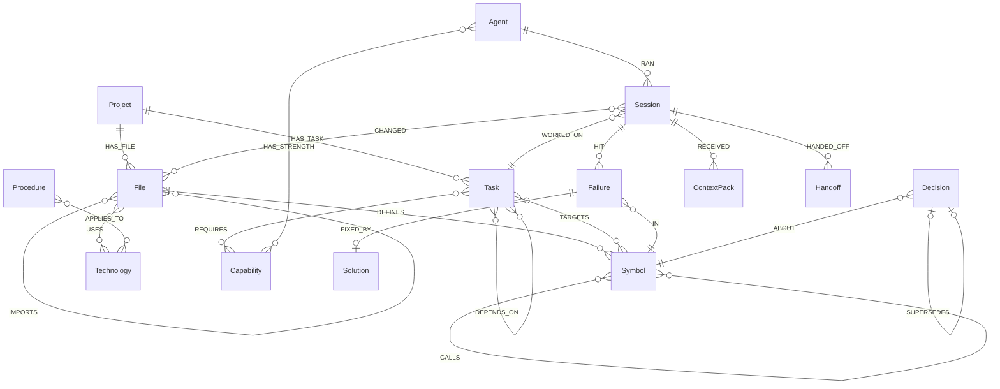
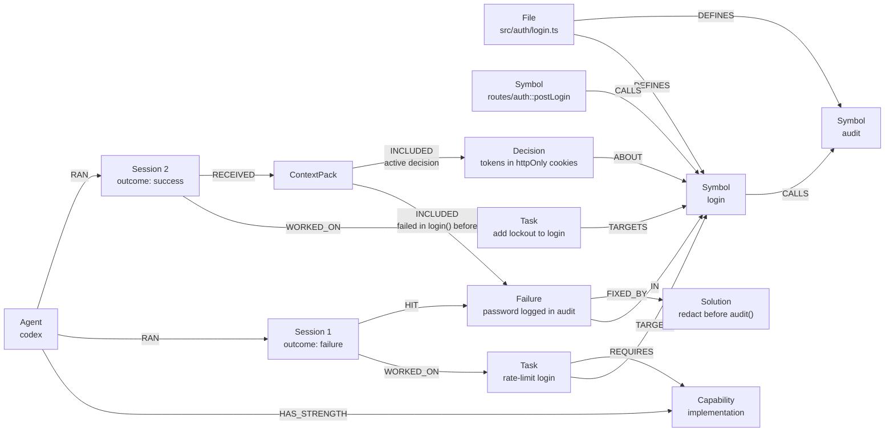

# 🕸️ Puff graph schema, database and Cypher queries

This is the reference for everything Puff stores in FalkorDB and every query it runs. If you can explain this file, you can explain Puff.

- [Database](#database)
- [Data model](#data-model)
- [Design rules](#design-rules)
- [IDs](#ids)
- [Indexes](#indexes)
- [Queries](#queries)
- [Mapping a failure to a function](#mapping-a-failure-to-a-function)
- [FalkorDB gotchas we design around](#falkordb-gotchas-we-design-around)
- [Example: the graph after the demo](#example-the-graph-after-the-demo)

---

## Database

| | |
|---|---|
| Engine | **FalkorDB**: an in-memory property graph database on the Redis protocol, queried with openCypher |
| Image | `falkordb/falkordb:latest` (port `6379` for the database, `3000` for the browser UI) |
| Client | official [`falkordb`](https://github.com/falkordb/falkordb-ts) npm package |
| Connection | `FALKORDB_URL` (default `falkor://localhost:6379`) |
| Persistence | Docker volume `falkordb-data` mounted at `/data` |

### One graph per project (tenancy)

Each project gets its own graph, named **`puff_<projectSlug>`** (for example `puff_shop_api`). Graphs in FalkorDB are fully isolated, so switching projects means switching graphs. `db.list()` shows all of them.

```ts
import { FalkorDB } from 'falkordb';

const db = await FalkorDB.connect({ url: process.env.FALKORDB_URL ?? 'falkor://localhost:6379' });
const graph = db.selectGraph(`puff_${projectSlug}`);

await graph.query('MERGE (p:Project {id: $id}) SET p.name = $name, p.repoPath = $repoPath',
  { params: { id: projectSlug, name, repoPath } });

const res = await graph.roQuery('MATCH (s:Symbol) RETURN count(s) AS n');
```

> ⚠️ A read-only query against a graph that doesn't exist yet fails with `Invalid graph operation on empty key`. Puff therefore **creates the graph (the `Project` node) and all indexes at startup**, before any reads.

### Concurrency

Several agents finish at once, so several writers hit one graph. We tested this before building on it: **4 writers × 250 writes plus 1 reader × 200 reads** completed in about 250 ms. `MERGE` produced exactly one node per key and none of the 1,000 `Failure` writes were lost. Puff keeps writes **small and append-mostly**, one event per query.

### Size

Puff stores **references, not code**: path, line range, signature and hash. The repository stays the source of truth. A 40-file demo repo is a few thousand nodes, well inside the 100 MB FalkorDB Cloud free tier.

---

## Data model

### Nodes

| Label | Key properties | Purpose |
|---|---|---|
| `Project` | `id`, `name`, `repoPath` | Root of the graph |
| `File` | `path` (unique), `hash`, `lang`, `updatedAt` | A source file. `hash` detects changes. |
| `Symbol` (+ `:Function` / `:Class` / `:Method`) | `id`, `name`, `file`, `startLine`, `endLine`, `signature`, `kind`, `pagerank?` | A code entity. **No code body is stored.** |
| `Technology` | `name` | TypeScript, Express, Vitest, Node.js… (from imports + `package.json`) |
| `Capability` | `name` | `reasoning`, `planning`, `implementation`, `verification`, `simple-edit`, `docs`, `refactor` |
| `Agent` | `name` (`claude-code` / `codex` / `opencode`), `instances` | A harness type in the pool |
| `Task` | `id`, `title`, `type`, `complexity`, `status`, `claimedBy?`, `createdAt` | A unit of work |
| `Session` | `id`, `role`, `outcome`, `tokensIn?`, `tokensOut?`, `durationMs`, `filesRead?`, `startedAt` | One agent run (**episodic memory**) |
| `Handoff` | `id`, `payload` (JSON string), `createdAt` | Structured state passed between sessions |
| `Failure` | `id`, `message`, `kind` (`test` / `type` / `lint` / `runtime` / `review`), `stale`, `embedding?` | What went wrong |
| `Solution` | `id`, `summary`, `commit?` | What fixed it |
| `Decision` | `id`, `text`, `status` (`active` / `superseded`), `stale` | Why something was chosen (**semantic memory**) |
| `Procedure` | `id`, `text` | How things are done here (**procedural memory**) |
| `ContextPack` | `id`, `createdAt`, `tokenEstimate` | Exactly what an agent was given |

### Relationships

```text
CODE
(Project)-[:HAS_FILE]->(File)
(File)-[:DEFINES]->(Symbol)
(Symbol)-[:CALLS]->(Symbol)
(File)-[:IMPORTS]->(File)
(File)-[:USES]->(Technology)

WORK
(Project)-[:HAS_TASK]->(Task)
(Task)-[:TARGETS]->(Symbol)
(Task)-[:DEPENDS_ON]->(Task)
(Task)-[:REQUIRES]->(Capability)

AGENTS
(Agent)-[:HAS_STRENGTH {declared: true}]->(Capability)
(Agent)-[:RAN]->(Session)-[:WORKED_ON]->(Task)
(Session)-[:CHANGED]->(File)
(Session)-[:HANDED_OFF]->(Handoff)-[:TO]->(Session)

MEMORY
(Session)-[:HIT]->(Failure)-[:IN]->(Symbol)        ← the link to code
(Failure)-[:FIXED_BY]->(Solution)
(Decision)-[:ABOUT]->(Symbol)
(Decision)-[:SUPERSEDES]->(Decision)
(Procedure)-[:APPLIES_TO]->(Technology)

EXPLAINABILITY
(Session)-[:RECEIVED]->(ContextPack)-[:INCLUDED {reason}]->(Failure|Decision|Procedure|Symbol|Solution)
```



### Track 02 memory types and where they live

| Memory type | Nodes |
|---|---|
| Episodic ("what happened") | `Session`, `HIT → Failure`, `CHANGED → File` |
| Semantic ("what is true") | code graph, `Technology`, `Decision` |
| Procedural ("how we do things") | `Procedure -APPLIES_TO→ Technology` |
| Shared state & handoffs | `Handoff` between sessions |
| Memory that changes over time | `stale` flags, `SUPERSEDES` chains |

---

## Design rules

1. **Memory is tied to code.** Every `Failure` and `Decision` links to a `Symbol`.
2. **Stable IDs + `MERGE`** make re-indexing idempotent.
3. **Store references, not code.** The repo is the source of truth.
4. **Never delete memory; supersede it.** History stays queryable.
5. **Invalidate on code change.** When a file's hash changes, linked memory gets `stale = true`.
6. **Record "why" when retrieving.** Every `ContextPack` item carries `INCLUDED {reason}`.
7. **Similarity finds the starting point, the graph supplies the context.** Vector lookup first, then traverse.
8. **Small, append-mostly writes**, one event per query.
9. **Puff writes facts; agents write reasoning.** Outcomes, diffs and tests come from Puff. Decisions come from agents through MCP or `<puff-report>`.

## IDs

IDs are prefixed by kind so they are readable and never collide across labels:

| Kind | Format | Example |
|---|---|---|
| Symbol | `path::name` / `path::Class.method` | `src/auth/login.ts::login` |
| Task | `task_<ulid>` | `task_01J9…` |
| Session | `ses_<ulid>` | `ses_01J9…` |
| Failure | `fail_<ulid>` | `fail_01J9…` |
| Solution | `sol_<ulid>` | |
| Decision | `dec_<ulid>` | |
| Procedure | `proc_<ulid>` | |
| ContextPack | `pack_<ulid>` | |
| Handoff | `hand_<ulid>` | |

---

## Indexes

Created at startup for every project graph.

```cypher
CREATE INDEX FOR (f:File) ON (f.path)
CREATE INDEX FOR (s:Symbol) ON (s.id)
CREATE INDEX FOR (s:Symbol) ON (s.name)
CREATE INDEX FOR (t:Task) ON (t.id)
CREATE INDEX FOR (t:Task) ON (t.status)
CREATE INDEX FOR (se:Session) ON (se.id)
CREATE INDEX FOR (a:Agent) ON (a.name)
CREATE INDEX FOR (f:Failure) ON (f.id)
CREATE INDEX FOR (d:Decision) ON (d.id)
CREATE INDEX FOR (p:Procedure) ON (p.id)
CREATE INDEX FOR (so:Solution) ON (so.id)
```

Full-text search over failure messages:

```cypher
CALL db.idx.fulltext.createNodeIndex('Failure', 'message')
```

Stretch: vector index for similar failures:

```cypher
CREATE VECTOR INDEX FOR (f:Failure) ON (f.embedding)
OPTIONS {dimension: 384, similarityFunction: 'cosine'}
```

---

## Queries

All queries use parameters (`$name`). Nothing is built by string concatenation.

| # | Purpose | Used by |
|---|---|---|
| Q1 | Index a file (symbols, calls) | indexer |
| Q2 | Mark memory stale when a file changes | indexer, after merge |
| Q3 | Build context for a task | context compiler |
| Q4 | Record a ContextPack | context compiler |
| Q5 | Why did this session get this context? | Why view, MCP `why` |
| Q6 | Impact of changing a symbol | context compiler, MCP `impact_of` |
| Q7 | Promote tasks whose dependencies are done | scheduler |
| Q8 | Overlap check | scheduler |
| Q9 | Atomic claim | scheduler |
| Q10 | Route a task to the best agent | router |
| Q11 | Record a session | orchestrator |
| Q12 | Record a failure tied to code | orchestrator, MCP |
| Q13 | Record a solution | orchestrator, MCP |
| Q14 | Supersede a decision | MCP, `<puff-report>` |
| Q15 | Handoff between sessions | MCP |
| Q16 | Graph neighbourhood for the UI | Memory graph screen |
| Q17 | Similar past failures (stretch) | context compiler |
| Q18 | PageRank on calls (stretch) | router |

### Q1: Index a file (idempotent)

`MERGE` on stable IDs means re-indexing the same file never duplicates nodes.

```cypher
MERGE (p:Project {id: $projectId})
MERGE (f:File {path: $path})
SET f.hash = $hash, f.lang = $lang, f.updatedAt = timestamp()
MERGE (p)-[:HAS_FILE]->(f)
WITH f
UNWIND $symbols AS sym
MERGE (s:Symbol {id: sym.id})
SET s.name = sym.name, s.file = $path, s.kind = sym.kind,
    s.startLine = sym.startLine, s.endLine = sym.endLine, s.signature = sym.signature
MERGE (f)-[:DEFINES]->(s)
```

Calls are written in a second pass, once every file's symbols exist:

```cypher
UNWIND $calls AS c
MATCH (a:Symbol {id: c.from}), (b:Symbol {id: c.to})
MERGE (a)-[:CALLS]->(b)
```

```cypher
UNWIND $imports AS i
MATCH (a:File {path: i.from}), (b:File {path: i.to})
MERGE (a)-[:IMPORTS]->(b)
```

### Q2: Mark memory stale when a file changes

When the hash changes, every failure and decision linked to a symbol in that file is marked stale. The context compiler then drops them, or labels them "possibly outdated" if nothing else exists.

```cypher
MATCH (f:File {path: $path}) WHERE f.hash <> $newHash
SET f.hash = $newHash, f.updatedAt = timestamp()
WITH f
MATCH (f)-[:DEFINES]->(:Symbol)<-[r:ABOUT|IN]-(m)
SET m.stale = true
RETURN count(DISTINCT m) AS flagged
```

### Q3: Build context for a task (core query)

For each symbol the task targets, this collects the callers (up to 2 hops), the failure history and the active decisions.

> **Note:** failures and their fixes are matched in **two separate** `OPTIONAL MATCH` clauses. Matching them in one clause would silently drop failures that have no fix yet, and those are the most important warnings to pass on.

```cypher
MATCH (t:Task {id: $taskId})-[:TARGETS]->(s:Symbol)
OPTIONAL MATCH (s)<-[:CALLS*1..2]-(caller:Symbol)
WITH t, s, collect(DISTINCT caller.id)[..10] AS callers
OPTIONAL MATCH (s)<-[:IN]-(f:Failure)
OPTIONAL MATCH (f)-[:FIXED_BY]->(sol:Solution)
WITH t, s, callers,
     collect(DISTINCT CASE WHEN f IS NULL THEN NULL
       ELSE {id: f.id, failure: f.message, fix: sol.summary, stale: f.stale} END)[..5] AS history
OPTIONAL MATCH (d:Decision {status: 'active'})-[:ABOUT]->(s)
RETURN s.id AS symbol, s.file AS file, s.startLine AS startLine, s.endLine AS endLine,
       callers, history,
       collect(DISTINCT CASE WHEN d IS NULL THEN NULL ELSE {id: d.id, text: d.text, stale: d.stale} END) AS decisions
```

Procedures for the technologies the targeted code uses:

```cypher
MATCH (t:Task {id: $taskId})-[:TARGETS]->(:Symbol)<-[:DEFINES]-(:File)-[:USES]->(tech:Technology)
MATCH (p:Procedure)-[:APPLIES_TO]->(tech)
RETURN DISTINCT p.id AS id, p.text AS text, tech.name AS technology
```

### Q4: Record the ContextPack (explainability)

The pack is created, then each included item is linked **per label** so the lookup uses the `id` index instead of scanning every node. The compiler groups items by kind and runs one statement per kind.

```cypher
MATCH (se:Session {id: $sessionId})
CREATE (se)-[:RECEIVED]->(:ContextPack {id: $packId, createdAt: timestamp(), tokenEstimate: $tokens})
```

```cypher
// run once per kind: Failure, Decision, Procedure, Solution, Symbol
MATCH (cp:ContextPack {id: $packId})
UNWIND $items AS item
MATCH (m:Failure {id: item.id})
CREATE (cp)-[:INCLUDED {reason: item.reason}]->(m)
```

Example reasons: `"failed in login() 2 sessions ago"`, `"caller of target: may break"`, `"active decision about Session.start"`, `"procedure for Vitest"`.

### Q5: Why did this session get this context?

```cypher
MATCH (se:Session {id: $sessionId})-[:RECEIVED]->(:ContextPack)-[r:INCLUDED]->(m)
RETURN labels(m)[0] AS kind, m.id AS id, r.reason AS reason
```

Why was this agent chosen? This returns the path from the task to the agent through the capability:

```cypher
MATCH (t:Task {id: $taskId})<-[:WORKED_ON]-(se:Session)<-[:RAN]-(a:Agent)
MATCH path = (t)-[:REQUIRES]->(:Capability)<-[:HAS_STRENGTH]-(a)
RETURN path, se.id AS sessionId
```

### Q6: Impact: what breaks if I change this?

```cypher
MATCH (s:Symbol {id: $id})<-[:CALLS*1..3]-(c:Symbol)<-[:DEFINES]-(f:File)
RETURN DISTINCT f.path AS file, collect(DISTINCT c.id) AS callers
```

### Q7: Promote tasks whose dependencies are done

A task moves from `planned` to `ready` only when **every** task it depends on is `done`. Dependencies in any other state (including `ready` and `escalated`) block it.

```cypher
MATCH (:Project {id: $projectId})-[:HAS_TASK]->(t:Task {status: 'planned'})
OPTIONAL MATCH (t)-[r:DEPENDS_ON]->(d:Task)
WITH t, count(r) AS deps, count(CASE WHEN d.status = 'done' THEN 1 END) AS doneDeps
WHERE deps = doneDeps
SET t.status = 'ready'
RETURN t.id AS id, t.title AS title
```

### Q8: Overlap check (safe to run in parallel?)

A task is blocked if any **active** task targets the same symbols, or symbols one `CALLS` hop away in either direction.

```cypher
MATCH (b:Task {id: $taskId})-[:TARGETS]->(s:Symbol)
OPTIONAL MATCH (s)-[:CALLS*0..1]-(near:Symbol)<-[r:TARGETS]-(other:Task)
WHERE other.status IN ['running', 'verifying', 'retrying'] AND other.id <> $taskId
RETURN count(r) = 0 AS safeToRun, collect(DISTINCT other.id) AS blockedBy
```

### Q9: Atomic claim

FalkorDB runs each query atomically, so two schedulers can't both claim the same task. An empty result means another one got there first.

```cypher
MATCH (t:Task {id: $taskId, status: 'ready'})
SET t.status = 'running', t.claimedBy = $sessionId, t.updatedAt = timestamp()
RETURN t.id AS id
```

### Q10: Route: best agent for this task

Candidates are agents with a declared strength that matches a capability the task requires. They are ranked by their **past success rate on that same capability**. An agent with no history scores a neutral 0.5. The orchestrator then takes the best agent with a free instance.

```cypher
MATCH (t:Task {id: $taskId})-[:REQUIRES]->(c:Capability)<-[:HAS_STRENGTH]-(a:Agent)
OPTIONAL MATCH (a)-[:RAN]->(s:Session)-[:WORKED_ON]->(:Task)-[:REQUIRES]->(c)
WITH a, collect(DISTINCT s) AS ss
WITH a, size(ss) AS runs, size([x IN ss WHERE x.outcome = 'success']) AS wins
RETURN a.name AS agent, a.instances AS instances, runs, wins,
       CASE WHEN runs = 0 THEN 0.5 ELSE toFloat(wins) / runs END AS successRate
ORDER BY successRate DESC, runs DESC
```

### Q11: Record a session outcome (written by Puff)

```cypher
MATCH (a:Agent {name: $agent}), (t:Task {id: $taskId})
CREATE (a)-[:RAN]->(se:Session {id: $sessionId, role: $role, outcome: $outcome,
        tokensIn: $tokensIn, tokensOut: $tokensOut, durationMs: $durationMs,
        filesRead: $filesRead, startedAt: $startedAt})-[:WORKED_ON]->(t)
WITH se
UNWIND $changedFiles AS p
MATCH (f:File {path: p})
MERGE (se)-[:CHANGED]->(f)
```

### Q12: Record a failure tied to code

```cypher
MATCH (se:Session {id: $sessionId}), (s:Symbol {id: $symbolId})
CREATE (se)-[:HIT]->(f:Failure {id: $failureId, message: $message, kind: $kind,
        stale: false, createdAt: timestamp()})-[:IN]->(s)
```

### Q13: Record a solution

```cypher
MATCH (f:Failure {id: $failureId})
CREATE (f)-[:FIXED_BY]->(:Solution {id: $solutionId, summary: $summary, commit: $commit,
        createdAt: timestamp()})
```

### Q14: Record or supersede a decision

New decision:

```cypher
MATCH (s:Symbol {id: $symbolId})
CREATE (:Decision {id: $id, text: $text, status: 'active', stale: false,
        createdAt: timestamp()})-[:ABOUT]->(s)
```

Supersede: the old decision is kept and marked, never deleted.

```cypher
MATCH (old:Decision {id: $oldId}), (s:Symbol {id: $symbolId})
SET old.status = 'superseded'
CREATE (new:Decision {id: $newId, text: $text, status: 'active', stale: false,
        createdAt: timestamp()})-[:SUPERSEDES]->(old),
       (new)-[:ABOUT]->(s)
```

### Q15: Handoff between sessions

```cypher
MATCH (from:Session {id: $fromSessionId})
CREATE (from)-[:HANDED_OFF]->(h:Handoff {id: $handoffId, payload: $payload, createdAt: timestamp()})
WITH h
OPTIONAL MATCH (to:Session {id: $toSessionId})
FOREACH (_ IN CASE WHEN to IS NULL THEN [] ELSE [1] END | CREATE (h)-[:TO]->(to))
```

Pending handoffs for a role are picked up by the context compiler (those without a `TO` edge yet):

```cypher
MATCH (:Task {id: $taskId})<-[:DEPENDS_ON]-(:Task)<-[:WORKED_ON]-(se:Session)-[:HANDED_OFF]->(h:Handoff)
WHERE NOT (h)-[:TO]->()
RETURN h.id AS id, h.payload AS payload
```

### Q16: Graph neighbourhood for the UI

```cypher
MATCH (n {id: $focusId})
OPTIONAL MATCH p = (n)-[*1..2]-(m)
WITH n, collect(p)[..300] AS paths
RETURN n, paths
```

### Q17 (stretch): Similar past failures

Vector lookup finds the starting point, then the graph supplies the fix and the location.

```cypher
CALL db.idx.vector.queryNodes('Failure', 'embedding', 5, vecf32($embedding)) YIELD node, score
OPTIONAL MATCH (node)-[:FIXED_BY]->(sol:Solution)
MATCH (node)-[:IN]->(s:Symbol)
RETURN node.message AS failure, sol.summary AS fix, s.id AS symbol, score
```

### Q18 (stretch): Central code via PageRank

Symbols with high centrality in the call graph are risky to change. Tasks that target the top 10% get `complexity = 'high'`, which routes them to the reasoning agent and makes review mandatory.

```cypher
CALL algo.pageRank('Symbol', 'CALLS') YIELD node, score
SET node.pagerank = score
```

> Check the exact signature at [docs.falkordb.com/algorithms](https://docs.falkordb.com/algorithms/) before relying on it.

---

## Mapping a failure to a function

The link between memory and code is only as good as this step, so here it is in full:

1. **Run the tests** in the task's worktree and capture the output (Vitest prints stack traces).
2. **Parse stack frames** (`at fn (src/auth/login.ts:31:7)`) into `(path, line)` pairs and drop frames from `node_modules` or tests.
3. **Find the innermost symbol** whose `file = path AND startLine <= line <= endLine`:

   ```cypher
   MATCH (s:Symbol {file: $path})
   WHERE s.startLine <= $line AND s.endLine >= $line
   RETURN s.id ORDER BY (s.endLine - s.startLine) ASC LIMIT 1
   ```

4. **Fallback 1:** no usable frame → use the symbols the task `TARGETS` that were in files the session `CHANGED`.
5. **Fallback 2:** the verifier agent names the symbol in `<puff-report>`.
6. Record with **Q12**. The failure message is the first assertion line, trimmed.

---

## FalkorDB gotchas we design around

| Gotcha | What we do |
|---|---|
| Read-only query on a missing graph errors | Create the graph and indexes at startup |
| An unnamed relationship in a pattern can undercount (only existence is checked) | Name relationships you count; use `collect(DISTINCT …)` |
| Indexes don't serve `<>` filters | Prefer `IN [...]`; fine at our scale |
| `LIMIT` doesn't limit eager writes | Never `CREATE … LIMIT`; filter before writing |
| Vector queries don't combine well with property filters | Vector lookup first, then filter and traverse |
| FalkorDB supports a subset of Cypher | Check [cypher-support](https://docs.falkordb.com/cypher/cypher-support.html) before using unusual clauses |

---

## Example: the graph after the demo



Session 2 never saw session 1's chat. It passed because the graph connected `login()` → the failure → its fix, and that context reached the agent.
