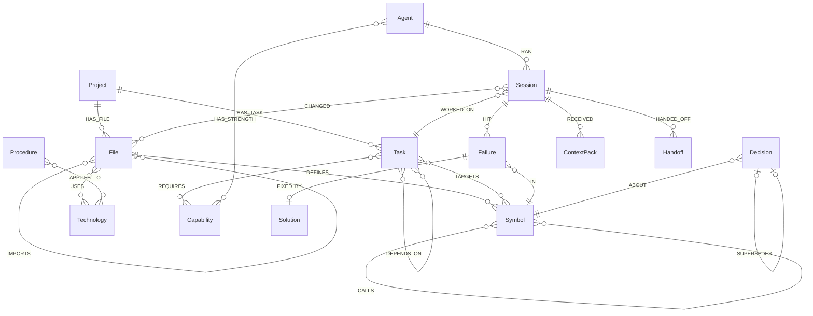
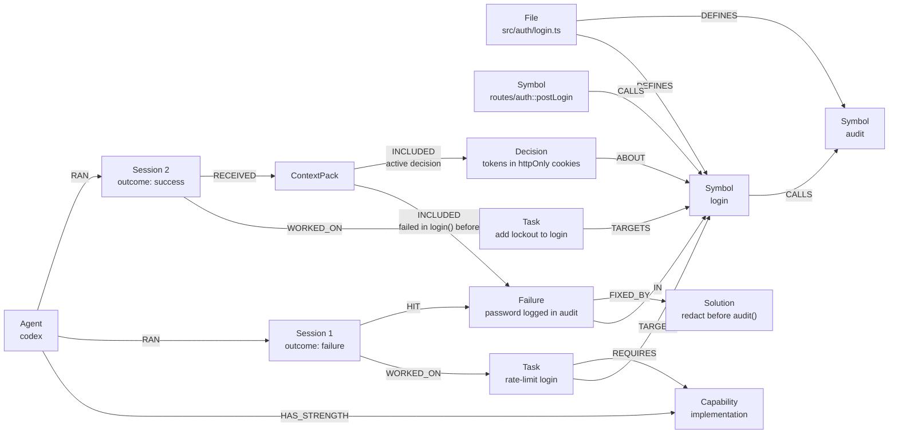

# 🕸️ Puff graph schema, database and Cypher queries

This is the reference for everything Puff stores in FalkorDB and every query it runs. If you can explain this file, you can explain Puff.

- [Database](#database)
- [Data model](#data-model)
- [Design rules](#design-rules)
- [IDs](#ids)
- [Indexes](#indexes)
- [Queries](#queries)
- [Mapping a failure to a function](#mapping-a-failure-to-a-function)
- [FalkorDB gotchas we design around](#falkordb-gotchas-we-design-around)
- [Example: the graph after the demo](#example-the-graph-after-the-demo)

---

## Database

| | |
|---|---|
| Engine | **FalkorDB**: an in-memory property graph database on the Redis protocol, queried with openCypher |
| Image | `falkordb/falkordb:latest` (port `6379` for the database, `3000` for the browser UI) |
| Client | official [`falkordb`](https://github.com/falkordb/falkordb-ts) npm package |
| Connection | `FALKORDB_URL` (default `falkor://localhost:6379`) |
| Persistence | Docker volume `falkordb-data` mounted at `/data` |

### One graph per project (tenancy)

Each project gets its own graph, named **`puff_<projectSlug>`** (for example `puff_shop_api`). Graphs in FalkorDB are fully isolated, so switching projects means switching graphs. `db.list()` shows all of them.

```ts
import { FalkorDB } from 'falkordb';

const db = await FalkorDB.connect({ url: process.env.FALKORDB_URL ?? 'falkor://localhost:6379' });
const graph = db.selectGraph(`puff_${projectSlug}`);

await graph.query('MERGE (p:Project {id: $id}) SET p.name = $name, p.repoPath = $repoPath',
  { params: { id: projectSlug, name, repoPath } });

const res = await graph.roQuery('MATCH (s:Symbol) RETURN count(s) AS n');
```

> ⚠️ A read-only query against a graph that doesn't exist yet fails with `Invalid graph operation on empty key`. Puff therefore **creates the graph (the `Project` node) and all indexes at startup**, before any reads.

### Concurrency

Several agents finish at once, so several writers hit one graph. We tested this before building on it: **4 writers × 250 writes plus 1 reader × 200 reads** completed in about 250 ms. `MERGE` produced exactly one node per key and none of the 1,000 `Failure` writes were lost. Puff keeps writes **small and append-mostly**, one event per query.

### Size

Puff stores **references, not code**: path, line range, signature and hash. The repository stays the source of truth. A 40-file demo repo is a few thousand nodes, well inside the 100 MB FalkorDB Cloud free tier.

---

## Data model

### Nodes

| Label | Key properties | Purpose |
|---|---|---|
| `Project` | `id`, `name`, `repoPath` | Root of the graph |
| `File` | `path` (unique), `hash`, `lang`, `updatedAt` | A source file. `hash` detects changes. |
| `Symbol` (+ `:Function` / `:Class` / `:Method`) | `id`, `name`, `file`, `startLine`, `endLine`, `signature`, `kind`, `pagerank?` | A code entity. **No code body is stored.** |
| `Technology` | `name` | TypeScript, Express, Vitest, Node.js… (from imports + `package.json`) |
| `Capability` | `name` | `reasoning`, `planning`, `implementation`, `verification`, `simple-edit`, `docs`, `refactor` |
| `Agent` | `name` (`claude-code` / `codex` / `opencode`), `instances` | A harness type in the pool |
| `Task` | `id`, `title`, `type`, `complexity`, `status`, `assignedAgent?`, `role?`, `worktree?`, `tokensIn?`, `tokensOut?`, `testsPassed?`, `testsTotal?`, `claimedBy?`, `createdAt`, `updatedAt` | A unit of work |
| `Session` | `id`, `role`, `outcome` (`running` / `success` / `failure` / `error`), `tokensIn?`, `tokensOut?`, `durationMs?`, `filesRead?`, `summary?`, `startedAt`, `endedAt?` | One agent run (**episodic memory**) |
| `Handoff` | `id`, `payload` (JSON string), `toRole?`, `createdAt` | Structured state passed between sessions |
| `Failure` | `id`, `message`, `kind` (`test` / `type` / `lint` / `runtime` / `review`), `stale`, `staleAt?`, `staleBecause?`, `count`, `anchoredBy`, `createdAt`, `embedding?` | What went wrong |
| `Solution` | `id`, `summary`, `commit?`, `createdAt` | What fixed it |
| `Decision` | `id`, `text`, `status` (`active` / `superseded`), `stale`, `staleAt?`, `supersededAt?`, `createdAt` | Why something was chosen (**semantic memory**) |
| `Procedure` | `id`, `text`, `createdAt` | How things are done here (**procedural memory**) |
| `ContextPack` | `id`, `role`, `tokenEstimate`, `prompt`, `createdAt` | Exactly what an agent was given, including the prompt text |

### Relationships

```text
CODE
(Project)-[:HAS_FILE]->(File)
(File)-[:DEFINES]->(Symbol)
(Symbol)-[:CALLS]->(Symbol)
(File)-[:IMPORTS]->(File)
(File)-[:USES]->(Technology)

WORK
(Project)-[:HAS_TASK]->(Task)
(Task)-[:TARGETS]->(Symbol)
(Task)-[:DEPENDS_ON]->(Task)
(Task)-[:REQUIRES]->(Capability)

AGENTS
(Agent)-[:HAS_STRENGTH {declared: true}]->(Capability)
(Agent)-[:RAN]->(Session)-[:WORKED_ON]->(Task)
(Session)-[:CHANGED]->(File)
(Session)-[:HANDED_OFF]->(Handoff)-[:TO]->(Session)

MEMORY
(Session)-[:HIT]->(Failure)-[:IN]->(Symbol)        ← the link to code
(Failure)-[:FIXED_BY]->(Solution)
(Decision)-[:ABOUT]->(Symbol)
(Decision)-[:SUPERSEDES]->(Decision)
(Procedure)-[:APPLIES_TO]->(Technology | Project)   ← a project-wide procedure points at the Project

EXPLAINABILITY
(Session)-[:RECEIVED]->(ContextPack)-[:INCLUDED {reason}]->(Failure|Decision|Procedure|Symbol|Solution)
```



### Track 02 memory types and where they live

| Memory type | Nodes |
|---|---|
| Episodic ("what happened") | `Session`, `HIT → Failure`, `CHANGED → File` |
| Semantic ("what is true") | code graph, `Technology`, `Decision` |
| Procedural ("how we do things") | `Procedure -APPLIES_TO→ Technology | Project` |
| Shared state & handoffs | `Handoff` between sessions |
| Memory that changes over time | `stale` flags, `SUPERSEDES` chains |

---

## Design rules

1. **Memory is tied to code.** Every `Failure` and `Decision` links to a `Symbol`.
2. **Stable IDs + `MERGE`** make re-indexing idempotent.
3. **Store references, not code.** The repo is the source of truth.
4. **Never delete memory; supersede it.** History stays queryable.
5. **Invalidate on code change.** When a file's hash changes, linked memory gets `stale = true`.
6. **Record "why" when retrieving.** Every `ContextPack` item carries `INCLUDED {reason}`.
7. **Similarity finds the starting point, the graph supplies the context.** Vector lookup first, then traverse.
8. **Small, append-mostly writes**, one event per query.
9. **Puff writes facts; agents write reasoning.** Outcomes, diffs and tests come from Puff. Decisions come from agents through MCP or `<puff-report>`.

## IDs

IDs are prefixed by kind so they are readable and never collide across labels:

| Kind | Format | Example |
|---|---|---|
| Symbol | `path::name` / `path::Class.method` | `src/auth/login.ts::login` |
| Task | `task_<ulid>` | `task_01J9…` |
| Session | `ses_<ulid>` | `ses_01J9…` |
| Failure | `fail_<ulid>` | `fail_01J9…` |
| Solution | `sol_<ulid>` | |
| Decision | `dec_<ulid>` | |
| Procedure | `proc_<ulid>` | |
| ContextPack | `pack_<ulid>` | |
| Handoff | `hand_<ulid>` | |

---

## Indexes

Created at startup for every project graph.

```cypher
CREATE INDEX FOR (f:File) ON (f.path)
CREATE INDEX FOR (s:Symbol) ON (s.id)
CREATE INDEX FOR (s:Symbol) ON (s.name)
CREATE INDEX FOR (t:Task) ON (t.id)
CREATE INDEX FOR (t:Task) ON (t.status)
CREATE INDEX FOR (se:Session) ON (se.id)
CREATE INDEX FOR (a:Agent) ON (a.name)
CREATE INDEX FOR (f:Failure) ON (f.id)
CREATE INDEX FOR (d:Decision) ON (d.id)
CREATE INDEX FOR (p:Procedure) ON (p.id)
CREATE INDEX FOR (so:Solution) ON (so.id)
```

Full-text search over failure messages:

```cypher
CALL db.idx.fulltext.createNodeIndex('Failure', 'message')
```

Stretch: vector index for similar failures:

```cypher
CREATE VECTOR INDEX FOR (f:Failure) ON (f.embedding)
OPTIONS {dimension: 384, similarityFunction: 'cosine'}
```

---

## Queries

All queries use parameters (`$name`). Nothing is built by string concatenation.

| # | Purpose | Used by |
|---|---|---|
| Q1 | Index a file (symbols, calls) | indexer |
| Q2 | Mark memory stale when a file changes | indexer, after merge |
| Q3 | Build context for a task | context compiler |
| Q4 | Record a ContextPack | context compiler |
| Q5 | Why did this session get this context? | Why view, MCP `why` |
| Q6 | Impact of changing a symbol | context compiler, MCP `impact_of` |
| Q7 | Promote tasks whose dependencies are done | scheduler |
| Q8 | Overlap check | scheduler |
| Q9 | Atomic claim | scheduler |
| Q10 | Route a task to the best agent | router |
| Q11 | Start and finish a session | orchestrator |
| Q12 | Record a failure tied to code | orchestrator, MCP |
| Q13 | Record a solution | orchestrator, MCP |
| Q14 | Supersede a decision | MCP, `<puff-report>` |
| Q15 | Handoff between sessions | MCP |
| Q16 | Graph and memory feed for the UI | Memory graph screen |
| Q17 | Similar past failures (stretch) | context compiler |
| Q18 | PageRank on calls (stretch) | router |

### Q1: Index a file (idempotent)

`MERGE` on stable IDs means re-indexing the same file never duplicates nodes.

```cypher
MERGE (p:Project {id: $projectId})
MERGE (f:File {path: $path})
SET f.hash = $hash, f.lang = $lang, f.updatedAt = timestamp()
MERGE (p)-[:HAS_FILE]->(f)
WITH f
UNWIND $symbols AS sym
MERGE (s:Symbol {id: sym.id})
SET s.name = sym.name, s.file = $path, s.kind = sym.kind,
    s.startLine = sym.startLine, s.endLine = sym.endLine, s.signature = sym.signature
MERGE (f)-[:DEFINES]->(s)
```

Calls are written in a second pass, once every file's symbols exist:

```cypher
UNWIND $calls AS c
MATCH (a:Symbol {id: c.from}), (b:Symbol {id: c.to})
MERGE (a)-[:CALLS]->(b)
```

```cypher
UNWIND $imports AS i
MATCH (a:File {path: i.from}), (b:File {path: i.to})
MERGE (a)-[:IMPORTS]->(b)
```

### Q2: Mark memory stale when a file changes

When a file's hash changes (or the file disappears), every failure and decision anchored to a symbol in it is marked stale, with the time and the file that caused it. This runs **before** the new hash is written. The context compiler then drops stale memory, or labels it "possibly outdated" if nothing fresher exists.

```cypher
UNWIND $files AS file
MATCH (f:File {path: file.path})
WHERE f.hash <> file.hash
MATCH (f)-[:DEFINES]->(:Symbol)<-[:ABOUT|IN]-(m)
WHERE coalesce(m.stale, false) = false
SET m.stale = true, m.staleAt = timestamp(), m.staleBecause = file.path
RETURN count(DISTINCT m) AS flagged
```

Stale memory is revived when it proves itself again: the same failure recurring on the same symbol (Q12) or a fix being recorded for it (Q13) sets `stale = false`.

### Q3: Build context for a task (core queries)

The context compiler asks the graph a handful of small questions instead of one large query. Each is easy to explain, each starts from an indexed `id`, and none can silently drop a row because of a missing optional match.

**3a. Where the task sits in the call graph.** The targets themselves, the symbols that call them, and the symbols they call:

```cypher
MATCH (:Task {id: $id})-[:TARGETS]->(s:Symbol)
RETURN s.id AS target, s.id AS near, 'self' AS rel
UNION
MATCH (:Task {id: $id})-[:TARGETS]->(s:Symbol)<-[:CALLS]-(n:Symbol)
WHERE coalesce(n.removed, false) = false
RETURN s.id AS target, n.id AS near, 'caller' AS rel
UNION
MATCH (:Task {id: $id})-[:TARGETS]->(s:Symbol)-[:CALLS]->(n:Symbol)
WHERE coalesce(n.removed, false) = false
RETURN s.id AS target, n.id AS near, 'callee' AS rel
```

Callers that may break (up to 2 hops, capped at 12):

```cypher
MATCH (:Task {id: $id})-[:TARGETS]->(s:Symbol)<-[:CALLS*1..2]-(c:Symbol)
WHERE coalesce(c.removed, false) = false
RETURN DISTINCT c.id AS id, s.id AS of ORDER BY id LIMIT 12
```

**3b. Failures on or next to those symbols, with their fixes.** The solution is its own `OPTIONAL MATCH`, so a failure with **no fix yet** is still returned. Those are the most important warnings to pass on.

```cypher
MATCH (f:Failure)-[:IN]->(s:Symbol) WHERE s.id IN $ids
OPTIONAL MATCH (f)-[:FIXED_BY]->(sol:Solution)
RETURN f.id AS id, f.message AS message, coalesce(f.stale, false) AS stale,
       coalesce(f.count, 1) AS count, f.createdAt AS at, s.id AS symbol,
       sol.id AS solId, sol.summary AS fix, sol.createdAt AS solAt
ORDER BY f.createdAt DESC
```

**3c. Active decisions about those symbols** (superseded ones are never sent):

```cypher
MATCH (d:Decision {status: 'active'})-[:ABOUT]->(s:Symbol) WHERE s.id IN $ids
RETURN d.id AS id, d.text AS text, coalesce(d.stale, false) AS stale, d.createdAt AS at,
       collect(s.id) AS symbols
ORDER BY at DESC
```

**3d. Procedures.** Project-wide ones always apply; technology ones apply when the target code uses that technology:

```cypher
MATCH (s:Symbol)<-[:DEFINES]-(:File)-[:USES]->(t:Technology) WHERE s.id IN $ids
RETURN DISTINCT t.name AS name
```

```cypher
MATCH (p:Procedure)-[:APPLIES_TO]->(:Project) RETURN p.id AS id, p.text AS text
```

```cypher
MATCH (p:Procedure)-[:APPLIES_TO]->(t:Technology) WHERE t.name IN $techs
RETURN p.id AS id, p.text AS text, t.name AS tech
```

**3e. Handoffs waiting for this task**: from earlier sessions on the same task (a retry) and from sessions on tasks it depends on. A handoff stops being pending once a context pack delivers it (a `TO` edge to the receiving session).

```cypher
MATCH (:Task {id: $taskId})-[:DEPENDS_ON]->(:Task)<-[:WORKED_ON]-(se:Session)-[:HANDED_OFF]->(h:Handoff)
WHERE NOT (h)-[:TO]->()
MATCH (a:Agent)-[:RAN]->(se)
RETURN h.id AS id, h.payload AS payload, h.toRole AS toRole, a.name AS agent, se.role AS role
```

**Role policy.** What each role is given:

| Role | Callers | Failures | Decisions | Procedures | Handoffs |
|---|---|---|---|---|---|
| planner | – | recent, project-wide (top 25 rows) | recent, project-wide (top 5) | ✅ | ✅ |
| coder | ✅ | on or next to targets | on or next to targets | ✅ | ✅ |
| verifier | – | on or next to targets | on or next to targets | ✅ | – |
| chore | – | – | on or next to targets | ✅ | – |

**Ranking and budget.** Items are ranked, then added in order while the prompt stays inside the token budget (default 2,000, `limits.contextTokenBudget`). Whatever does not fit is counted in `dropped`.

| Rank | Item |
|---|---|
| 10 | Unresolved failure on a target (no fix recorded yet) |
| 20 | Fixed failure on a target (the failure and its fix are one bundle) |
| 30 | Handoff |
| 40 | Decision on a target |
| 50 / 55 | Unresolved / fixed failure on a caller or callee |
| 60 | Decision on a caller or callee |
| 70 | Procedure |

**Staleness.** Stale failures and decisions are dropped as long as any fresh failure or decision exists. If everything is stale, they are kept and labelled *"possibly outdated: the code changed since this was recorded"*.

### Q4: Record the ContextPack (explainability)

The pack stores the exact prompt that was sent, the role, and a token estimate. Each included item is linked **per label** (a closed set, never taken from input) so the lookup uses the `id` index. `ord` keeps the ranking order, `stale` records whether the item was labelled outdated, and `reason` says why it is there.

```cypher
MATCH (se:Session {id: $sid})
CREATE (se)-[:RECEIVED]->(:ContextPack {id: $id, role: $role, tokenEstimate: $tokens,
                                        prompt: $prompt, createdAt: timestamp()})
```

```cypher
// once per kind: Failure, Solution, Decision, Procedure, Symbol, Handoff
MATCH (cp:ContextPack {id: $id})
UNWIND $items AS item
MATCH (m:Failure {id: item.id})
CREATE (cp)-[:INCLUDED {reason: item.reason, stale: item.stale, ord: item.ord}]->(m)
```

```cypher
// delivered handoffs are no longer pending
MATCH (se:Session {id: $sid}) UNWIND $ids AS hid MATCH (h:Handoff {id: hid}) MERGE (h)-[:TO]->(se)
```

Example reasons, as stored:

- `failed in checkUser(), which the target login() calls`
- `fix for: login > never writes a password to the logs: …`
- `calls login(): may break if it changes`
- `active decision about Session.start(), which the target login() calls`
- `project-wide procedure`

### Q5: Why did this session get this context?

What a session was given, in ranked order:

```cypher
MATCH (:Session {id: $sid})-[:RECEIVED]->(p:ContextPack)
RETURN p.id AS id, p.tokenEstimate AS tokens, p.prompt AS prompt ORDER BY p.createdAt DESC LIMIT 1
```

```cypher
MATCH (:ContextPack {id: $id})-[r:INCLUDED]->(m)
RETURN labels(m)[0] AS kind, properties(m) AS props, coalesce(r.reason, '') AS reason,
       coalesce(r.stale, false) AS stale, coalesce(r.ord, 0) AS ord
ORDER BY ord
```

Why was this agent chosen? Which declared strength matched, and how that agent did on the same capability before:

```cypher
MATCH (:Task {id: $id})-[:REQUIRES]->(c:Capability)<-[:HAS_STRENGTH]-(a:Agent {name: $agent})
OPTIONAL MATCH (a)-[:RAN]->(s:Session)-[:WORKED_ON]->(:Task)-[:REQUIRES]->(c)
WHERE s.outcome IN ['success', 'failure', 'error'] AND s.id <> $sid
WITH c, collect(DISTINCT s) AS ss
RETURN c.name AS cap, size(ss) AS runs, size([x IN ss WHERE x.outcome = 'success']) AS wins
```

And where each included memory is anchored, so the path from a lesson back to the code is visible:

```cypher
MATCH (m)-[r:IN|ABOUT]->(s:Symbol) WHERE m.id IN $ids
RETURN m.id AS id, labels(m)[0] AS kind, s.id AS symbol, s.name AS name, type(r) AS rel
```

The desktop app's **Why?** tab renders these as a list of `Node -[TYPE]-> Node` rows, with the reason shown on each `INCLUDED` edge. `npm run puff -- why <taskId>` prints the same.

### Q6: Impact: what breaks if I change this?

```cypher
MATCH (s:Symbol {id: $id})<-[:CALLS*1..3]-(c:Symbol)<-[:DEFINES]-(f:File)
RETURN DISTINCT f.path AS file, collect(DISTINCT c.id) AS callers
```

### Q7: Promote tasks whose dependencies are done

A task moves from `planned` to `ready` only when **every** task it depends on is `done`. Dependencies in any other state (including `ready` and `escalated`) block it.

```cypher
MATCH (:Project {id: $projectId})-[:HAS_TASK]->(t:Task {status: 'planned'})
OPTIONAL MATCH (t)-[r:DEPENDS_ON]->(d:Task)
WITH t, count(r) AS deps, count(CASE WHEN d.status = 'done' THEN 1 END) AS doneDeps
WHERE deps = doneDeps
SET t.status = 'ready'
RETURN t.id AS id, t.title AS title
```

### Q8: Overlap check (safe to run in parallel?)

A task is blocked if any **active** task targets the same symbols, or symbols one `CALLS` hop away in either direction.

```cypher
MATCH (b:Task {id: $taskId})-[:TARGETS]->(s:Symbol)
OPTIONAL MATCH (s)-[:CALLS*0..1]-(near:Symbol)<-[r:TARGETS]-(other:Task)
WHERE other.status IN ['running', 'verifying', 'retrying'] AND other.id <> $taskId
RETURN count(r) = 0 AS safeToRun, collect(DISTINCT other.id) AS blockedBy
```

### Q9: Atomic claim

FalkorDB runs each query atomically, so two schedulers can't both claim the same task. An empty result means another one got there first.

```cypher
MATCH (t:Task {id: $taskId, status: 'ready'})
SET t.status = 'running', t.claimedBy = $sessionId, t.updatedAt = timestamp()
RETURN t.id AS id
```

### Q10: Route: best agent for this task

Candidates are agents with a declared strength that matches a capability the task requires. They are ranked by their **past success rate on that same capability**. An agent with no history scores a neutral 0.5. The orchestrator then takes the best agent with a free instance.

```cypher
MATCH (t:Task {id: $taskId})-[:REQUIRES]->(c:Capability)<-[:HAS_STRENGTH]-(a:Agent)
OPTIONAL MATCH (a)-[:RAN]->(s:Session)-[:WORKED_ON]->(:Task)-[:REQUIRES]->(c)
WITH a, collect(DISTINCT s) AS ss
WITH a, size(ss) AS runs, size([x IN ss WHERE x.outcome = 'success']) AS wins
RETURN a.name AS agent, a.instances AS instances, runs, wins,
       CASE WHEN runs = 0 THEN 0.5 ELSE toFloat(wins) / runs END AS successRate
ORDER BY successRate DESC, runs DESC
```

### Q11: Record a session (written by Puff)

A session is started when the run begins, so the context pack can hang off it, and finished with what Puff observed. Facts only: outcome, tokens, duration, files.

```cypher
MATCH (a:Agent {name: $agent}), (t:Task {id: $taskId})
CREATE (a)-[:RAN]->(se:Session {id: $id, role: $role, outcome: 'running', startedAt: timestamp()})
       -[:WORKED_ON]->(t)
RETURN se.id AS id
```

```cypher
MATCH (se:Session {id: $id})
SET se.outcome = $outcome, se.tokensIn = $tokensIn, se.tokensOut = $tokensOut,
    se.durationMs = $durationMs, se.filesRead = $filesRead, se.summary = $summary,
    se.endedAt = timestamp()
RETURN se.id AS id
```

```cypher
MATCH (se:Session {id: $id}) UNWIND $files AS p MATCH (f:File {path: p}) MERGE (se)-[:CHANGED]->(f)
```

### Q12: Record a failure tied to code

A failure must be anchored to at least one symbol that exists in the graph; otherwise nothing is recorded. The message is sanitised first: first line only, ANSI stripped, values of sensitive keys (`password`, `token`, `secret`, …) and bearer tokens redacted, capped at 300 characters. Test output often prints the received value on later lines, and those are never stored.

**A repeat is counted, not duplicated.** If the same message already exists on the same primary symbol, the new session is linked to it, `count` goes up, and it is revived if it had gone stale. This count is what the benchmark's *repeated-mistake rate* is built on.

```cypher
MATCH (f:Failure {message: $message})-[:IN]->(s:Symbol {id: $primary})
RETURN f.id AS id ORDER BY f.createdAt DESC LIMIT 1
```

```cypher
// already known: link, count, revive
MATCH (se:Session {id: $sessionId}), (f:Failure {id: $id})
MERGE (se)-[:HIT]->(f)
SET f.count = coalesce(f.count, 1) + 1, f.stale = false, f.lastSeenAt = timestamp()
```

```cypher
// new
MATCH (se:Session {id: $sessionId})
CREATE (se)-[:HIT]->(f:Failure {id: $id, message: $message, kind: $kind, stale: false, count: 1,
                                anchoredBy: $anchoredBy, createdAt: timestamp()})
RETURN f.id AS id
```

```cypher
MATCH (f:Failure {id: $id}) UNWIND $symbols AS sid MATCH (s:Symbol {id: sid}) MERGE (f)-[:IN]->(s)
```

`anchoredBy` records how the failure was tied to code: `stack`, `diff`, `changed-target`, `target` or `manual` (see [Mapping a failure to a function](#mapping-a-failure-to-a-function)). When the failure comes from test output, the stored message is `<test name>: <headline>`, because the human-written test name ("never writes a password to the logs") says what the code must do.

### Q13: Record a solution

```cypher
MATCH (f:Failure {id: $failureId})
CREATE (f)-[:FIXED_BY]->(s:Solution {id: $id, summary: $summary, commit: $commit, createdAt: timestamp()})
SET f.stale = false
RETURN s.id AS id
```

### Q14: Record or supersede a decision

A decision must be about at least one existing symbol. When superseding, the old decision must be `active`, and the new one inherits its symbols unless others are given.

```cypher
CREATE (:Decision {id: $id, text: $text, status: 'active', stale: false, createdAt: timestamp()})
```

```cypher
MATCH (d:Decision {id: $id}) UNWIND $symbols AS sid MATCH (s:Symbol {id: sid}) MERGE (d)-[:ABOUT]->(s)
```

Supersede: the old decision is kept and marked, never deleted.

```cypher
MATCH (n:Decision {id: $id}), (o:Decision {id: $old})
SET o.status = 'superseded', o.supersededAt = timestamp()
MERGE (n)-[:SUPERSEDES]->(o)
```

### Q15: Handoff between sessions

```cypher
MATCH (se:Session {id: $from})
CREATE (se)-[:HANDED_OFF]->(h:Handoff {id: $id, payload: $payload, toRole: $toRole, createdAt: timestamp()})
RETURN h.id AS id
```

Pending handoffs are found by the context compiler (query 3e above). Delivery is recorded by the pack (`(h)-[:TO]->(session)`), so a handoff is delivered once.

### Q16: Graph for the UI

The desktop app draws the project graph from two queries; the 2-hop neighbourhood view is computed in memory from the result. Bookkeeping nodes (`Project`, `ContextPack`) and removed code are left out.

```cypher
MATCH (n)
WHERE NOT labels(n)[0] IN $hidden AND coalesce(n.removed, false) = false
RETURN labels(n)[0] AS label, coalesce(n.id, n.path, n.name) AS key, properties(n) AS props
```

```cypher
MATCH (a)-[r]->(b)
WHERE NOT type(r) IN $hiddenEdges
  AND NOT labels(a)[0] IN $hidden AND NOT labels(b)[0] IN $hidden
  AND coalesce(a.removed, false) = false AND coalesce(b.removed, false) = false
RETURN labels(a)[0] AS al, coalesce(a.id, a.path, a.name) AS ak, type(r) AS type,
       labels(b)[0] AS bl, coalesce(b.id, b.path, b.name) AS bk
```

The memory feed is derived the same way, from timestamps on the memory nodes themselves (`createdAt`, `staleAt`), so there is no second copy of events to keep in sync.

### Q17 (stretch): Similar past failures

Vector lookup finds the starting point, then the graph supplies the fix and the location.

```cypher
CALL db.idx.vector.queryNodes('Failure', 'embedding', 5, vecf32($embedding)) YIELD node, score
OPTIONAL MATCH (node)-[:FIXED_BY]->(sol:Solution)
MATCH (node)-[:IN]->(s:Symbol)
RETURN node.message AS failure, sol.summary AS fix, s.id AS symbol, score
```

### Q18 (stretch): Central code via PageRank

Symbols with high centrality in the call graph are risky to change. Tasks that target the top 10% get `complexity = 'high'`, which routes them to the reasoning agent and makes review mandatory.

```cypher
CALL algo.pageRank('Symbol', 'CALLS') YIELD node, score
SET node.pagerank = score
```

> Check the exact signature at [docs.falkordb.com/algorithms](https://docs.falkordb.com/algorithms/) before relying on it.

---

## Mapping a failure to a function

The link between memory and code is only as good as this step, so it is deliberately conservative and explainable: every answer says which strategy produced it (`anchoredBy` on the `Failure`).

**Why a stack trace alone is not enough.** We ran the demo repo's tests with the "never log passwords" trap broken and captured the real Vitest output (`packages/core/test/fixtures/`). The only stack frame was `test/auth.spec.ts:27`, in the **test**. The code that caused the failure, `checkUser()` in `login.ts`, appears nowhere in the trace. Assertion failures are the common case, so the locator has fallbacks.

Strategies, best first. The first one that produces a symbol that exists in the graph wins:

| # | Strategy (`anchoredBy`) | How | Typical case |
|---|---|---|---|
| 1 | `stack` | The first non-test, non-`node_modules` frame in the stack, mapped to the innermost symbol containing that line. If a later frame is a task target, it is added as a second anchor. | Runtime errors (`throw`, `TypeError`) |
| 2 | `diff` | Symbols whose lines the agent's diff touched (added lines, and the spot where lines were removed). Task targets are preferred over other touched symbols. | Assertion failures: the stack only shows the test |
| 3 | `changed-target` | Task targets that live in files the session changed | No diff available |
| 4 | `target` | The task's own targets | Last resort |

If none of them yields an existing symbol, **nothing is recorded**. Floating memory is worse than none.

**Resolve lines against the worktree, not the graph.** Failures come from the worktree an agent edited, and its edits shift line numbers. Mapping a line against the graph's last-indexed ranges would anchor to the wrong function. The locator parses the files in the worktree with tree-sitter at the moment of the failure, derives the same `path::name` ids, and then checks that the id exists in the graph. A function the agent just invented does not exist in the graph yet, so it cannot be an anchor.

**Parsing test output.** Vitest (`FAIL file > test name`, `❯ fn path:line:col`) and Jest (`● suite › test`, `at fn (path:line:col)`) are both read; Windows paths and `file://` URLs are normalised to repo-relative POSIX paths. At most 10 failures are recorded per run so a broken build does not flood memory.

The code is in `packages/core/src/memory/locate.ts` (strategies) and `failures.ts` (from test output to recorded failures). It is tested against the two real captured outputs, one with a source frame and one without.

---

## FalkorDB gotchas we design around

| Gotcha | What we do |
|---|---|
| Read-only query on a missing graph errors | Create the graph and indexes at startup |
| An unnamed relationship in a pattern can undercount (only existence is checked) | Name relationships you count; use `collect(DISTINCT …)` |
| Indexes don't serve `<>` filters | Prefer `IN [...]`; fine at our scale |
| `LIMIT` doesn't limit eager writes | Never `CREATE … LIMIT`; filter before writing |
| Vector queries don't combine well with property filters | Vector lookup first, then filter and traverse |
| A string concatenation that contains an aggregate (`'x' + toString(count(r))`) returns **null** | Return the parts as separate columns and build the string in TypeScript |
| `ORDER BY` cannot reference a node you only projected as a map (`RETURN properties(t) … ORDER BY t.createdAt`) | Also return the sort key as its own column |
| A query parameter that is `undefined` throws in the client | Convert optional values to `null` (`input.at ?? null`) and use `coalesce($at, timestamp())` |
| FalkorDB supports a subset of Cypher | Check [cypher-support](https://docs.falkordb.com/cypher/cypher-support.html) before using unusual clauses |

---

## Example: the graph after the demo



Session 2 never saw session 1's chat. It passed because the graph connected `login()` → the failure → its fix, and that context reached the agent.
