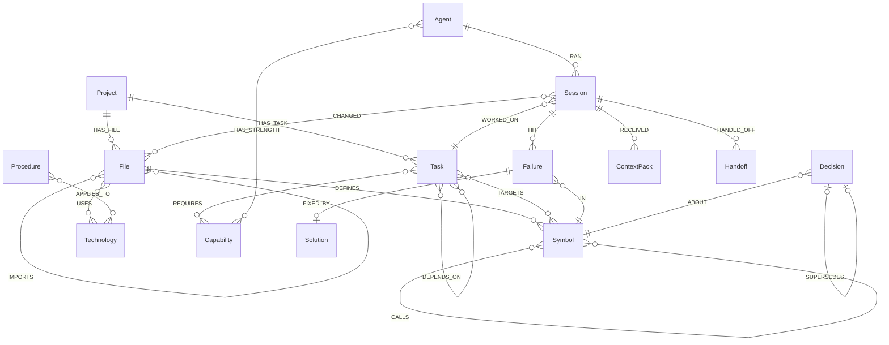
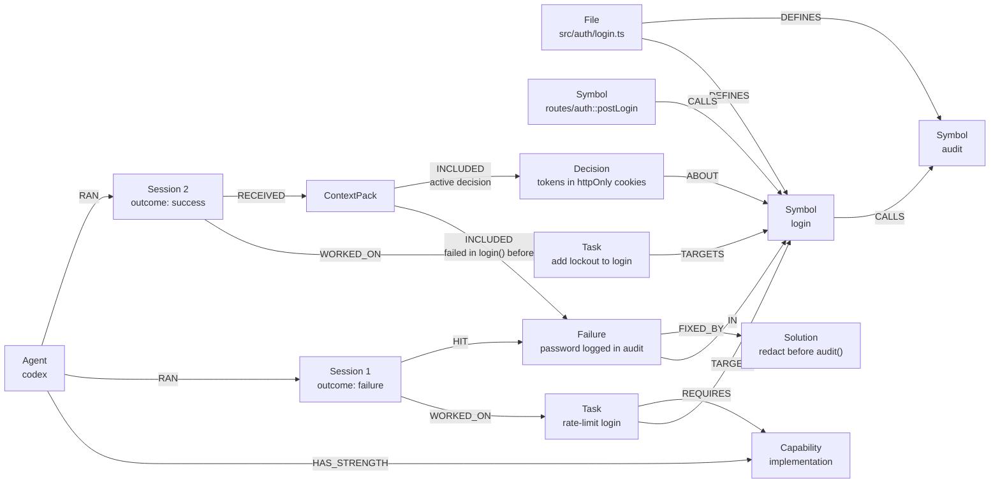

# 🕸️ Puff graph schema, database and Cypher queries

This is the reference for everything Puff stores in FalkorDB and every query it runs. If you can explain this file, you can explain Puff.

- [Database](#database)
- [Data model](#data-model)
- [Design rules](#design-rules)
- [IDs](#ids)
- [Indexes](#indexes)
- [Queries](#queries)
- [Mapping a failure to a function](#mapping-a-failure-to-a-function)
- [FalkorDB gotchas we design around](#falkordb-gotchas-we-design-around)
- [Example: the graph after the demo](#example-the-graph-after-the-demo)

---

## Database

| | |
|---|---|
| Engine | **FalkorDB**: an in-memory property graph database on the Redis protocol, queried with openCypher |
| Image | `falkordb/falkordb:latest` (port `6379` for the database, `3000` for the browser UI) |
| Client | official [`falkordb`](https://github.com/falkordb/falkordb-ts) npm package |
| Connection | `FALKORDB_URL` (default `falkor://localhost:6379`) |
| Persistence | Docker volume `falkordb-data` mounted at `/data` |

### One graph per project (tenancy)

Each project gets its own graph, named **`puff_<projectSlug>`** (for example `puff_shop_api`). Graphs in FalkorDB are fully isolated, so switching projects means switching graphs. `db.list()` shows all of them.

```ts
import { FalkorDB } from 'falkordb';

const db = await FalkorDB.connect({ url: process.env.FALKORDB_URL ?? 'falkor://localhost:6379' });
const graph = db.selectGraph(`puff_${projectSlug}`);

await graph.query('MERGE (p:Project {id: $id}) SET p.name = $name, p.repoPath = $repoPath',
  { params: { id: projectSlug, name, repoPath } });

const res = await graph.roQuery('MATCH (s:Symbol) RETURN count(s) AS n');
```

> ⚠️ A read-only query against a graph that doesn't exist yet fails with `Invalid graph operation on empty key`. Puff therefore **creates the graph (the `Project` node) and all indexes at startup**, before any reads.

### Concurrency

Several agents finish at once, so several writers hit one graph. We tested this before building on it: **4 writers × 250 writes plus 1 reader × 200 reads** completed in about 250 ms. `MERGE` produced exactly one node per key and none of the 1,000 `Failure` writes were lost. Puff keeps writes **small and append-mostly**, one event per query.

### Size

Puff stores **references, not code**: path, line range, signature and hash. The repository stays the source of truth. A 40-file demo repo is a few thousand nodes, well inside the 100 MB FalkorDB Cloud free tier.

---

## Data model

### Nodes

| Label | Key properties | Purpose |
|---|---|---|
| `Project` | `id`, `name`, `repoPath` | Root of the graph |
| `File` | `path` (unique), `hash`, `lang`, `updatedAt` | A source file. `hash` detects changes. |
| `Symbol` (+ `:Function` / `:Class` / `:Method`) | `id`, `name`, `file`, `startLine`, `endLine`, `signature`, `bodyHash`, `kind`, `pagerank?` | A code entity. **No code body is stored.** |
| `Technology` | `name` | TypeScript, Express, Vitest, Node.js… (from imports + `package.json`) |
| `Capability` | `name` | `reasoning`, `planning`, `implementation`, `verification`, `simple-edit`, `docs`, `refactor` |
| `Agent` | `name` (`claude-code` / `codex` / `opencode`), `instances` | A harness type in the pool |
| `Task` | `id`, `title`, `type`, `complexity`, `status`, `assignedAgent?`, `role?`, `worktree?`, `preferredAgent?`, `model?`, `depth`, `hints?`, `blockedBy?`, `tokensIn?`, `tokensOut?`, `testsPassed?`, `testsTotal?`, `claimedBy?`, `createdAt`, `updatedAt` | A unit of work. `depth` is how many agent-created steps sit between a person and the task; `hints` are names a plan gave that are not in the graph yet; `blockedBy` is set while it waits on overlapping tasks |
| `Session` | `id`, `role`, `outcome` (`running` / `success` / `failure` / `error`), `tokensIn?`, `tokensOut?`, `durationMs?`, `filesRead?`, `summary?`, `startedAt`, `endedAt?` | One agent run (**episodic memory**) |
| `Handoff` | `id`, `payload` (JSON string), `toRole?`, `createdAt` | Structured state passed between sessions |
| `Failure` | `id`, `message`, `kind` (`test` / `type` / `lint` / `runtime` / `review`), `stale`, `staleAt?`, `staleBecause?`, `count`, `anchoredBy`, `createdAt`, `embedding?` | What went wrong |
| `Solution` | `id`, `summary`, `commit?`, `createdAt` | What fixed it |
| `Decision` | `id`, `text`, `status` (`active` / `superseded`), `stale`, `staleAt?`, `supersededAt?`, `createdAt` | Why something was chosen (**semantic memory**) |
| `Procedure` | `id`, `text`, `createdAt` | How things are done here (**procedural memory**) |
| `ContextPack` | `id`, `role`, `tokenEstimate`, `prompt`, `createdAt` | Exactly what an agent was given, including the prompt text |

### Relationships

```text
CODE
(Project)-[:HAS_FILE]->(File)
(File)-[:DEFINES]->(Symbol)
(Symbol)-[:CALLS]->(Symbol)
(File)-[:IMPORTS]->(File)
(File)-[:USES]->(Technology)

WORK
(Project)-[:HAS_TASK]->(Task)
(Task)-[:TARGETS]->(Symbol)
(Task)-[:DEPENDS_ON]->(Task)
(Task)-[:REQUIRES]->(Capability)
(Session)-[:SPAWNED]->(Task)               ← which session asked for this task (a plan, or a follow-up request)

AGENTS
(Agent)-[:HAS_STRENGTH {declared: true}]->(Capability)
(Agent)-[:RAN]->(Session)-[:WORKED_ON]->(Task)
(Session)-[:CHANGED]->(File)
(Session)-[:HANDED_OFF]->(Handoff)-[:TO]->(Session)

MEMORY
(Session)-[:HIT]->(Failure)-[:IN]->(Symbol)        ← the link to code
(Failure)-[:FIXED_BY]->(Solution)
(Decision)-[:ABOUT]->(Symbol)
(Decision)-[:SUPERSEDES]->(Decision)
(Procedure)-[:APPLIES_TO]->(Technology | Project)   ← a project-wide procedure points at the Project

EXPLAINABILITY
(Session)-[:RECEIVED]->(ContextPack)-[:INCLUDED {reason}]->(Failure|Decision|Procedure|Symbol|Solution)
```



### Track 02 memory types and where they live

| Memory type | Nodes |
|---|---|
| Episodic ("what happened") | `Session`, `HIT → Failure`, `CHANGED → File` |
| Semantic ("what is true") | code graph, `Technology`, `Decision` |
| Procedural ("how we do things") | `Procedure -APPLIES_TO→ Technology | Project` |
| Shared state & handoffs | `Handoff` between sessions |
| Memory that changes over time | `stale` flags, `SUPERSEDES` chains |

---

## Design rules

1. **Memory is tied to code.** Every `Failure` and `Decision` links to a `Symbol`.
2. **Stable IDs + `MERGE`** make re-indexing idempotent.
3. **Store references, not code.** The repo is the source of truth.
4. **Never delete memory; supersede it.** History stays queryable.
5. **Invalidate on code change.** When a symbol's own code changes (or it is deleted), memory linked to it gets `stale = true`.
6. **Record "why" when retrieving.** Every `ContextPack` item carries `INCLUDED {reason}`.
7. **Similarity finds the starting point, the graph supplies the context.** Vector lookup first, then traverse.
8. **Small, append-mostly writes**, one event per query.
9. **Puff writes facts; agents write reasoning.** Outcomes, diffs and tests come from Puff. Decisions come from agents through MCP or `<puff-report>`.

## IDs

IDs are prefixed by kind so they are readable and never collide across labels:

| Kind | Format | Example |
|---|---|---|
| Symbol | `path::name` / `path::Class.method` | `src/auth/login.ts::login` |
| Task | `task_<ulid>` | `task_01J9…` |
| Session | `ses_<ulid>` | `ses_01J9…` |
| Failure | `fail_<ulid>` | `fail_01J9…` |
| Solution | `sol_<ulid>` | |
| Decision | `dec_<ulid>` | |
| Procedure | `proc_<ulid>` | |
| ContextPack | `pack_<ulid>` | |
| Handoff | `hand_<ulid>` | |

---

## Indexes

Created at startup for every project graph.

```cypher
CREATE INDEX FOR (f:File) ON (f.path)
CREATE INDEX FOR (s:Symbol) ON (s.id)
CREATE INDEX FOR (s:Symbol) ON (s.name)
CREATE INDEX FOR (t:Task) ON (t.id)
CREATE INDEX FOR (t:Task) ON (t.status)
CREATE INDEX FOR (se:Session) ON (se.id)
CREATE INDEX FOR (a:Agent) ON (a.name)
CREATE INDEX FOR (f:Failure) ON (f.id)
CREATE INDEX FOR (d:Decision) ON (d.id)
CREATE INDEX FOR (p:Procedure) ON (p.id)
CREATE INDEX FOR (so:Solution) ON (so.id)
CREATE INDEX FOR (t:Trace) ON (t.id)
CREATE INDEX FOR (t:Trace) ON (t.kind)
CREATE INDEX FOR (c:Commit) ON (c.sha)
CREATE INDEX FOR (m:Module) ON (m.id)
```

Full-text search over failure messages:

```cypher
CALL db.idx.fulltext.createNodeIndex('Failure', 'message')
```

Vector index for failures that mean the same (Q32), created once the embedding model is on disk:

```cypher
CREATE VECTOR INDEX FOR (f:Failure) ON (f.embedding)
OPTIONS {dimension: 256, similarityFunction: 'cosine'}
```

---

## Queries

All queries use parameters (`$name`). Nothing is built by string concatenation.

| # | Purpose | Used by |
|---|---|---|
| Q1 | Index a file (symbols, calls) | indexer |
| Q2 | Mark memory stale when the code it is about changes | indexer, after merge |
| Q3 | Build context for a task | context compiler |
| Q4 | Record a ContextPack | context compiler |
| Q5 | Why did this session get this context? | Why view, MCP `why` |
| Q6 | Impact of changing a symbol | context compiler, MCP `impact_of` |
| Q7 | Promote tasks whose dependencies are done | scheduler |
| Q8 | Overlap check | scheduler |
| Q9 | Atomic claim | scheduler |
| Q10 | Route a task to the best agent | router |
| Q11 | Start and finish a session | orchestrator |
| Q12 | Record a failure tied to code | orchestrator, MCP |
| Q13 | Record a solution | orchestrator, MCP |
| Q14 | Supersede a decision | MCP, `<puff-report>` |
| Q15 | Handoff between sessions | MCP |
| Q16 | Graph and memory feed for the UI | Memory graph screen |
| Q17 | Similar past failures: see Q22 (full-text); the vector version is still a stretch | context compiler |
| Q18 | PageRank on calls: see Q20 | router |
| Q19 | Trace: the queries behind each decision | every decision point, Graph trace tab |
| Q20 | Risk: PageRank + betweenness per function | indexer → router, context budget, Board |
| Q21 | Lessons two calls away | context compiler |
| Q22 | Failures worded like the task (full-text) | context compiler |
| Q23 | Repair on revert: downgrade what a reverted merge taught | after Puff's re-test revert, on every merge and on project open |
| Q24 | Trust: how far to believe a lesson | context compiler, Context tab |
| Q25 | Merge preview: what a branch changes in the graph, on a `GRAPH.COPY` | run loop before each merge, Merge preview tab |
| Q26 | Plan preview: a dry run of the scheduler on a `GRAPH.COPY` | planner, Dry run tab |
| Q27 | Modules: which folder each function is in, and how modules depend on each other | indexer → expertise, choke points |
| Q28 | Expertise: what each agent has done in each module | router, Agents screen |
| Q29 | Choke points: tasks in a choke point's module do not run side by side | scheduler |
| Q30 | Lanes: weakly connected components (`algo.WCC`) of a plan's tasks, tied by shared code or dependencies | Dry run tab |
| Q31 | Wait reasons and nearby work: which functions meet, and the shortest call path (`algo.SPpaths`) to running work | scheduler, task cards |
| Q32 | Similar failures by meaning: a vector index on `Failure.embedding` (`db.idx.vector.queryNodes`) | context compiler |

### Q1: Index a file (idempotent)

`MERGE` on stable IDs means re-indexing the same file never duplicates nodes.

```cypher
MERGE (p:Project {id: $projectId})
MERGE (f:File {path: $path})
SET f.hash = $hash, f.lang = $lang, f.updatedAt = timestamp()
MERGE (p)-[:HAS_FILE]->(f)
WITH f
UNWIND $symbols AS sym
MERGE (s:Symbol {id: sym.id})
SET s.name = sym.name, s.file = $path, s.kind = sym.kind,
    s.startLine = sym.startLine, s.endLine = sym.endLine, s.signature = sym.signature
MERGE (f)-[:DEFINES]->(s)
```

Calls are written in a second pass, once every file's symbols exist:

```cypher
UNWIND $calls AS c
MATCH (a:Symbol {id: c.from}), (b:Symbol {id: c.to})
MERGE (a)-[:CALLS]->(b)
```

```cypher
UNWIND $imports AS i
MATCH (a:File {path: i.from}), (b:File {path: i.to})
MERGE (a)-[:IMPORTS]->(b)
```

### Q2: Mark memory stale when the code it is about changes

Staleness is decided **per symbol, not per file**. Each symbol stores `bodyHash`, a hash of its own lines. When a changed file is re-indexed, a symbol whose `bodyHash` differs has every failure and decision anchored to it marked stale, with the time and the symbol that caused it (`staleBecause`). Editing `login` flags what was learned about `login`; the other functions in the same file, a comment added after them, or a reformat of a different function flag nothing. A symbol that was deleted (or whose whole file was deleted) flags its memory too. This runs **before** the new hashes are written. The context compiler then drops stale memory, or labels it "possibly outdated" if nothing fresher exists. A symbol indexed before `bodyHash` existed is only recorded, never flagged.

```cypher
// edited symbols
UNWIND $syms AS sym
MATCH (s:Symbol {id: sym.id})
WHERE s.bodyHash IS NOT NULL AND s.bodyHash <> sym.hash
MATCH (s)<-[:ABOUT|IN]-(m)
WHERE coalesce(m.stale, false) = false
SET m.stale = true, m.staleAt = timestamp(), m.staleBecause = s.id
RETURN count(DISTINCT m) AS flagged

// deleted symbols
UNWIND $files AS file
MATCH (:File {path: file.path})-[:DEFINES]->(s:Symbol)
WHERE NOT s.id IN file.ids AND coalesce(s.removed, false) = false
MATCH (s)<-[:ABOUT|IN]-(m)
WHERE coalesce(m.stale, false) = false
SET m.stale = true, m.staleAt = timestamp(), m.staleBecause = s.id
RETURN count(DISTINCT m) AS flagged
```

Stale memory is revived when it proves itself again: the same failure recurring on the same symbol (Q12) or a fix being recorded for it (Q13) sets `stale = false`. A person or agent who checked that it still holds can clear it directly (`puff confirm <id>`, MCP `confirm_memory`), which sets `stale = false` and `confirmedAt`. A decision that was replaced is not stale, it is `superseded` (Q14), and is never handed out.

### Q3: Build context for a task (core queries)

The context compiler asks the graph a handful of small questions instead of one large query. Each is easy to explain, each starts from an indexed `id`, and none can silently drop a row because of a missing optional match.

**3a. Where the task sits in the call graph.** The targets themselves, the symbols that call them, and the symbols they call:

```cypher
MATCH (:Task {id: $id})-[:TARGETS]->(s:Symbol)
RETURN s.id AS target, s.id AS near, 'self' AS rel
UNION
MATCH (:Task {id: $id})-[:TARGETS]->(s:Symbol)<-[:CALLS]-(n:Symbol)
WHERE coalesce(n.removed, false) = false
RETURN s.id AS target, n.id AS near, 'caller' AS rel
UNION
MATCH (:Task {id: $id})-[:TARGETS]->(s:Symbol)-[:CALLS]->(n:Symbol)
WHERE coalesce(n.removed, false) = false
RETURN s.id AS target, n.id AS near, 'callee' AS rel
```

Callers that may break (up to 2 hops, capped at 12):

```cypher
MATCH (:Task {id: $id})-[:TARGETS]->(s:Symbol)<-[:CALLS*1..2]-(c:Symbol)
WHERE coalesce(c.removed, false) = false
RETURN DISTINCT c.id AS id, s.id AS of ORDER BY id LIMIT 12
```

**3b. Failures on or next to those symbols, with their fixes.** The solution is its own `OPTIONAL MATCH`, so a failure with **no fix yet** is still returned. Those are the most important warnings to pass on.

```cypher
MATCH (f:Failure)-[:IN]->(s:Symbol) WHERE s.id IN $ids
OPTIONAL MATCH (f)-[:FIXED_BY]->(sol:Solution)
RETURN f.id AS id, f.message AS message, coalesce(f.stale, false) AS stale,
       coalesce(f.count, 1) AS count, f.createdAt AS at, s.id AS symbol,
       sol.id AS solId, sol.summary AS fix, sol.createdAt AS solAt
ORDER BY f.createdAt DESC
```

**3c. Active decisions about those symbols** (superseded ones are never sent):

```cypher
MATCH (d:Decision {status: 'active'})-[:ABOUT]->(s:Symbol) WHERE s.id IN $ids
RETURN d.id AS id, d.text AS text, coalesce(d.stale, false) AS stale, d.createdAt AS at,
       collect(s.id) AS symbols
ORDER BY at DESC
```

**3d. Procedures.** Project-wide ones always apply; technology ones apply when the target code uses that technology:

```cypher
MATCH (s:Symbol)<-[:DEFINES]-(:File)-[:USES]->(t:Technology) WHERE s.id IN $ids
RETURN DISTINCT t.name AS name
```

```cypher
MATCH (p:Procedure)-[:APPLIES_TO]->(:Project) RETURN p.id AS id, p.text AS text
```

```cypher
MATCH (p:Procedure)-[:APPLIES_TO]->(t:Technology) WHERE t.name IN $techs
RETURN p.id AS id, p.text AS text, t.name AS tech
```

**3e. Handoffs waiting for this task**: from earlier sessions on the same task (a retry) and from sessions on tasks it depends on. A handoff stops being pending once a context pack delivers it (a `TO` edge to the receiving session).

```cypher
MATCH (:Task {id: $taskId})-[:DEPENDS_ON]->(:Task)<-[:WORKED_ON]-(se:Session)-[:HANDED_OFF]->(h:Handoff)
WHERE NOT (h)-[:TO]->()
MATCH (a:Agent)-[:RAN]->(se)
RETURN h.id AS id, h.payload AS payload, h.toRole AS toRole, a.name AS agent, se.role AS role
```

**Role policy.** What each role is given:

| Role | Callers | Failures | Decisions | Procedures | Handoffs |
|---|---|---|---|---|---|
| planner | – | recent, project-wide (top 25 rows) | recent, project-wide (top 5) | ✅ | ✅ |
| coder | ✅ | on or next to targets | on or next to targets | ✅ | ✅ |
| verifier | – | on or next to targets | on or next to targets | ✅ | – |
| chore | – | – | on or next to targets | ✅ | – |

**Ranking and budget.** Items are ranked, then added in order while the prompt stays inside the token budget (default 2,000, `limits.contextTokenBudget`). Whatever does not fit is counted in `dropped`.

| Rank | Item |
|---|---|
| 10 | Unresolved failure on a target (no fix recorded yet) |
| 20 | Fixed failure on a target (the failure and its fix are one bundle) |
| 30 | Handoff |
| 40 | Decision on a target |
| 50 / 55 | Unresolved / fixed failure on a caller or callee |
| 60 | Decision on a caller or callee |
| 70 | Procedure |

**Staleness.** Stale failures and decisions are dropped as long as any fresh failure or decision exists. If everything is stale, they are kept and labelled *"possibly outdated: the code changed since this was recorded"*.

### Q4: Record the ContextPack (explainability)

The pack stores the exact prompt that was sent, the role, and a token estimate. Each included item is linked **per label** (a closed set, never taken from input) so the lookup uses the `id` index. `ord` keeps the ranking order, `stale` records whether the item was labelled outdated, and `reason` says why it is there.

```cypher
MATCH (se:Session {id: $sid})
CREATE (se)-[:RECEIVED]->(:ContextPack {id: $id, role: $role, tokenEstimate: $tokens,
                                        prompt: $prompt, createdAt: timestamp()})
```

```cypher
// once per kind: Failure, Solution, Decision, Procedure, Symbol, Handoff
MATCH (cp:ContextPack {id: $id})
UNWIND $items AS item
MATCH (m:Failure {id: item.id})
CREATE (cp)-[:INCLUDED {reason: item.reason, stale: item.stale, ord: item.ord}]->(m)
```

```cypher
// delivered handoffs are no longer pending
MATCH (se:Session {id: $sid}) UNWIND $ids AS hid MATCH (h:Handoff {id: hid}) MERGE (h)-[:TO]->(se)
```

Example reasons, as stored:

- `failed in checkUser(), which the target login() calls`
- `fix for: login > never writes a password to the logs: …`
- `calls login(): may break if it changes`
- `active decision about Session.start(), which the target login() calls`
- `project-wide procedure`

### Q5: Why did this session get this context?

What a session was given, in ranked order:

```cypher
MATCH (:Session {id: $sid})-[:RECEIVED]->(p:ContextPack)
RETURN p.id AS id, p.tokenEstimate AS tokens, p.prompt AS prompt ORDER BY p.createdAt DESC LIMIT 1
```

```cypher
MATCH (:ContextPack {id: $id})-[r:INCLUDED]->(m)
RETURN labels(m)[0] AS kind, properties(m) AS props, coalesce(r.reason, '') AS reason,
       coalesce(r.stale, false) AS stale, coalesce(r.ord, 0) AS ord
ORDER BY ord
```

Why was this agent chosen? Which declared strength matched, and how that agent did on the same capability before:

```cypher
MATCH (:Task {id: $id})-[:REQUIRES]->(c:Capability)<-[:HAS_STRENGTH]-(a:Agent {name: $agent})
OPTIONAL MATCH (a)-[:RAN]->(s:Session)-[:WORKED_ON]->(:Task)-[:REQUIRES]->(c)
WHERE s.outcome IN ['success', 'failure', 'error'] AND s.id <> $sid
WITH c, collect(DISTINCT s) AS ss
RETURN c.name AS cap, size(ss) AS runs, size([x IN ss WHERE x.outcome = 'success']) AS wins
```

And where each included memory is anchored, so the path from a lesson back to the code is visible:

```cypher
MATCH (m)-[r:IN|ABOUT]->(s:Symbol) WHERE m.id IN $ids
RETURN m.id AS id, labels(m)[0] AS kind, s.id AS symbol, s.name AS name, type(r) AS rel
```

The desktop app's **Why?** tab renders these as a list of `Node -[TYPE]-> Node` rows, with the reason shown on each `INCLUDED` edge. `npm run puff -- why <taskId>` prints the same.

### Q6: Impact: what breaks if I change this?

```cypher
MATCH (s:Symbol {id: $id})<-[:CALLS*1..3]-(c:Symbol)<-[:DEFINES]-(f:File)
RETURN DISTINCT f.path AS file, collect(DISTINCT c.id) AS callers
```

### Q7: Promote tasks whose dependencies are done

A task moves from `planned` to `ready` only when **every** task it depends on is `done`. A dependency in any other state (including `ready`, `running` and `escalated`) blocks it. A task whose dependency failed stays `planned`, and the team loop reports it as waiting. (Implemented in `promoteReady`.)

```cypher
MATCH (:Project {id: $projectId})-[:HAS_TASK]->(t:Task {status: 'planned'})
OPTIONAL MATCH (t)-[r:DEPENDS_ON]->(d:Task)
WITH t, count(r) AS deps, count(CASE WHEN d.status = 'done' THEN 1 END) AS doneDeps
WHERE deps = doneDeps
SET t.status = 'ready'
RETURN t.id AS id, t.title AS title
```

### Q8: Overlap check (safe to run in parallel?)

Two tasks conflict when they target the **same function**, or functions **one `CALLS` hop apart in either direction**, because an edit to one can break the other. The check only looks at *in-flight* tasks (`running`, `verifying`, `retrying`, `escalated`) that write code.

```cypher
MATCH (:Task {id: $id})-[:TARGETS]->(s:Symbol)
MATCH (s)-[:CALLS*0..1]-(near:Symbol)<-[:TARGETS]-(other:Task)
WHERE other.id <> $id AND other.status IN $statuses
RETURN DISTINCT other.id AS id
```

Two rules are applied on top of the query, in code:

- An **`implement` task that names no targets** has an unknown footprint, so it conflicts with every other writer (and every writer conflicts with it). The planner is told to name targets on every code task for this reason.
- A **`chore` with no targets** (docs, formatting) is taken to edit files outside the code graph: it runs next to code tasks and only waits for another untargeted chore. If it does touch the same lines as another task, git reports a merge conflict and that task fails cleanly.
- **Read-only tasks** (plans, reviews) never conflict, so a planner can run next to anything.

While a task waits, the loop stores what it waits for in `Task.blockedBy`, and the board shows "Waiting on task_x (overlapping code)". It is cleared when the task starts.

### Q9: Atomic claim

FalkorDB runs each query atomically, so when several schedulers race for the same task, **exactly one** gets a row back. This is tested with 8 concurrent claims.

```cypher
MATCH (t:Task {id: $id, status: 'ready'})
SET t.status = 'running', t.claimedBy = $owner, t.updatedAt = timestamp(), t.blockedBy = null
RETURN t.id AS id
```

An empty result means someone else claimed it, or it is no longer ready.

### Q10: Route: best agent for this task

Candidates are agents with a declared strength matching a capability the task requires, counted per capability. They are ranked by (1) how many of the required capabilities they declare, (2) their past success rate **on those capabilities** (finished sessions only; errors do not count against them), and (3) experience. An agent with no history scores a neutral 0.5.

```cypher
MATCH (:Task {id: $id})-[:REQUIRES]->(c:Capability)<-[:HAS_STRENGTH]-(a:Agent)
OPTIONAL MATCH (a)-[:RAN]->(s:Session)-[:WORKED_ON]->(:Task)-[:REQUIRES]->(c)
WHERE s.outcome IN ['success', 'failure']
WITH a, c, collect(DISTINCT s) AS ss
RETURN a.name AS agent, size(ss) AS runs, size([x IN ss WHERE x.outcome = 'success']) AS wins
```

The order to try agents in is: the person's choice if the task has a `preferredAgent`, otherwise the best-ranked agent; then up the `escalation` chain; then any other installed agent, so one agent that is not signed in never leaves a task stuck. An agent's slots (`instances` in the config) are enforced separately, by an in-process `SlotPool`.

### Q11: Record a session (written by Puff)

A session is started when the run begins, so the context pack can hang off it, and finished with what Puff observed. Facts only: outcome, tokens, duration, files.

```cypher
MATCH (a:Agent {name: $agent}), (t:Task {id: $taskId})
CREATE (a)-[:RAN]->(se:Session {id: $id, role: $role, outcome: 'running', startedAt: timestamp()})
       -[:WORKED_ON]->(t)
RETURN se.id AS id
```

```cypher
MATCH (se:Session {id: $id})
SET se.outcome = $outcome, se.tokensIn = $tokensIn, se.tokensOut = $tokensOut,
    se.durationMs = $durationMs, se.filesRead = $filesRead, se.summary = $summary,
    se.endedAt = timestamp()
RETURN se.id AS id
```

```cypher
MATCH (se:Session {id: $id}) UNWIND $files AS p MATCH (f:File {path: p}) MERGE (se)-[:CHANGED]->(f)
```

### Q12: Record a failure tied to code

A failure must be anchored to at least one symbol that exists in the graph; otherwise nothing is recorded. The message is sanitised first: first line only, ANSI stripped, values of sensitive keys (`password`, `token`, `secret`, …) and bearer tokens redacted, capped at 300 characters. Test output often prints the received value on later lines, and those are never stored.

**A repeat is counted, not duplicated.** If the same message already exists on the same primary symbol, the new session is linked to it, `count` goes up, and it is revived if it had gone stale. This count is what the benchmark's *repeated-mistake rate* is built on.

```cypher
MATCH (f:Failure {message: $message})-[:IN]->(s:Symbol {id: $primary})
RETURN f.id AS id ORDER BY f.createdAt DESC LIMIT 1
```

```cypher
// already known: link, count, revive
MATCH (se:Session {id: $sessionId}), (f:Failure {id: $id})
MERGE (se)-[:HIT]->(f)
SET f.count = coalesce(f.count, 1) + 1, f.stale = false, f.lastSeenAt = timestamp()
```

```cypher
// new
MATCH (se:Session {id: $sessionId})
CREATE (se)-[:HIT]->(f:Failure {id: $id, message: $message, kind: $kind, stale: false, count: 1,
                                anchoredBy: $anchoredBy, createdAt: timestamp()})
RETURN f.id AS id
```

```cypher
MATCH (f:Failure {id: $id}) UNWIND $symbols AS sid MATCH (s:Symbol {id: sid}) MERGE (f)-[:IN]->(s)
```

`anchoredBy` records how the failure was tied to code: `stack`, `diff`, `changed-target`, `target` or `manual` (see [Mapping a failure to a function](#mapping-a-failure-to-a-function)). When the failure comes from test output, the stored message is `<test name>: <headline>`, because the human-written test name ("never writes a password to the logs") says what the code must do.

### Q13: Record a solution

```cypher
MATCH (f:Failure {id: $failureId})
CREATE (f)-[:FIXED_BY]->(s:Solution {id: $id, summary: $summary, commit: $commit, createdAt: timestamp()})
SET f.stale = false
RETURN s.id AS id
```

### Q14: Record or supersede a decision

A decision must be about at least one existing symbol. When superseding, the old decision must be `active`, and the new one inherits its symbols unless others are given.

```cypher
CREATE (:Decision {id: $id, text: $text, status: 'active', stale: false, createdAt: timestamp()})
```

```cypher
MATCH (d:Decision {id: $id}) UNWIND $symbols AS sid MATCH (s:Symbol {id: sid}) MERGE (d)-[:ABOUT]->(s)
```

Supersede: the old decision is kept and marked, never deleted.

```cypher
MATCH (n:Decision {id: $id}), (o:Decision {id: $old})
SET o.status = 'superseded', o.supersededAt = timestamp()
MERGE (n)-[:SUPERSEDES]->(o)
```

### Q15: Handoff between sessions

```cypher
MATCH (se:Session {id: $from})
CREATE (se)-[:HANDED_OFF]->(h:Handoff {id: $id, payload: $payload, toRole: $toRole, createdAt: timestamp()})
RETURN h.id AS id
```

Pending handoffs are found by the context compiler (query 3e above). Delivery is recorded by the pack (`(h)-[:TO]->(session)`), so a handoff is delivered once.

### Q16: Graph for the UI

The desktop app draws the project graph from two queries; the 2-hop neighbourhood view is computed in memory from the result. Bookkeeping nodes (`Project`, `ContextPack`) and removed code are left out.

```cypher
MATCH (n)
WHERE NOT labels(n)[0] IN $hidden AND coalesce(n.removed, false) = false
RETURN labels(n)[0] AS label, coalesce(n.id, n.path, n.name) AS key, properties(n) AS props
```

```cypher
MATCH (a)-[r]->(b)
WHERE NOT type(r) IN $hiddenEdges
  AND NOT labels(a)[0] IN $hidden AND NOT labels(b)[0] IN $hidden
  AND coalesce(a.removed, false) = false AND coalesce(b.removed, false) = false
RETURN labels(a)[0] AS al, coalesce(a.id, a.path, a.name) AS ak, type(r) AS type,
       labels(b)[0] AS bl, coalesce(b.id, b.path, b.name) AS bk
```

The memory feed is derived the same way, from timestamps on the memory nodes themselves (`createdAt`, `staleAt`), so there is no second copy of events to keep in sync.

### Q17 (stretch): Similar past failures

Vector lookup finds the starting point, then the graph supplies the fix and the location.

```cypher
CALL db.idx.vector.queryNodes('Failure', 'embedding', 5, vecf32($embedding)) YIELD node, score
OPTIONAL MATCH (node)-[:FIXED_BY]->(sol:Solution)
MATCH (node)-[:IN]->(s:Symbol)
RETURN node.message AS failure, sol.summary AS fix, s.id AS symbol, score
```

### Q18 (stretch): Central code via PageRank

Symbols with high centrality in the call graph are risky to change. Tasks that target the top 10% get `complexity = 'high'`, which routes them to the reasoning agent and makes review mandatory.

```cypher
CALL algo.pageRank('Symbol', 'CALLS') YIELD node, score
SET node.pagerank = score
```

Built as Q20 (below), with betweenness added and the score stored as a percentile.

### The graph switch: `PUFF_GRAPH=off`

Every decision below can be switched off to measure what the graph is worth (the ablation used by arm D of the transfer benchmark). `PUFF_GRAPH=off` (or `graph.enabled: false` in `puff.config.yaml`) makes:

| Decision | With the graph | With the graph off |
|---|---|---|
| Routing (Q10, Q20) | strengths, past results, risk | the escalation order, cheapest first |
| Context (Q3, Q21, Q22) | target, callers, lessons near the code, lessons worded like the task, procedures, handoffs | the task and its target files only |
| Overlap (Q8) | same function or one `CALLS` hop apart | targets in the same file |
| Staleness (Q2) | memory about changed functions is marked possibly outdated | nothing is marked |
| Risk (Q20) | computed after every index | not computed |

The Why view and every trace say "graph off" when it was. Test: `packages/core/test/graph-decisions.test.ts` ("the ablation").

### Q19: Trace the queries behind a decision

Each decision runs inside `traced()` (`db/trace.ts`): an `AsyncLocalStorage` collector that `read` and `run` report every query to (Cypher text, parameter **names** only, milliseconds, rows). The decision is then stored once, with its result in words:

```cypher
MATCH (o:Task {id: $owner})            // or :Session, from a closed set
CREATE (t:Trace {id: $id, kind: $kind, reason: $reason, steps: $steps, queries: $queries,
                 ms: $ms, rows: $rows, graphOff: $graphOff, at: timestamp()})-[:FOR]->(o)
WITH o
MATCH (old:Trace {kind: $kind})-[:FOR]->(o)
WITH old ORDER BY old.at DESC SKIP $keep
DETACH DELETE old                      // keep the last 5 per kind (the scheduler asks again and again)
```

| Kind | Made in | Stored on | Example reason |
|---|---|---|---|
| `route` | `run.ts` (`routeTask`) | Task | "claude-code because checkUser() is in the top 4% of this code by risk (PageRank 0.018, betweenness 20): load-bearing code goes to an agent that declares reasoning" |
| `context` | `compileContext` | Session | "9 items (4 from memory), ~1480 of 3000 tokens; budget ×1.5 because checkUser() is in the top 4% by risk" |
| `schedule` | `orchestrator.ts` (`overlappingTasks`) | Task | "waits for task_…: they target the same functions, or functions one CALLS hop away" |
| `stale` | `indexRepo` after a merge or a revert | Task | "2 memories marked possibly outdated because the code they are about changed" |
| `locate` | `recordTestFailures` | Session | "\"never writes a password to the logs\" pinned to checkUser() by diff" |

Read back with `listTraces` (both owners, newest first) and shown in the task's **Graph trace** tab. Tests: the run test (every kind after a fail-then-fix run, with `ms > 0`), the team test (`schedule`: "waits for", then "free to start"), `graph-decisions.test.ts` (Q19).

### Q20: Risk from PageRank and betweenness

After every index (`queries/insights.ts`, `computeRisk`):

```cypher
CALL algo.pageRank('Symbol', 'CALLS') YIELD node, score
WITH node, score WHERE coalesce(node.removed, false) = false
RETURN node.id AS id, score

CALL algo.betweenness({nodeLabels: ['Symbol'], relationshipTypes: ['CALLS']}) YIELD node, score
WITH node, score WHERE coalesce(node.removed, false) = false
RETURN node.id AS id, score

MATCH (f:Failure)-[:IN]->(s:Symbol) WHERE coalesce(f.stale, false) = false
OPTIONAL MATCH (f)-[:FIXED_BY]->(sol:Solution)
WITH s, f, count(sol) AS fixes WHERE fixes = 0
RETURN s.id AS id, count(DISTINCT f) AS open
```

Score = PageRank / max + betweenness / max + 0.5 per open failure (at most 2). Stored as a percentile so a threshold means the same in any project:

```cypher
UNWIND $rows AS r
MATCH (s:Symbol {id: r.id})
SET s.pagerank = r.pagerank, s.betweenness = r.betweenness, s.openFailures = r.openFailures, s.risk = r.risk
```

**Decisions it changes:** a task whose riskiest target is at or above `graph.riskThreshold` (default 0.9, the top 10%) goes first to an agent that declares `reasoning`, and its context budget is ×1.5. The Board shows "load-bearing · top N%" on its card. Verified live: both procedures need both arguments, and `SET` straight after the `CALL` works. Test: `graph-decisions.test.ts` (Q20, two tests).

### Q21: Lessons two calls away

A mistake in `audit()` matters to a task on `login()` because `login()` calls `audit()`, and `log()` matters because `audit()` calls it. The near query (Q3) gains a fourth branch:

```cypher
MATCH (:Task {id: $id})-[:TARGETS]->(s:Symbol)-[:CALLS]->(m:Symbol)-[:CALLS]->(n:Symbol)
WHERE n <> s AND coalesce(m.removed, false) = false AND coalesce(n.removed, false) = false
RETURN s.id AS target, n.id AS near, 'callee2' AS rel, m.id AS via
```

Ranked below lessons on the target and one hop away. Reason: "failed in log(), which the target login() reaches through audit()". Test: `graph-decisions.test.ts` (Q21).

### Q22: Failures worded like the task

Up to two failures the call graph did not bring in, found by full-text search on the task's words (HTTP verbs and generic words are dropped; punctuation never reaches the query):

```cypher
CALL db.idx.fulltext.queryNodes('Failure', $query) YIELD node, score   // $query = 'pagination | zero | ...'
MATCH (node)-[:IN]->(s:Symbol)
RETURN node.id AS id, node.message AS message, s.id AS symbol, coalesce(node.stale, false) AS stale, score
ORDER BY score DESC LIMIT $limit
```

Stale hits are skipped; the rest rank lowest of all memory. Reason: "failed in listProducts(), worded like this task (full-text search)". In the transfer benchmark this is how the rate-limit lesson learned on sign-up reaches the login lockout task, which is not near it in the call graph. Test: `graph-decisions.test.ts` (Q22).

### Provenance (P16)

Every lesson knows where it came from:

| Edge | Written by |
|---|---|
| `(Failure)-[:LEARNED_IN]->(Session)` | `recordFailure`, with the session that first hit it |
| `(Solution)-[:LEARNED_IN]->(Session)`, `(Solution)-[:IN_COMMIT]->(Commit {sha})` | `recordSolution`, with the session whose work fixed it and the merge commit |
| `(Decision)-[:LEARNED_IN]->(Session)` | `recordDecision` from an agent's `<puff-report>` |
| `(Decision)-[:DERIVED_FROM]->(Failure \| Solution)` | the decisions a session wrote while fixing earlier failures (`runTask`), and the benchmark's lessons |
| `(Session)-[:MERGED]->(Commit)` | `runAttempt`, right after a merge |
| `(Commit)-[:REVERTED_BY]->(Commit)` | Q23 |

Memory recorded before this existed is backfilled when a project graph opens (`backfillProvenance`, idempotent): the first session that `HIT` a failure becomes its `LEARNED_IN`, and a solution's `commit` property becomes an `IN_COMMIT` edge.

### Q23: Repair on revert

A merge can be undone by Puff's re-test (`git revert -m 1`) or by a person. `syncReverts` reads the branch history for "This reverts commit …" on every merge and when a project opens, so both are caught. For each newly reverted merge `$m`:

```cypher
MERGE (x:Commit {sha: $m})
MERGE (y:Commit {sha: $r}) ON CREATE SET y.at = coalesce($at, timestamp())
MERGE (x)-[e:REVERTED_BY]->(y) ON CREATE SET e.at = coalesce($at, timestamp())

MATCH (s:Solution)-[:IN_COMMIT]->(:Commit {sha: $m})
SET s.status = 'reverted', s.revertedIn = $m
RETURN s.id AS id

MATCH (d:Decision)-[:LEARNED_IN]->(:Session)-[:MERGED]->(:Commit {sha: $m})
SET d.revertedIn = $m
RETURN DISTINCT d.id AS id

MATCH (m)-[:DERIVED_FROM*1..3]->(root) WHERE root.id IN $roots AND NOT m.id IN $roots
SET m.downgradedBy = coalesce(m.downgradedBy, $m)
RETURN DISTINCT m.id AS id
```

**Decisions it changes:** a reverted fix is no longer offered as the fix ("its earlier fix was reverted, so find another way"); the decisions from that merge and anything derived from them lose trust (Q24) and drop out of context. The memory feed says "3 lessons downgraded because abc1234 was reverted", and a `revert` trace on the task says what was undone. The failure itself keeps its trust: the mistake was real. Tests: `trust.test.ts` (Q23), `run.test.ts` (Puff's own revert, and a person's `git revert` found by `syncReverts`).

### Q24: Trust

Read every time context is built, so it always reflects the latest outcomes:

```cypher
UNWIND $ids AS mid
MATCH (m:Failure {id: mid})                                  // and the same for Decision
OPTIONAL MATCH (m)-[:LEARNED_IN]->(:Session)<-[:RAN]-(a:Agent)
RETURN m.id AS id, head(collect(a.name)) AS agent, coalesce(m.confirmations, 0) AS confirmations,
       coalesce(m.stale, false) AS stale, m.revertedIn AS revertedIn, m.downgradedBy AS downgradedBy

UNWIND $ids AS mid                                            // sessions that were told, and succeeded
MATCH (m:Failure {id: mid})<-[:INCLUDED]-(:ContextPack)<-[:RECEIVED]-(se:Session)
RETURN m.id AS id, count(DISTINCT CASE WHEN se.outcome = 'success' THEN se END) AS helped

UNWIND $ids AS mid                                            // told, and made the same mistake anyway
MATCH (f:Failure {id: mid})<-[:INCLUDED]-(:ContextPack)<-[:RECEIVED]-(se:Session)-[:HIT]->(f)
RETURN f.id AS id, count(DISTINCT se) AS repeated
```

plus each agent's record (`(a:Agent)-[:RAN]->(s:Session)` outcomes). The score (`trustScore`, plain TypeScript so every step has a reason): start at 0.6; +0.1 per confirmation (2 at most); +0.08 per session that succeeded with it in context (3 at most); −0.15 per repeat despite being shown (2 at most); −0.2 if stale; −0.4 if learned in a reverted merge, else −0.3 if derived from one; ±0.1 for the learning agent's success rate once it has 3 runs. Clamped to 0..1.

**Decisions it changes:** context ranking adds `(1 − trust) × 20` to a lesson's rank, so less trusted lessons sink; below 0.35 a lesson is left out, and the context trace lists it with its reasons; below 0.5 it is included but marked "low confidence: …" in the prompt. Confirming a lesson (`confirm_memory`) adds trust and can bring it back. The trust is stored on the `INCLUDED` edge and shown as a bar in the task's Context tab. Tests: `trust.test.ts`.

### Previews on a copy: `GRAPH.COPY` (P18)

`GRAPH.COPY puff_<project> puff_<project>__preview_<purpose>_<time>` copies the whole project graph in milliseconds. Puff changes the copy, compares it with the real graph, and deletes it in a `finally` (`withGraphCopy`). Copies are named with `__preview_`, hidden from `puff graphs`, and any a crash left behind are deleted when the project graph is opened.

### Q25: Merge preview

When a task's tests pass, before it is merged, the task's worktree is indexed **into a copy** with the real indexer (so the copy also marks memory about changed functions stale). The copy is then compared with the real graph:

```cypher
MATCH (s:Symbol) WHERE coalesce(s.removed, false) = false RETURN s.id AS id, s.bodyHash AS hash
MATCH (a:Symbol)-[:CALLS]->(b:Symbol) WHERE coalesce(a.removed, false) = false AND coalesce(b.removed, false) = false
RETURN a.id + ' -> ' + b.id AS edge
MATCH (m) WHERE labels(m)[0] IN ['Failure', 'Decision'] AND coalesce(m.stale, false) = true
RETURN m.id AS id, labels(m)[0] AS kind, coalesce(m.message, m.text) AS text
MATCH (s:Symbol) WHERE s.risk >= $t RETURN s.id AS id, s.risk AS risk
```

run on both graphs, and diffed in code: functions added, removed and changed (by body hash), calls added and removed, lessons that **would become possibly outdated**, and **new calls into load-bearing functions** (risk at or above the threshold). Stored as `(Task)-[:PREVIEWED]->(:MergePreview {summary, data})` (newest only), recorded as a `preview` trace, shown in the task's **Merge preview** tab, and written to the activity feed as "Merge preview: …". A preview that fails never blocks the merge. Switched off with the graph (`PUFF_GRAPH=off`). Test: `preview.test.ts` (Q25), `run.test.ts`.

### Q26: Plan preview

For a plan, a dry run of the scheduler on a copy: tasks start in waves as the scheduler would start them (dependencies done, no overlapping running task by Q8, at most `maxParallel` at once), and each wait says why:

```cypher
MATCH (:Task {id: $id})-[:TARGETS]->(s:Symbol)
MATCH (s)-[:CALLS*0..1]-(near:Symbol)<-[:TARGETS]-(other:Task)
WHERE other.id <> $id AND other.status IN $statuses
RETURN DISTINCT other.id AS id
```

The plan's tasks are found through `(Session)-[:SPAWNED]->(Task)`. Tasks started in a wave are marked running **in the copy**, so the next check sees them; nothing real is claimed or run. Shown in the plan task's **Dry run** tab; the planner's log says "dry run: N wave(s), M task(s) can start at once". Test: `preview.test.ts` (Q26, two tests).

### Modules and expertise (P17)

```
(Symbol)-[:IN_MODULE]->(Module {id, name, size})
(Module)-[:DEPENDS_ON {calls}]->(Module)
(Agent)-[:KNOWS {runs, wins, lastAt}]->(Module)
```

### Q27: Modules

A module is a folder: the first directory below the source root (`auth` for `src/auth/login.ts`), the folder a whole app lives in is skipped (Kite's `my-app/`), and in a monorepo it is the package and the folder inside it (`core/orchestrator`). Recomputed after every index (`computeModules`): symbols are put in their module and counted, then the `CALLS` that cross a module boundary become `DEPENDS_ON {calls}`.

```cypher
UNWIND $rows AS r
MATCH (s:Symbol {id: r.id})
MERGE (m:Module {id: r.module}) SET m.name = r.module
MERGE (s)-[:IN_MODULE]->(m)

MATCH (a:Symbol)-[:CALLS]->(b:Symbol)
WHERE coalesce(a.removed, false) = false AND coalesce(b.removed, false) = false
RETURN a.id AS a, b.id AS b          // grouped by module pair in code, written as DEPENDS_ON
```

**Why not community detection.** `algo.labelPropagation` over `CALLS` was tried on the demo first (the procedure is `labelPropagation`; `algo.CDLP` is not registered here). Its clusters follow shared utilities instead of features: `users`, `products`, `orders` and `middleware` code landed in two big clusters. Folders are what people mean by a module, so they name the modules, and `CALLS` is used for what it is good at: how modules depend on each other. Test: `modules.test.ts` (naming, Q27).

### Q28: Expertise

What an agent has done in a module is read from history, so it is right for sessions recorded before modules existed, and written as `KNOWS` so the graph and the Agents screen can show it. Refreshed when a session ends as a success or a failure and after every index. A run that ended as an error (the agent could not start) says nothing about the code and does not count.

```cypher
MATCH (a:Agent)-[:RAN]->(s:Session)-[:WORKED_ON]->(:Task)-[:TARGETS]->(:Symbol)-[:IN_MODULE]->(m:Module)
WHERE s.outcome IN ['success', 'failure']
WITH a, m, collect(DISTINCT s) AS ss
RETURN a.name AS agent, m.id AS module, size(ss) AS runs,
       size([x IN ss WHERE x.outcome = 'success']) AS wins

UNWIND $rows AS r
MATCH (a:Agent {name: r.agent}), (m:Module {id: r.module})
MERGE (a)-[k:KNOWS]->(m) SET k.runs = r.runs, k.wins = r.wins, k.lastAt = r.last
```

**Decisions it changes (routing).** Declared strengths still pick the first candidate. But an agent that has at least 3 runs in the task's module and a win rate there (smoothed toward 0.5 with two imaginary runs) at least 0.25 higher than the declared best's takes the lead. Two lucky runs do not: the smoothing and the minimum keep thin evidence from moving anything. The reason says so: "opencode has won 5 of 6 runs in the cart module (codex has not worked there), so it goes first even though codex declares 1 of the task's capabilities". The load-bearing-code rule (Q20) still comes first. Shown on each agent's card as "Knows". Test: `modules.test.ts` (Q28, three tests).

### Q29: Choke points

The three functions with the highest betweenness (stored by Q20) are choke points: the code most call paths run through. A task whose targets include one waits for any running task in the same module, and a task in that module waits for a running task that targets one, even when no two functions call each other:

```cypher
MATCH (s:Symbol) WHERE s.betweenness > 0 AND coalesce(s.removed, false) = false
WITH s ORDER BY s.betweenness DESC, s.id LIMIT $k
WITH collect(s.id) AS choke
MATCH (:Task {id: $id})-[:TARGETS]->(mine:Symbol)-[:IN_MODULE]->(m:Module)
MATCH (other:Task)-[:TARGETS]->(theirs:Symbol)-[:IN_MODULE]->(m)
WHERE other.id <> $id AND other.status IN $statuses AND (mine.id IN choke OR theirs.id IN choke)
RETURN DISTINCT other.id AS other, CASE WHEN mine.id IN choke THEN mine.name ELSE theirs.name END AS symbol, m.name AS module
```

The wait says why in the schedule trace: "createUser() is a choke point in the users module". Other modules and modules without a choke point still run in parallel. Off with the graph (`PUFF_GRAPH=off`). Test: `modules.test.ts` (Q29).

### Q30: Lanes

On the plan's `GRAPH.COPY` (Q26), every pair of tasks that would collide is tied with a `CONFLICTS` edge: a shared function or one call apart (the Q8 rule, whatever their status), a dependency, or a writer that names no code. Weakly connected components over tasks and those edges are the lanes. A lane runs its tasks one after another; different lanes never touch each other's code, so the number of lanes is how many agents the plan can keep busy without a collision. The edges exist only on the copy.

```cypher
MATCH (a:Task)-[:TARGETS]->(s:Symbol)-[:CALLS*0..1]-(n:Symbol)<-[:TARGETS]-(b:Task)
WHERE a.id IN $ids AND b.id IN $ids AND a.id < b.id
RETURN DISTINCT a.id AS a, b.id AS b, s.name AS s, n.name AS n   // plus dependencies, written below

UNWIND $pairs AS p
MATCH (a:Task {id: p.a}), (b:Task {id: p.b})
MERGE (a)-[:CONFLICTS]->(b)

CALL algo.WCC({nodeLabels: ['Task'], relationshipTypes: ['CONFLICTS']})
YIELD node, componentId
WITH node, componentId WHERE node.id IN $ids
RETURN node.id AS id, componentId AS lane
```

**Why over tasks and not code.** WCC over `CALLS` on the demo is one component of 72 functions plus singletons: everything is connected to everything through the app's entry point. Over the conflict graph it answers a real question (how many agents can this plan use at once). Shown in the Dry run tab with what ties each lane ("audit() and login()", "depends on"). Test: `preview.test.ts` (Q30).

### Q31: Wait reasons and nearby work

When a task waits (Q8), the reason names the two functions and which way the call goes: "login() calls audit(), which task_03 changes", "task_03 changes login(), which calls audit()", "both change audit()". It is the schedule trace's reason and the line under the task on the Tasks screen.

```cypher
MATCH (:Task {id: $id})-[:TARGETS]->(s:Symbol)
MATCH (s)-[:CALLS*0..1]-(near:Symbol)<-[:TARGETS]-(other:Task)
WHERE other.id <> $id AND other.status IN $statuses
OPTIONAL MATCH (s)-[c:CALLS]->(near)
RETURN DISTINCT other.id AS id, s.id AS mine, near.id AS theirs,
       CASE WHEN s = near THEN 'same' WHEN c IS NOT NULL THEN 'calls' ELSE 'called' END AS how
```

A task that is free to start also records how close the nearest running work is, as the shortest call path in either direction, 2 or 3 calls long: "free to start: …; nearest running work: task_05, 2 calls away (login() → audit() → log())". `shortestPath` cannot do this here (FalkorDB allows it only in `WITH`/`RETURN` and only directed), so it is `algo.SPpaths`:

```cypher
MATCH (:Task {id: $id})-[:TARGETS]->(s:Symbol), (other:Task)-[:TARGETS]->(t:Symbol)
WHERE other.id <> $id AND other.status IN $statuses AND other.type IN $writes AND s <> t
CALL algo.SPpaths({sourceNode: s, targetNode: t, relTypes: ['CALLS'], relDirection: 'both',
                   maxLen: $max, pathCount: 1})
YIELD path, pathWeight
RETURN other.id AS id, pathWeight AS hops, [n IN nodes(path) | n.id] AS path
ORDER BY hops, id
```

Test: `graph-decisions.test.ts` (Q8 and Q31).

### Q32: Similar failures by meaning

Full-text search (Q22) finds failures that share words with a task. Q32 finds the ones that mean the same: "Stop leaking user credentials when recording events" finds "password appears in audit log" (cosine 0.39) although they share no word, and full-text finds nothing.

Each failure's message is embedded with **minishlab/potion-base-8M** (MIT, 256 dimensions, 30 MB): a static model2vec model, a BERT word-piece tokenizer and one vector per token, averaged and normalised. It runs in plain TypeScript (`embed/static.ts`, about 1 ms per text), so there is no model server and no native code in the installer. The model is downloaded once into `~/.puff/models` (the app starts it in the background; `puff index` does it too). Vectors are written lazily, before a search, for failures that have none or one from another model.

```cypher
UNWIND $rows AS r
MATCH (f:Failure {id: r.id})
SET f.embedding = vecf32(r.vec), f.embedModel = $model

CALL db.idx.vector.queryNodes('Failure', 'embedding', $k, vecf32($q)) YIELD node, score
WITH node, 1 - score AS similarity WHERE similarity >= $min        // score is the cosine distance
MATCH (node)-[:IN]->(s:Symbol)
RETURN node.id AS id, node.message AS message, s.id AS symbol,
       coalesce(node.stale, false) AS stale, similarity AS score
ORDER BY score DESC LIMIT $limit
```

The context compiler takes vector matches first, then full-text matches it did not already have, and each item says how it was found: "means the same as this task (vector search, similarity 0.53)" or "worded like this task (full-text search)". The minimum similarity is 0.35. `PUFF_EMBED=off` (or no model on disk) leaves full-text alone. Test: `vectors.test.ts` (tokenizer, model, Q32 in the graph and in the context, fallback).

---

## Mapping a failure to a function

The link between memory and code is only as good as this step, so it is deliberately conservative and explainable: every answer says which strategy produced it (`anchoredBy` on the `Failure`).

**Why a stack trace alone is not enough.** We ran the demo repo's tests with the "never log passwords" trap broken and captured the real Vitest output (`packages/core/test/fixtures/`). The only stack frame was `test/auth.spec.ts:27`, in the **test**. The code that caused the failure, `checkUser()` in `login.ts`, appears nowhere in the trace. Assertion failures are the common case, so the locator has fallbacks.

Strategies, best first. The first one that produces a symbol that exists in the graph wins:

| # | Strategy (`anchoredBy`) | How | Typical case |
|---|---|---|---|
| 1 | `stack` | The first non-test, non-`node_modules` frame in the stack, mapped to the innermost symbol containing that line. If a later frame is a task target, it is added as a second anchor. | Runtime errors (`throw`, `TypeError`) |
| 2 | `diff` | Symbols whose lines the agent's diff touched (added lines, and the spot where lines were removed). Task targets are preferred over other touched symbols. | Assertion failures: the stack only shows the test |
| 3 | `changed-target` | Task targets that live in files the session changed | No diff available |
| 4 | `target` | The task's own targets | Last resort |

If none of them yields an existing symbol, **nothing is recorded**. Floating memory is worse than none.

**Resolve lines against the worktree, not the graph.** Failures come from the worktree an agent edited, and its edits shift line numbers. Mapping a line against the graph's last-indexed ranges would anchor to the wrong function. The locator parses the files in the worktree with tree-sitter at the moment of the failure, derives the same `path::name` ids, and then checks that the id exists in the graph. A function the agent just invented does not exist in the graph yet, so it cannot be an anchor.

**Parsing test output.** Vitest (`FAIL file > test name`, `❯ fn path:line:col`) and Jest (`● suite › test`, `at fn (path:line:col)`) are both read; Windows paths and `file://` URLs are normalised to repo-relative POSIX paths. At most 10 failures are recorded per run so a broken build does not flood memory.

The code is in `packages/core/src/memory/locate.ts` (strategies) and `failures.ts` (from test output to recorded failures). It is tested against the two real captured outputs, one with a source frame and one without.

---

## FalkorDB gotchas we design around

| Gotcha | What we do |
|---|---|
| Read-only query on a missing graph errors | Create the graph and indexes at startup |
| An unnamed relationship in a pattern can undercount (only existence is checked) | Name relationships you count; use `collect(DISTINCT …)` |
| Indexes don't serve `<>` filters | Prefer `IN [...]`; fine at our scale |
| `LIMIT` doesn't limit eager writes | Never `CREATE … LIMIT`; filter before writing |
| Vector queries don't combine well with property filters | Vector lookup first, then filter and traverse |
| `db.idx.vector.queryNodes` yields a cosine **distance** (0 is identical), not a similarity | Use `1 - score` and filter on it |
| `exists((a)-[:CALLS]->(b))` is true in either direction when both nodes are already bound | `OPTIONAL MATCH (a)-[c:CALLS]->(b)` and test `c IS NOT NULL` |
| `shortestPath` only in `WITH`/`RETURN`, only directed, and hop bounds must be literals | `algo.SPpaths` with `relDirection: 'both'` and `maxLen` as a parameter |
| A string concatenation that contains an aggregate (`'x' + toString(count(r))`) returns **null** | Return the parts as separate columns and build the string in TypeScript |
| `ORDER BY` cannot reference a node you only projected as a map (`RETURN properties(t) … ORDER BY t.createdAt`) | Also return the sort key as its own column |
| A query parameter that is `undefined` throws in the client | Convert optional values to `null` (`input.at ?? null`) and use `coalesce($at, timestamp())` |
| FalkorDB supports a subset of Cypher | Check [cypher-support](https://docs.falkordb.com/cypher/cypher-support.html) before using unusual clauses |

---

## Example: the graph after the demo



Session 2 never saw session 1's chat. It passed because the graph connected `login()` → the failure → its fix, and that context reached the agent.
